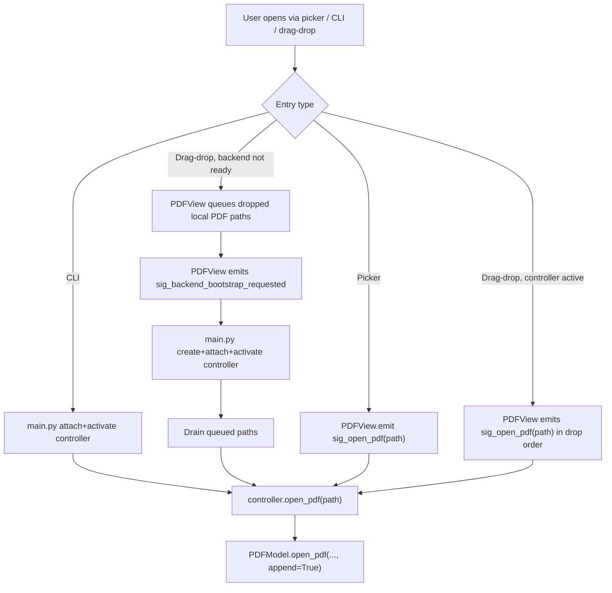
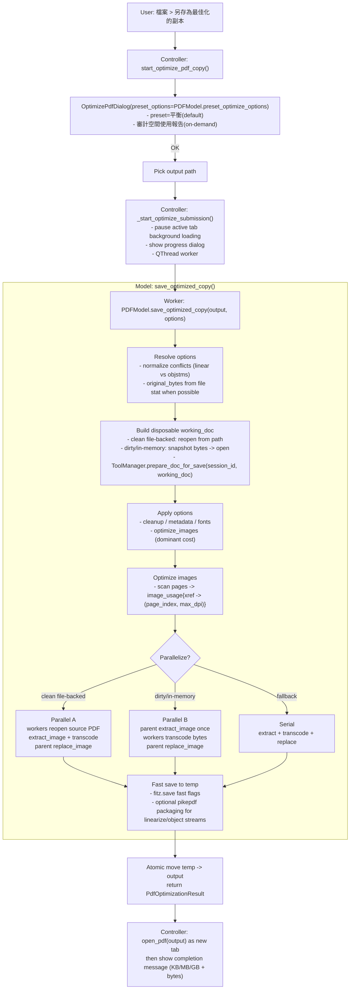

# PDF Editor Architecture

## 1. Overview

The project uses MVC with built-in tool extensions.

```text
+-------------------+         signals          +---------------------+
|       View        | -----------------------> |     Controller      |
| (Qt widgets/UI)   | <----------------------- | (flow coordination) |
+-------------------+        updates           +----------+----------+
                                                       calls |
                                                             v
                                                +------------+------------+
                                                |          Model          |
                                                | (docs, sessions, edits) |
                                                +------------+------------+
                                                             |
                                               delegates     |
                                                             v
                                                +------------+------------+
                                                |       ToolManager       |
                                                | annotation/watermark/   |
                                                | search/ocr extensions   |
                                                +-------------------------+
```

Entry wiring happens in `main.py`. CLI-open startup instantiates `PDFModel`, `PDFView`, and `PDFController` immediately; empty startup instantiates only `PDFView` until a document is requested.
Application-level logging configuration is also owned by `main.py`; importable modules only acquire named loggers and do not call `logging.basicConfig(...)` at import time. Some modules may still apply narrow logger-level adjustments for extremely noisy third-party debug channels (for example PIL PNG chunk parsing).
For empty startup (no CLI PDF paths), `main.py` shows `PDFView` first and defers backend creation. When the user requests a document (open or drop), the view queues paths and emits `sig_backend_bootstrap_requested`; `main.py` then creates model/controller, attaches/activates them, and drains queued open paths. Direct CLI-open startup keeps the synchronous attach/activate/open path.
The CLI entry point in `main.py` now has an `argparse` surface: positional PDF paths open as tabs, `--merge OUTPUT <inputs...>` runs a headless `fitz`-only merge and exits before Qt widget bootstrap, and real app launches use a per-user single-instance bridge (`QLocalServer` / `QLocalSocket`) so later invocations forward file paths into the already-running window instead of spawning duplicate editor windows. A forwarded open never activates a tab while a modal dialog or popup is up: `PDFController.handle_forwarded_cli` (and the optimize worker's success handler, the other tab activation from outside the user's flow) queue through `_run_when_session_activation_allowed`, which runs them in arrival order once no modal is open, so a dialog started for one tab (Save As, merge, optimize, metadata, export) never resumes against a tab opened behind it (F11-1). The hand-off sender splits its budgets: `CONNECT_TIMEOUT_MS` (2 s) only decides whether a primary is alive, while `RESPONSE_TIMEOUT_MS` (60 s) is one deadline for the payload write wait plus the ack, because a live primary whose GUI thread is blocked (save, startup open loop) answers only once its event loop runs again and an aborted hand-off is never delivered (F11-2).

App identity is **CyberSagaPDF** (org `CyberSaga`): `main.py` sets the Windows AppUserModelID (`CyberSaga.CyberSagaPDF`) and the application icon (`view/icons.py:load_app_icon` → `view/resources/app_icon.ico`); `utils/preferences.py` stores QSettings under `CyberSaga/CyberSagaPDF` and migrates each known key from the legacy `pdf_editor` namespace when it is missing in the new store; `utils/single_instance.py` probes the legacy `pdf_editor_singleinstance_*` server name as a fallback so a new build still forwards into an older running instance. Optional Windows `.pdf` association is handled by `scripts/windows_file_association.ps1` (HKCU-only, snapshot/rollback, never touches the protected UserChoice). The identity strings are consolidated in the dependency-free leaf `utils/app_identity.py` (R1.2; mirrors `utils/theme_ids.py`), which `main.py`, `utils/preferences.py`, and `utils/single_instance.py` import; the `.ps1` cannot import Python, so it mirrors the leaf with a header sync-note. The IPC prefixes and the legacy QSettings org/app are compatibility values kept byte-identical — a drift silently breaks open-file forwarding to a running instance or the one-time settings migration.

## 2. Layer Responsibilities

**CI enforcement (2026-07-02):** the boundaries below are checked by `.github/workflows/ci.yml`'s `layer-boundaries`
job — `[tool.importlinter]` in `pyproject.toml` (advisory until the known violations in `TODOS.md` clear) plus a
blocking `threading.Thread` grep over `view/`+`controller/`.

### 2.1 Model (`model/pdf_model.py`)

Model owns document correctness and persistence behavior. It manages sessions (`DocumentSession`), document handles (`fitz.Document`), text hit-testing, text edit transactions, add-text insertion, save/save-as pipeline, and snapshot helpers used by history commands.

Important text APIs include `get_text_info_at_point(...)`, `edit_text(...)`, `add_textbox(...)`, and `set_text_target_mode(...)`. Text a user types or pastes into a drawn textbox or watermark passes `text_normalization.strip_unrenderable_controls` (C0/C1 controls, DEL, noncharacters and U+FFFC removed, CR LF folded to LF; MuPDF stops at NUL and draws the rest as a replacement glyph) at `_insert_textbox_visual_content`, `_textbox_markup`, `PDFController.add_textbox` and `_coerce_wm`; the textbox marker stores the cleaned string (F16-PASTE-1). `InlineTextEditor.insertFromMimeData` pastes plain text only, drops U+FFFC (an image inside pasted HTML) and the control characters, and reports the counts through its `paste_cleaned` signal (the View shows a zh-TW status-bar notice, S17-PASTE-NOTICE; the character set is shared through `utils/text_chars.py`), and the rebuild verification refuses a placeholder character nobody acknowledged (F16-PASTE-2).
Tiered text editing is session-owned: `get_tiered_commit_engine()` returns one
`TieredCommitEngine` for the active `DocumentSession` (or the legacy document
slot), and `cache_verified_candidate(...)` transfers a scratch-verified
`PreparedEdit` from the preview result into that engine. The engine and its
candidate cache are discarded when the document handle/session closes or is
replaced; a new preview session clears candidates from the prior edit session.
`edit_text(..., plan_token=...)` consumes the cache at commit: a token that
matches a cached candidate commits exactly that `PreparedEdit` (no re-prepare);
a miss or `None` falls back to a fresh `engine.prepare()`. Stale cached
candidates can never mutate the document — `apply_patchset` revalidates the
page fingerprint and refuses with `STALE_PLAN`.
The text rendering path now resolves style tokens and supports custom CJK-family embedding for insert-html flows (for example `microsoft jhenghei`, `pmingliu`, `dfkai-sb`) when local font files are available.
Browse-mode selection is also model-owned: legacy rectangle helpers still exist, but the primary browse drag path now uses a run-anchored resolver. Mouse-down locks the start run, mouse-up resolves the end run, boundary lines stay partial, and only the fully covered lines between them expand to whole-line units. `get_text_info_at_point(...)` now has a strict-hit option (`allow_fallback=False`) so browse selection can reject coarse block fallback hits while other flows keep backward-compatible text-block behavior.
Object manipulation correctness is also model-owned. App-owned textboxes/rectangles/images still use hidden annotation markers for identity. A textbox marker also stores the text, font, size and colour that Move / Rotate Object re-insert, so every successful `edit_text` (tiered and legacy) calls `pdf_object_ops.sync_textbox_markers_after_text_edit` to replace the edited words in the stored text of each textbox holding the edited runs (whole-box legacy edits also store the new style; an edit that empties the box, or drags its text out, removes the marker; edited words found more than once flag the marker `content_unsynced`, a box that does not hold them is left alone; the edited words are looked up in the raw stored text first and, for a non-ASCII box, in the text layer htmlbox writes for it (the page index text is lossy for emoji / shaped scripts; mapped back to raw characters by `_lossy_span_ignoring_whitespace`, F16-1-LOSSY); the box rect grows over new words the edit drew outside it, even partly). Move and rotate refuse a textbox whose stored text the page no longer draws inside its rect (`_textbox_payload_drawn_on_page`), which also covers files saved before the sync (F15-2). Every textbox check compares the page with the text layer htmlbox writes for the stored text when the raw text does not match (`_textbox_layer`, a scratch render of the shared `_textbox_markup`, with glyph ids for a box of CJK Ext-B alone; F16-1), because htmlbox's text layer is lossy for emoji, shaped scripts and CJK Ext-B (OD-UNI1-COMMIT). Native PDF images are discovered from parsed page content stream operators. Their primary bbox/rotation data comes from the parsed `cm` transform, with per-xref placement APIs only used as a fallback when a safe `cm` is unavailable. Native-image move/resize/rotate/delete rewrites the target image invocation operators instead of redacting the painted bbox, so overlapping text/graphics are preserved.

Snapshot APIs include `_capture_doc_snapshot()`, `_restore_doc_from_snapshot(...)`, `_capture_page_snapshot(...)`, `_capture_page_snapshot_strict(...)`, and `_restore_page_from_snapshot(...)`.
Page snapshots are page-object-graph snapshots (`model/page_snapshot.py`, Model layer, no Qt), restored IN PLACE by xref. `_capture_page_snapshot(...)` (an alias of `_capture_page_snapshot_strict(...)`) returns a `PageSnapshot(bytes)`: magic `PGSNAP1\0` + `<qII xref_epoch page_xref n_records` then per object `<IIq xref obj_len raw_len|-1` + the object's source text (utf-8, surrogatepass) + the raw stream bytes. The source text is read with `utils.pdf_object_source.xref_object_exact`, never `xref_object`, whose decoded text renames a name that holds a literal backslash-u escape when written back (W1B-DICT-RT). `capture_page_graph` walks from the page object through every reachable indirect object (never up through `/Parent` or a structure `/P`, never into other pages, the page tree or the catalog; budget 100 000 objects). `_restore_page_from_snapshot(...)` -> `restore_page_graph` rewrites those objects at the SAME xrefs (non-root objects first, the page object last; stream bytes before the stream dictionary), so the page object, OCGs listed in `/OCProperties`, fonts and annotations keep their identity. There is no `insert_pdf` graft anywhere in the restore: when an in-place restore is impossible it raises `PageSnapshotStale` before any write (zero mutation) and `EditTextCommand` / `AddTextboxCommand` undo and redo refuse (`EditTextResult.STALE_UNDO` / `STALE_PLAN`; the controller shows its refusal toast and the command stays on its stack). A failed write part-way re-applies the prior state and raises `RuntimeError("page snapshot restore failed; page put back")`. Every exit that wrote (success or put-back) then calls `utils.pymupdf_refs.sync_open_pages` (MuPDF `pdf_sync_open_pages`): a `fitz.Page` alive across the restore shares MuPDF's loaded page, with its annotation / widget / link lists, with every later `doc[n]`, and the xref writes bypass the annotation API that would otherwise keep those lists current (F11-ANN-2). The restore gates (page xref, `xref_length`, `/Parent`, stream type) run before any write; records beyond the live xref table are NOT a refusal: after a whole-document `SnapshotCommand` undo/redo reopened the document from older bytes the table is shorter than the xrefs a later rebuild/textbox allocated, those slots are free in this lineage, so `restore_page_graph` grows the table (`get_new_xref`, capped by `PAGE_SNAPSHOT_MAX_XREF_GROWTH`, corrupt snapshots still raise `PageSnapshotStale`) and treats out-of-range prior entries as null on rollback. `SnapshotCommand.__init__` stamps a bare `after_bytes` (the controller's merge records plain bytes) with the live `xref_epoch` through `_stamp_live_epoch`, so redoing it reinstates the numbering the page-snapshot commands above it were captured in. Page snapshots are the ONLY page-level undo format: the old one-page-PDF snapshot (`insert_pdf` graft) no longer exists, and a bare `bytes` page snapshot is not accepted.
The xref-numbering epoch (`PDFModel.xref_epoch`, per `DocumentSession`) says which numbering a snapshot belongs to. Every newly installed live `fitz.Document` gets a fresh epoch (default: renumbered); numbering-preserving installers put the old one back (`_restore_doc_from_snapshot` reinstates `DocSnapshot.xref_epoch`, `_roundtrip_live_doc` with garbage <= 1, the non-secure save over the open file), and a live `garbage >= 2` serialization of a SAVE (`_atomic_full_save`, the secure `save_as` detach) bumps it through `_note_live_doc_serialized`. A print is read-only and never renumbers the live document: the secure `garbage=4` prune of `capture_print_snapshot_bytes` / `ToolManager.build_print_snapshot` runs on a throwaway `garbage=0` clone (`PDFModel._open_numbering_clone`, `write_pruned_live_copy`), so the epoch, retained page snapshots and listed annotation xrefs survive a print (DS-1). A page snapshot only restores under the epoch it was captured in; Tier 0/1 patch replay is separate and still relocates across renumbering by content fingerprint.
`build_print_snapshot(dest: Path) -> None` (delegating to `ToolManager.build_print_snapshot(dest)`) writes the print-input PDF directly to a destination path instead of returning bytes, so the print path never holds a full serialized copy of the document in memory. The former `capture_print_input_pdf_bytes()` helper was removed with this change (the print submission worker was its only caller).
Signed-document append save (round 7 R7-1, `model/signed_append_save.py`, Model layer, no Qt; `PDFModel._save_signed_by_appending`): when the live handle cannot append (in-memory after a snapshot undo/redo, or a Save As target) and the document is digitally signed, the live state is replayed onto a copy of the signed source file and saved incrementally, so the signed revision stays a byte prefix (object-stream / xref-stream containers of the source are file structure and never replayed, including a file-backed live handle's own xref-stream object whose trailer /ID drifts after an edit, R8-SIG-A); the appended xref stream takes a new object number in the written file, so afterwards `PDFModel._reserve_numbers_of_appended_file` records that file's `xref_length()` as `DocumentSession.reserved_xref_length` and the `doc` setter pads every installed handle to it with empty slots (`_reserve_xref_numbers`), keeping later edits off the container so the next Ctrl+S still appends (R8-SIG-B). A decline never rewrites a signed file silently (SIG-DIALOG): `_save_signed_by_appending` returns a reason code (`signed_append_save.try_append_state_onto_source` carries the replay's own, `DECLINE_REASONS`), and before each full-rewrite route of a signed document (append declined, prepared watermark clone, failed in-place append) `PDFModel._signature_loss_gate` raises `SignatureWouldBreakError(reason_code, path)` before anything is written unless the save was called with `allow_signature_loss=True` (`save_as`, `save_session_as`); the failed in-place append is the one route that may already have written: `PDFModel._roll_back_partial_append` truncates the half revision back to the pre-append fingerprint first, and `save_as` re-records the disk fingerprint for the codes in `_SIGNATURE_REFUSALS_AFTER_A_WRITE` (`incremental_failed`) so the consented retry is not refused as a foreign change (F12-SIG-1). The controller's `_save_with_signature_consent` wraps every save call site (Ctrl+S, Save As, close-with-save / Save All), asks through `view.message_boxes.confirm_signature_loss` (zh-TW, one line per reason code, names the signed document via the saved session's `display_name`, default cancel, suggests Save As and first a switch to that tab when it is not the active one, F12-DLG-1) and retries with the flag on consent; a cancel writes nothing and keeps the session dirty. The replayable check never reads `needs_pass` on the live document (R9 M9-1: in PyMuPDF 1.27 that read on an authenticated handle overwrites its crypt key and blanks every page's text, and the declined append's full-save fallback then wrote the garbage): it reads the flags only on the fresh `base` copy and compares the live document's trailer `/Encrypt` entry to the base's. The object comparison skips a stream's own `/Length` when both sides are streams with equal raw bytes (H10-1: a stream created in the live handle prints its plaintext length, the appended encrypted copy the ciphertext length, which declined every owner-password-only encrypted signed append). The replay and the verification compare only the slots MuPDF holds an object for on either side (H10-2 Part A: `_in_use_xrefs`, one `fitz.mupdf.ll_pdf_object_exists` C call per declared slot, ~0.19 us, no object loaded; a slot outside both sets is null on both sides, so the list equals the full walk's), with one state census shared by replay and verification; a 28 KB xref stream declaring `/Size 4000000` now appends in ~2.6 s with the signature kept, where the old Python walk took ~70 s. A failed base/check census declines (never an unbounded walk); without the census primitive the walk is `range(1, xref_length)` again and the unbacked-table guard (`MAX_UNBACKED_XREF_SLOTS` = 100 000 always allowed, beyond it one slot per source byte, `xref_slots_are_unbacked`) declines first; `MAX_APPEND_GROWTH_SLOTS` (100 000) bounds the `get_new_xref` pad loop; the full walk skips the stream probe for a slot that is `null` on both sides. New objects still take numbers above the declared `/Size`, which qpdf/pikepdf ignore on such files (owner-accepted, PITFALLS H10-2). Whole-document serialization (H10-2 Part B, `model/doc_bytes.py`, no Qt): every model snapshot (`_capture_doc_snapshot`, worker / print / session-transfer bytes, `_roundtrip_live_doc`, the controller merge via `PDFModel.serialize_document_bytes`, the optimizer, the watermark save clone, `text_commit` engine / preview / verify) goes through `doc_bytes.serialize_doc`, which writes through MuPDF's native output instead of PyMuPDF's Python file object (~4.5 us per xref row: a 4M-slot snapshot 18.6 s -> 0.35 s, identical bytes): a temp file in the model's temp dir by default, an in-memory `fz_buffer` for a decrypted copy of an encrypted document, a caller-flagged plaintext copy or a secure-latched session, so decrypted bytes never touch disk. The text-commit engine and preview session take the model's funnel as an injected `serialize` callable (`TieredCommitEngine(serialize=)`, `open_preview_session(serialize=)`; `PDFModel.get_tiered_commit_engine` and the controller's plan-preview request pass `serialize_document_bytes`), so their KEEP clones follow the same rule (model temp dir, memory only once latched); without one `doc_bytes.keep_snapshot_in_memory` keeps the clone in memory, and an AST test (`test_no_production_site_serializes_a_live_doc_to_disk_behind_the_models_back`) allows `serialize_doc` without `in_memory=True` only inside `serialize_document_bytes` (F12-H102-1). A file sink that fails (model temp dir removed, volume full: `OSError` or MuPDF `FzErrorBase`) is retried through the in-memory sink with a warning, so an edit never depends on a writable disk (F12-H102-2). Save-time pruning (round 6, `model/save_compaction.py`, Model layer, no Qt). Undo leaves the objects a command created in the live document (`restore_page_graph` writes only the snapshot's own records back) and a legacy rebuild leaves its Redact annotation, old content stream and font resources unreachable even when kept, so a `garbage=0` full save turned a 222 KB file into 5.9 MB. Rule: every NON-secure full save (`_full_save_to_path` both branches, the `save_as` full-save / temp-overwrite branches, the prepared-doc branch, the same-path reopen) serializes with `garbage=1` (frees unreachable objects, keeps the xref numbering, never touches the live document, so `xref_epoch` and page-snapshot undo survive). The secure paths (`_atomic_full_save`, `garbage>=4`) are unchanged. An incremental save appends whatever is unreachable, so `save_as` first calls `_session_orphans_block_incremental`: `save_compaction.session_orphan_stream_bytes(doc, base)` sums the raw stream bytes of objects at or above `DocumentSession.persisted_xref_length` (the per-session watermark recorded on open / reopen-after-save / successful incremental save; the `PDFModel.persisted_xref_length` property reads the active session's) that no `/Root`, `/Info` or `/Encrypt` path reaches; at `ORPHAN_FALLBACK_MIN_BYTES = 64 KiB` or more the save becomes the pruned full save, below it (e.g. the small `clean_contents` leftover of `apply_pending_redactions`) it stays incremental. An unknown watermark takes the full save; `xref_length() == watermark` skips the scan. The reachability BFS (`reachable_xrefs`) is bounded by `doc.xref_length()`, never the stale trailer `/Size`, and over-approximates (any `N G R` counts). Known residual: orphans persisted by an earlier incremental save sit below the watermark; `capture_worker_snapshot_bytes`, `build_print_snapshot` and `save_external_document` still write `garbage=0` (see PITFALLS). A digitally signed document never takes the orphan fallback (`_session_orphans_block_incremental` returns False): a full rewrite would invalidate the signature's `/ByteRange`, so the append-only save is kept and the orphans ride along. One incremental revision per handle (round 8, EXT-1): MuPDF keeps the end-of-file offset it read at open, so a second incremental save from the same `fitz.Document` would overwrite the previous revision and write a broken `/Prev` chain; after each successful incremental save `save_as` therefore calls `_renew_handle_after_incremental_save` (reopen the saved file, swap the live handle through the `doc` setter, restore the unchanged `xref_epoch`, re-note the persisted baseline, close the old handle), and a handle that could not be replaced is marked spent (`_INCREMENTAL_SPENT_ATTR`) so the next save takes the full-save path.

Live handle vs file ownership (round 7, PERS-1). A session's live `fitz.Document` never reads a file the session no longer owns: after `save_as` to another path `_detach_live_doc_from_source_file` rebinds the handle to a private `live_<uuid>.pdf` copy in the model temp dir (live doc written with `garbage=0`, so numbering, `xref_epoch` and the un-pruned undo/redo slots are kept; skipped for in-memory docs, a handle already on the saved file or already on a private copy; deleted by `close_session`, and by the `doc` setter's `_retire_replaced_handle` / `_sweep_retired_live_copies` when a snapshot restore or `_roundtrip_live_doc` swaps in an in-memory handle), because MuPDF reads stream bytes lazily at stored offsets and another tab may then open and rewrite the old path in place. Write-side guard: `save_as` refuses a target any other session's live handle reads (`_session_reading_path` checks `doc.name`, not only `_path_to_session_id`), and `save_external_document` (export pages, merge to a new file) refuses a path any open tab reads. `_backing_file` is the single test for "a file backs this doc" (an in-memory doc's `name` is `"pdf"`).
Installing a save over the file the live handle reads (round 7, PERS-2). Windows refuses to overwrite a file MuPDF holds open, so the handle must be closed first; `_install_stage_over_open_file(stage, target, recovery=...)` is the single place that does it (used by `_full_save_to_path`, the `save_as` prepared-doc branch and, since round-7 FS-1, the secure `_atomic_full_save(replace_live_handle=True)`, which first writes a recovery copy of the LIVE doc: a byte copy of the verified stage, or a separate `garbage=4` serialization when `doc` is the watermark clone). Order: copy the staged serialization to a hidden sibling of the target (handle and target untouched, a failure costs nothing), close the handle, `os.replace` the sibling over the target (atomic, never truncated), reopen the target. When the stage is NOT the live doc's content (the watermark clone: `keep_live_content=True`, M9-2) the handle is instead rebound to the unbaked LIVE `recovery` copy (same numbering, epoch kept), so retained xref-keyed undo patches stay valid and the next save bakes the overlay once instead of stacking it. If the replace fails the session is rebound to `recovery` (a file holding the LIVE doc, `garbage=1`, same numbering; `xref_epoch` restored, encryption re-authenticated) and the real error is re-raised (if the recovery file cannot be opened by path it is opened from its bytes as an in-memory doc; if even that fails the recovery file is kept and `SaveRecoveryError`, carrying its path and whether the target was written, replaces the error and is shown verbatim by the controller - round-7 ERR-1); the rebound handle then lives on a temp-dir file, so the next save takes the plain write path. A lost session (S14-SAVEREC-DEAD-TAB) is latched in `DocumentSession.save_lost_error` (`PDFModel._mark_session_lost`, `session_lost`, `is_session_lost`, `lost_session_error`): `PDFModel.doc` is `None` for it, `save_as` re-raises the error, `copy_lost_session_recovery(new_path, session_id)` is its Save As, and `get_session_meta` / `list_sessions` carry `lost` and `recovery_path`. The controller shows it as a dead tab (`_render_active_session` is the single tab-switch guard, `PDFView.show_lost_session` / `clear_lost_session`, tab title “（已中斷）”) and drops every view-signal slot outside `PDFController._LOST_SESSION_SLOTS` via `_live_only`. Both discard paths of a lost tab (single-tab close and window-close Discard all) show its recovery path through `_show_lost_discard_notice`; the window-close prompt lists each lost tab's copy (F15-DEADTAB-APPCLOSE). `save_as` no longer retries a failed orphan-fallback full save on the closed handle (only a failed incremental attempt falls back to a full save).
Foreign writers of the session's file (round 10, F10-FS-1). MuPDF holds the open file with a share mode that lets other programs rewrite it in place, and after a Save As nothing holds the new file at all. Each `DocumentSession` therefore keeps `disk_fingerprint` (`_file_fingerprint`: size, `mtime_ns`, sha256 of the first and last 4 KB) for the file it owns (`disk_fingerprint_path`, canonical), recorded by `open_pdf` and by `save_as` after every successful write (and after a failed write to the same path, which was the session's own). `save_as` is now a thin wrapper: target checks, then `_refuse_save_over_foreign_rewrite` (before `apply_pending_redactions`, so a refusal touches nothing) raises `SourceChangedOnDiskError(RuntimeError, path)` for a save back to that path whose fingerprint changed, then `_save_as_unchecked` does the old work. A missing file is not a conflict. The controller's `_save_failure_text` shows the message as written; `_save_session_for_close` shows it and then offers the Save dialog. The gate protects the file only: the live handle can still read the foreign bytes (owner decision in TODOS). The signed append save reads its prefix through the same fingerprint (round 11, F11-FS-1): `PDFModel._signed_append_base_bytes` returns only the leading bytes of `original_path` that still match `disk_fingerprint` (`_edge_digest_of_bytes`) and `append_state_onto_source(..., source_bytes=...)` uses exactly those, so a foreign revision appended to the source is never embedded in a Save As; a rewritten or unreadable source declines to the full rewrite.
Damaged-session latch (round 13, S13-DLG5-DAMAGED; owner decision A + C of F12-DLG-5). `DocumentSession.damaged` (Qt-free; `PDFModel.session_damaged` / `is_session_damaged(sid)`) is set only by `PDFModel.mark_session_damaged(reason)` when a rollback of a mutated document fails: the `ROLLBACK_FAILED` raise sites in `pdf_text_edit` (via `_rollback_failed_refusal`), `_restore_doc_after_failed_mutation` (delete_pages / move_page / insert_pages_from_file / batch-delete rollbacks), and the protected-page rollback failures in `ToolManager`. `save_as` refuses a target that is the session's own file with `DamagedSessionSaveError(message, path)` (nothing written; checked right after the target checks and before the foreign-rewrite check); Save As to another file stays allowed and the latch is kept for the session's life. The files the session is bound to at the latch are frozen into `DocumentSession.damaged_protected_paths` (F14-DMG-1: a Save As rebinds the current paths); `PDFModel.damaged_protected_paths(sid)` (frozen set + current file, empty when undamaged) is the one source for the Save As gate, `_refuse_write_over_damaged_original` (`save_external_document` export / merge, `copy_lost_session_recovery`) and `OptimizeSourceSnapshot.damaged_protected_paths` (checked by `save_optimized_copy_from_snapshot` off the GUI thread). `SessionTransferPayload.damaged` and `.damaged_protected_paths` carry it across a tab detach. The controller shows the error as written and `_save_session_for_close` follows it with the Save dialog. The cross-page move judges trust by its own whole-document restore (F13-MOVE-1a): a successful restore clears the latch the model set (`PDFModel.clear_session_damaged`, the only place it is cleared, and only if the session was not damaged before the move) and shows the "page restored" sentence; a failed restore latches the session and shows the do-not-save sentence (`user_message_for_exception(..., document_restored=...)`).

Deny-write share lock on the session's file (round 11, OD-FS1-LOCK; owner decision for the F10-FS-1 RAM half). `utils/file_share_lock.py` (Qt-free, ctypes, no-op off Windows) holds one `CreateFileW(GENERIC_READ, FILE_SHARE_READ)` handle per file per process, reference counted by `FileShareLock` tokens: other processes can read but not write, replace, rename or delete the file. `DocumentSession.file_locks` holds the session's tokens: `open_pdf` acquires before `fitz.open` and releases in its `finally` unless the session adopted it, `import_session_transfer` acquires for the source path, `close_session` releases, and `save_as` ends in `_sync_session_file_locks` (owned file `saved_path or original_path`, plus a non-temp backing file), which moves the lock after a Save As and retries a degraded claim. The app's own writes suspend it: `file_share_lock.suspended(path)` around the in-place incremental append in `_save_as_unchecked`, and `utils/path_staging.replace_file` suspends `dst` for every staged install. A claim that cannot be taken (network share, file already open for writing, missing file) is logged and degrades to the old behaviour; the fingerprint gate above stays the defence there. Tests that simulate a foreign writer of an open session's file use the `share_lock_disabled` fixture. Every registry operation runs inside `_registry_call` (the `RLock` plus an in-flight depth; `_finalize_holder` takes the mutex itself first, so a garbage-collection drop never blocks): a claim dropped on the thread already inside one (a garbage-collection finalize, a `__del__` -> `release()`) is queued and applied by the outermost call before it returns, never in the middle of a re-open. Only drops are deferred, so a finalizer or `__del__` must not call `acquire` / `ensure` / `suspended`.

Open-time xref compaction (round 8 LS-3, owner option B; `model/xref_compaction.py`, no Qt). Non-secure full saves keep the xref numbering (`garbage=1`), so each edit -> undo -> save cycle leaves free slots in the file and no save may renumber (it would strand the page-snapshot history). `PDFModel.open_pdf` therefore compacts at the one history-free moment: just before the xref repair step (a repair the census walk triggers on a lazily damaged file is then caught by the repair round trip), `_compact_doc_xref_in_memory` skips encrypted files (`_doc_is_encrypted`), asks `xref_compaction.open_compaction_verdict` (size cap 64 MB, census cap 200,000 slots plus the H10-2 unbacked-table guard, a bounded early-exit `null` census (the count normally comes from the open-time read of every object, next paragraph), free slots >= 512 and >= 50 % of the table), skips signed files (`document_has_a_signed_signature`, probed only when the census says compact) and installs the `compact_in_memory` round trip as the session's document (`doc_bytes.serialize_doc(..., garbage=2, in_memory=True)`: MuPDF's native output into an in-memory sink, the bytes `tobytes(garbage=2)` gives, then `fitz.open`): memory-backed like a repaired document, so `persisted_xref_length` is None (the open and `_note_persisted_baseline` key on `_backing_file`), incremental saves are off for that session and the next save is the staged `garbage=1` full rewrite that puts the compact layout on disk. The open leaves the file byte-identical and the session clean (a file opened and never saved keeps its slots; growth within a session is accepted). A failure in `compact_in_memory` (its `garbage=2` write renumbers the source handle in place) replaces a file-backed handle with a fresh `fitz.open`; a memory-backed handle is kept as it is.
Open-time read of every object (round 11 OD-FS1-READALL; owner decision for F10-FS-1 open issue 2). MuPDF loads objects lazily and repairs a broken xref entry, silently (`is_repaired` False -> True, no exception), the first time that object is loaded; when that was a save, the repair dropped every in-memory edit. `open_pdf` therefore calls `_read_every_object_at_open` right after the 0-page check: `xref_compaction.read_every_object` loads each slot once with `xref_object` (bounded by `MAX_READ_ALL_SLOTS` = 200,000 and the H10-2 unbacked-table guard; continues past objects that fail to load; stops at a repair) and returns an `ObjectWalk` (free / total / failed slots, `repaired`). A repair found here is handled by the existing repair round trip (encrypted documents keep MuPDF's repaired handle); a usable walk (`census_usable`) is passed to `_compact_doc_xref_in_memory` -> `open_compaction_verdict(..., walk)` so the compaction does not walk again. The compaction failure fallback re-walks the fresh `fitz.open` handle. Cost tracks the slot count (~2-6 us per slot; 200,000 slots ~1 s); healthy files stay file-backed and untouched.
New-font compaction (round 6, `model/font_stream_compaction.py`, no Qt). MuPDF's Story device embeds each font as a raw stream and a fresh copy on every `insert_htmlbox` call. `font_compaction_scope(doc)` (reentrant, per document; only the outermost normal exit acts) takes an xref watermark at the start of an operation and on exit dedupes identical new `FontFile*` / `ToUnicode` streams (decoded-bytes hash) and Flate-compresses each surviving unfiltered one once; `insert_htmlbox_tracked(page, rect, html, ..., scratch=False)` is the only model-side `insert_htmlbox` call site (it raises outside a scope unless `scratch=True`; an AST test guards `model/`). `_apply_redact_insert` is a thin wrapper that opens the scope around `_apply_redact_insert_body` (legacy edit_text: all strategies, vertical retry, push-down); `_insert_textbox_visual_content` opens one per attempt (add_textbox, cross-page textbox move, textbox rotate). The scope closes before the command's after-snapshot, the tiered engine never opens one, and a failure inside compaction is logged, never raised. Compress-only; no subsetting of the embedded fonts (TODOS). The same chokepoint draws CJK Ext-B (U+20000 and up, which htmlbox has no font for; EXTB-SUBSET, owner decision C): `utils/cjk_ext_b_font.py` (Qt-free; the only production module that imports `fontTools`, lazily) wraps Ext-B runs of the markup's text nodes in their own span and subsets the Windows SimSun-ExtB (`simsunb.ttf`, first) / MingLiU-ExtB (`mingliub.ttc`, fallback per character) font (found in the system Fonts folder, else the per-user `%LOCALAPPDATA%\Microsoft\Windows\Fonts` one; F13-ENV-2) in memory to exactly those code points; `htmlbox_args_with_ext_b(html, kwargs)` (the `@font-face` rules plus the subsets in an in-memory `fitz.Archive`, merged into the htmlbox kwargs) is applied by `insert_htmlbox_tracked` and by the view's live CSS preview (`PreviewRenderer.render`; view -> utils, S12-EXTB-PREVIEW), and an AST test requires it of every `insert_htmlbox` call in `view/`, `controller/` and `utils/`. The live preview never runs the subset on the GUI thread (S14-EXTB-PREVIEW-WORKER, owner decision C on F13-EXTB-PERF-1): `PreviewRenderer.render(defer_ext_b=True)` calls `htmlbox_args_with_ext_b(..., cached_only=True)`, which only peeks the thread-safe `_PeekCache` caches of font coverage and subsets and raises `ExtBSubsetNotReady` on a miss; that frame draws .notdef and is not cached, `PreviewRenderer.pending_ext_b_html` names its markup, and `view/ext_b_subset_worker.py` (`ExtBSubsetService`: one parentless `QThread` at a time, latest request wins, results as queued signals, awaited at `aboutToQuit`) calls `warm_ext_b_subsets` to fill the caches before the editor (`PreviewBackedInlineTextEditor._on_ext_b_subsets_ready`, stale markup dropped, `release_background_work` from `_teardown_editor`) re-renders. The commit chokepoint still computes synchronously. Each subset's PostScript name is `PdfEditorExtB-<font>-<hash of its code points>`, which `_texttrace_glyphs` uses to keep those glyphs in the glyph evidence (htmlbox's 16-bit cut turns U+20000 into a space code). No installed font: nothing is wrapped, htmlbox draws .notdef and the rebuild verification refuses with a reason naming the fonts (`ext_b_refusal_reason`).

#### Transactional Text Editing Phases (Helper Boundaries)

`PDFModel.edit_text(...)` is implemented as a transactional pipeline and is structured into independently testable helper phases:

- Target-mode resolution: `_resolve_effective_target_mode(...)`
- Phase 1 (resolve): `_resolve_edit_target(...)`
- Phase 2 (mutate): `_apply_redact_insert(...)`
- Phase 3 (verify + index): `_verify_rebuild_edit(...)`
- Horizontal single-line edits that still fit on one line use an origin-preserving `insert_text(...)` fast path inside `_apply_redact_insert(...)`, but only for printable-Latin-1 text (`_simple_font_can_encode`: PyMuPDF's simple-font encoder writes U+00B7 for every other code point, F10-UNI-1); wrapped / dragged / turned (any run not written along +x: the quarter turns AND upside-down text, whose `insert_text(rotate=0)` rewrite would be drawn upright and grow the wrong way, F15-VM2-FAST180) / vertical / non-Latin-1 cases use the existing htmlbox flow. "Still fits" means room to the page's right safe margin AND to the left edge of the next untouched run on the line (`_right_neighbour_limit`, F13-VF-4; a run that starts inside the edited extent but sticks out of its right edge is a wall at the extent's old right edge, F14-VF4-OVERLAP; only axis-aligned runs count, a run written off the page axes -- a diagonal watermark -- never walls, floors or core-boxes an edit by its bbox, F15-VF4OV-DIAGONAL); the horizontal htmlbox rect and its strategy-B widening are capped there too, so a wider substitute font wraps, shrinks (floor 50 %) or is refused instead of overprinting the neighbour. The right limit of that box and of the fast path's room is `_right_wall`: the page's safe right margin, unless the edited runs already reach past it (a title or page number in the margin), in which case page edge - 10 pt for one line or the paragraph's own right edge, never left of the text it limits (F14-DT-1). Wrapped lines only get the room the push-down can clear (F14-VF4-WRAP): `_wrap_floor` ends the htmlbox at the top of the next untouched line below the edit in a block `_push_down_overlapping_text` never moves (shared rule `_push_down_can_move`; the edited paragraph's own next lines), with `_NO_WRAP_CSS` when only one line fits; a wrapped word may break after an existing hyphen (U+002D / U+2010, `Two-` / `Colunm`; MuPDF's line breaker decides, U+2011 never breaks, no hyphen is inserted, and `_latin_word_html` glues a hyphen that opens the word to it so a line is never just `-`, D-HYPHEN-WRAP); the pre-push probe runs the same A/B/C chain as the insert; and every in-place insert (horizontal fast path and htmlbox, and the quarter turns) is checked by `_new_text_overprints` (added glyph ink cores against untouched ones; the overlap cluster's replayed `protected_spans` are exempt, and so are untouched runs written off the page axes -- a diagonal watermark may be printed over, D-DIAG-INK -- while horizontal and vertical runs still block), which rolls back with `TEXT_DOES_NOT_FIT`. A quarter-turn edit grows along its reading direction instead and is walled at the next untouched axis-aligned run on its column (`_vertical_neighbour_limit`, the vertical twin of `_right_neighbour_limit`, F13-VF-4b): the insert box ends there, `_binary_shrink_height(far_limit=...)` does not search past it, and text that does not fit at full size is retried at 50 % and then refused with `TEXT_DOES_NOT_FIT` (rolled back). An upside-down run (text rotation 180) is written toward -x and stacks its extra lines up the page, so its horizontal box is the mirror image (`grows_left`, F16-2): pinned on the run's right edge and bottom, walled at the nearest run on the LEFT (`_horizontal_neighbour_limit(grows_left=True)`) and at `_left_wall` (`_right_wall` mirrored), bounded above by `_wrap_ceiling` (the nearest untouched line above, any block), widened toward -x by strategy B, and never pre-pushed (the push-down only moves text down). A dragged `new_rect` is not capped. `_verify_rebuild_edit` compares NFKC-folded text and rolls back (`_RebuildRolledBack`) when any requested character is missing from the page, on top of the similarity gate. One accepted exception (owner decision OD-UNI1-COMMIT): characters htmlbox draws but cannot encode in its text layer (emoji and other non-BMP code points, shaped conjuncts and ligatures) commit on glyph evidence -- a scratch render of the same markup (`_rebuild_insert_markup`, the one builder the insert also uses; `_htmlbox_reference`) must lack them too, draw no .notdef, and every `(font, glyph id)` it draws (`get_texttrace`) must be on the page around the insert; the presence gates then compare against that render's text layer. Placeholders (U+FFFD, controls, PUA, unassigned: glyphs with no Unicode identity, which htmlbox draws as a replacement glyph or a blank .notdef) are forgiven only when they are UNTOUCHED and the consent acknowledged exactly them (F11-UNI-1, owner decision C: `_rebuild_glyph_loss` reports them as `UnkeepableGlyph(span_id, index, codepoint, fate)` before the ask, a character diff against the members' text tells untouched from typed, and a typed one empties the report so the rebuild keeps refusing), and `_validate_protected_spans` applies the same rule to replayed neighbours (`_protected_span_markup`), including a gate that refuses a neighbour with an unacknowledged placeholder (`_presence_norm` drops U+FFFD, so it used to pass while being redrawn as another glyph). CJK Ext-B goes through the same gate: the chokepoint draws it from an in-memory Ext-B font subset (EXTB-SUBSET, see the font-compaction paragraph), so the scratch reference and the page draw the same glyphs. The committed text layer is wrong for those characters (TODOS.md). `_apply_redact_insert_body` also proves the redaction itself worked: it refuses (`_RebuildRolledBack`, page rolled back) when a glyph it erased is still there after `apply_redactions` (MuPDF redacts WMode 1 / Identity-V glyphs one em off their extracted boxes, F10-UNI-3), and `_push_down_overlapping_text` leaves vertical blocks and blocks with a line written off the page axes untouched (`_push_down_can_move`) and redraws every other pushed span, like the protected-neighbour replay, along its own writing direction (`_replay_rotate`, the one run-direction -> `rotate` mapping, F15-VM2-FAST180). Both rewrites erase only the glyphs they own (F13-VF-2): `_page_glyphs` reads the page with the run index's own extraction (flags 0; the push-down uses its own flags), `_glyphs_owned_by_runs` gives the rebuild the glyphs of the overlap-cluster runs (same block, inside the run's box), the push-down owns the glyphs of the blocks it moves, and `_redact_owned_glyphs` removes them with point-sized redactions inside MuPDF's own glyph box (`_glyph_redact_point`: advance midline, 0.15 em above the baseline), joined into 0.2 pt strips along each axis-aligned line and broken at any non-owned glyph (`_owned_redaction_rects`; text pass, no line art) after a box pass over the runs'/blocks' own boxes that removes only fully covered line art (`text=PDF_REDACT_TEXT_NONE`). The cluster's bounding box (`redact_rect`) no longer erases anything: it only bounds the annotation save/restore and the dirty region. Before refusing, a lost glyph that is turned off the page axes (a diagonal watermark: MuPDF erases a glyph whose box touches a redaction point and a turned glyph's box is a big square) is put back when the edited glyphs are upright: `model/off_axis_shows.py` (`restore_turned_shows`, Qt-free) writes the turned shows the redaction changed back as their ORIGINAL operator bytes in the original drawing order (whole top-level `q ... Q` block when it draws only turned text, else show by show), and such runs are no member of the overlap cluster of an upright edit, so they are never replayed (S17-WMARK-UNDER; a turned run in a form XObject is not repaired). Afterwards any owned glyph still present refuses `REDACTION_LEFT_SOURCE` and any non-owned glyph that disappeared (drawn over an owned glyph's centre) refuses `UNTOUCHED_TEXT_WOULD_BE_LOST`; the rebuild rolls the page back itself, the push-down raises and `edit_text` rolls back (the pre-push probe re-raises `TextEditRefused`).
- Paragraph-mode edits that span ≥2 distinct span colors use `_build_multi_style_html(...)` (difflib char-level mapping) to rebuild per-run color fidelity. This path is gated on `preserve_multi_style` and takes priority over the single-line fast path.

This structure is enforced by per-phase unit tests using real PyMuPDF documents (no mocks) in `test_scripts/test_edit_text_helpers.py`.

#### Tiered Preview Verification

`PlanPreviewRenderer` prepares and applies a candidate on its one
session-scratch document, captures `PageState` before the patch, and invokes
the same Tier 0/Tier 1 verifier used by live commit before rasterizing. The
preview clip is the union of the requested clip and
`PreparedEdit.effective_verify_bbox`, so verified ink growth is visible.
V0e is a real per-session KEEP round trip, not a reused assertion: a single
`_live_keep_round_trip` performs one `tobytes(PDF_ENCRYPT_KEEP)` + reopen at
session open and feeds *both* the probe verdict and the session snapshot, so
the one-serialization-per-session keystroke budget is preserved while the
certificate stays evidence-backed. `PreviewSessionInput.reopen_probe_ok`
defaults to `False` (fail-closed). Preview also runs
`patch.build_tier1_font_outcome` and refuses `FONT_RESOURCE_NOT_PROVEN`
exactly as commit does. `PlanPreviewResult.prepared` is an immutable DTO,
not a live document handle, and is cached by the controller on the GUI
thread — but only after the preview PNG decodes, and the commit-side cache
hit re-runs the policy and shared-stream gates rather than trusting the token
(see PITFALLS, "a cache hit may skip work, never checks").

#### Structural Page Operations and Text Indexing

Structural operations (insert/delete/reorder pages) are model-owned correctness logic. The model must sanitize dirty inputs and return the actual affected pages so the controller can synchronize UI and undo metadata without re-deriving page numbers.

Key contracts:
- `delete_pages(pages) -> list[int]` returns the actual deleted pages (1-based, sorted).
- `insert_blank_page(position) -> list[int]` returns the actual inserted page number (1-based).
- `insert_pages_from_file(source_file, source_pages, position) -> list[int]` returns the actual inserted target page numbers (1-based, sorted).
- `move_page(source_index, destination_index) -> list[int]` accepts final 0-based indices and returns the inclusive affected range (1-based). The model translates forward moves to PyMuPDF's pre-removal destination convention.
- Deleting every page creates one blank physical page and sets the session-local `blank_placeholder_active` marker; importing real pages replaces it. `SnapshotCommand` captures the marker’s before/after state with its document bytes so undo/redo cannot restore the wrong semantic state.

Text index lifecycle:
- Page text indices live in `TextBlockManager` ([`model/text_block.py`](../model/text_block.py)). The
  stateless parsing layer — geometry helpers, the `TextBlock`/`EditableSpan`/`EditableParagraph`
  dataclasses, and the pure fitz-dict→dataclass transforms — lives in
  [`model/text_block_parsing.py`](../model/text_block_parsing.py) (R3.1). It owns **no** index state;
  `TextBlockManager` keeps every page-keyed index and delegates the transforms. `text_block` re-exports
  the dataclasses and `rotation_degrees_from_dir`, so `from model.text_block import …` is unchanged.
- Index text contract (F15-RTL-ORDER): a run's / paragraph's `text` is LOGICAL order (the order typed and read), its
  `bbox`/`origin` are visual page geometry. For a line with right-to-left characters the run parser keeps MuPDF's source
  order for the text and numbers the line's runs in it (`span_idx` order = reading order); `model/rtl_text.py`
  (`contains_rtl`) is the one predicate. Tier 0 never targets such text.
- Table cells of a right-to-left row (F16-RTL-CELLS): rule (a) cuts a line that holds RTL letters by the gap between
  VISUAL neighbours (`_split_bidi_line_into_cells`); a block's reading direction (`_build_paragraphs`) is its first strong
  character (`rtl_text.first_strong_is_rtl`) XOR upside-down, and it orders the (a2) merge, the unit order and the
  paragraphs of one row (right cell first for Hebrew).
- The index, every index-aligned `block_idx`/`line_idx` lookup, the rebuild's protected-span capture and
  glyph-survivor check, and the push-down read page text through
  [`model/page_content_text.py`](../model/page_content_text.py) (`content_text`, a `get_text` equivalent that runs the
  page with `fz_run_page_contents`), never `page.get_text` directly: `get_text` also extracts annotation
  and widget appearance text (a FreeText body, a form value), which is not page content and must never be
  indexed, replayed as a protected span or pushed down into the content stream (F11-ANN-4). Visible-text
  reads keep the whole page: `text_commit.verify` reads rawdict through `visible_text(page, option)`, search
  through `visible_search(page, needle)` (each hit's context snippet through `page.get_text("text", clip=)`),
  and the post-insert presence check keeps `page.get_text("text")`. Selection copy is content-only: the
  rectangle reader (`get_text_selection_snapshot`) reads the index and `content_text` and falls back to
  `page.get_text("text", clip=)` only on a page without runs; the drag reader reads the index alone.
  `test_page_content_text.py` pins the equivalence with `get_text` and greps the edit modules for strays.
- The same module owns the one correction of PyMuPDF's upside-down glyph boxes (GATE16-1):
  `upright_glyph_boxes(option, result, textpage)` reflects back about its baseline every char box PyMuPDF
  1.27's `JM_char_quad` mirrored (a (-1, 0) line whose MuPDF quad is upside down, i.e. upright text on a
  `/Rotate 180` page, under the production `small_glyph_heights` flag). `content_text` (dict/rawdict/words),
  `visible_text`, `visible_search` and `text_commit.interpretation.PageInterpretation.rawdict` apply it, so the
  index, hit tests, the engine's glyph boxes and search hits agree with the ink. Tests run under the same
  production flags: `test_scripts/conftest.py` pins them at import and around every test.
- A protected neighbour replayed through htmlbox (`_replay_protected_span_as_html`) and the blocks the overflow
  push-down moves are placed by `_place_htmlbox_at_origin` (an oversized unwrapped box, its text-start offset measured
  on a scratch page, `scale_low=1`) so they keep their size and origin; `_validate_protected_spans` checks size and
  origin as well as text presence (F13-VF-3). The EDITED text's own htmlbox insert (strategies A/B/C and the vertical
  insert) is placed the same way (`_align_htmlbox_rect`: first-glyph offset measured on a scratch page with the actual
  rect, the rect moved at its own size to `_start_glyph_origin` + the drag), so a rewrite keeps its origin and a drag is an
  exact translation (F14-VM-2). Both sides of every placement use ONE geometric start rule, `_start_point` (target:
  `_start_glyph_origin` / a run origin / the push-down span's glyph origins; probe: `_drawn_text_start`), never the
  first DRAWN glyph, which is the rightmost one of right-to-left text; a markup that starts with blank lines is
  measured without its leading `<br>`s so the blank line keeps its height (F15-VM2-RTL).
- Right-to-left growth (D-RTL-GROW, owner decision): `model/rtl_text.grows_right_to_left(text, paragraph)` is the one
  direction rule (no RTL letter = LTR, unchanged; RTL letters only = RTL; both = the paragraph's base direction, the first
  strong character of the index block). For an RTL run every placement anchors the RIGHT edge where reading starts:
  `_start_point(rtl=True)` takes the far advance edge of the boxes along the writing direction on both sides of a
  placement (edited text, protected replay and its validation, push-down); the markup carries `_RTL_BASE_CSS`
  (`body { direction: rtl; }`) in its one builder; the in-place box is pinned on that edge and grows away from it, with the
  wall and the neighbour check on the growth side (`grows_left = rotation 180 XOR rtl`, quarter turns
  `grows_up = reads_up XOR rtl`); line stacking follows the rotation alone (`stacks_up`). Tier 0 never places RTL text. The legacy live preview frame goes through the same rule: `pdf_text_edit.preview_insert_css` (`PDFModel.build_preview_insert_css`, called by `PDFController.build_insert_preview_html(member_spans=...)` and the `PreviewRenderer` model shim) adds `_RTL_BASE_CSS` for an edit of an RTL run (D-RTL-PREVIEW). An EDIT is right-to-left only when the old runs AND the text it draws are (`_spans_grow_right_to_left(model, spans, new_text)`; the old runs pick the anchor edge, the new text the layout, F17-RTL-LATIN), so `build_insert_preview_html` / `build_preview_insert_css` / `preview_insert_css` take the typed text as `new_text`.
- Paint state of rewritten text (F17-COL-1..4): [`model/text_paint_state.py`](../model/text_paint_state.py) is the one place that
  knows how the text the legacy rebuild writes again was painted. `PageTextStates(page)` walks the page's content streams and
  the form XObjects they invoke (lossless `pdf_lexer`; render mode, fill / stroke colour space and components, visual
  ExtGState entries, enclosing `/OC`) and maps glyphs to shows, when the page holds more than one state, by drawing a scratch
  copy with one unique fill colour per show and reading MuPDF's rawdict. `pdf_text_edit._rebuild_paint` captures it once,
  before the consent prompt and before anything is erased (the push-down captures its own before its redaction), and every
  live-page writer call of the rebuild (edited text: fast path and htmlbox strategies; `_replay_protected_spans`;
  `_push_down_overlapping_text`) runs inside `with paint_state_applied(page, style)`, which strips the writer's own colour /
  render mode / pen / ExtGState from the stream and forms it created, wraps the stream in `q [/OC /n BDC] <state> ... [EMC] Q`
  (resources registered by value; the render mode goes right after every `BT` it drew, because the save's content cleaning
  drops text state set outside a text object) and reads it back. Plain text (DeviceRGB fill, `0 Tr`, nothing else) is written as before;
  an unreproducible state refuses with `TextEditRefusal.TEXT_STATE_NOT_REPRODUCIBLE` with zero mutation. An AST guard in
  `test_text_editing_fidelity_suite.py` keeps every live-page writer call of `pdf_text_edit.py` inside the context manager.
  A cross-page move's source deletion passes `edit_text(moving_off_page=True)`: invisible / outline / translucent / layered
  source text refuses before Tier 0 or the rebuild runs (the destination is a plain text box).
- Each cached page has a state: `"missing" | "clean" | "stale"`.
- Structural ops shift cached keys and mark shifted pages `"stale"` (cheap), instead of eagerly rebuilding the entire document. A page reorder marks every page in its moved interval stale while rebuilding the final destination page as the immediate anchor.
- Any immediate edit/search path calls `model.ensure_page_index_built(page_num)` which rebuilds missing/stale pages on-demand.

### 2.2 Commands (`model/edit_commands.py`)

Command classes define history boundaries:
- `EditTextCommand` for existing text edits.
- `AddTextboxCommand` for atomic add-text insertion.
- `SnapshotCommand` for document-level structural operations.
- `CommandManager` for undo/redo stacks.

`EditTextCommand` now carries an `EditTextResult` outcome (`success`, `no_change`, `target_block_not_found`, `target_span_not_found`). When execution does not succeed, `CommandManager.execute()` / redo skip undo-stack recording for that command instead of creating a no-op history entry.
`AddTextboxCommand` stores strict before-page snapshots, captures after-page snapshots on first execute, and restores only the target page on undo/redo (in place by xref; `undo()` / redo return `False` with zero mutation when the snapshot is stale after a renumbering save).

Undo-stack memory budget: in addition to the count cap (`MAX_UNDO_STACK_SIZE = 100`), `CommandManager` enforces `MAX_UNDO_STACK_BYTES = 512 MiB` over the sum of each command's `_byte_size()` (snapshot payload bytes; base `EditCommand` reports 0). `_trim_undo_stack_if_needed()` evicts oldest commands first and decrements `_saved_stack_size` per eviction (clamped at 0) so `has_pending_changes()` stays correct. After every push (execute/record/redo), `_dedup_top_snapshot_pair()` shares a single `bytes` object between two adjacent `SnapshotCommand`s whose `after`/`before` boundary snapshots are equal — safe because `bytes` is immutable and `_restore_doc_from_snapshot` copies on `fitz.open("pdf", ...)`.

### 2.3 Controller (`controller/pdf_controller.py`)

Controller is the only mutation coordinator between View and Model. It normalizes mode transitions, creates/executes commands, controls refresh scopes, and preserves per-session UI state.
Document-tab refresh also synchronizes the active session's Save As suggestion into the view, so the view-owned `另存PDF` dialog opens with the current tab's path/name instead of a blank or stale filename.

Mode registry includes `browse`, `edit_text`, `add_text`, `rect`, `highlight`, and `add_annotation`.

Plan-backed text preview requests remain View-emitted DTOs. The controller
forwards style overrides and geometry intent through
`TextCommitPreviewCoordinator`, caches only the verified candidate returned by
the worker, and then delivers the raster/token to the View. The View never
opens or mutates a PDF.

Controller activation is now explicit. `PDFController.__init__()` keeps startup cheap, while `PDFController.activate()` performs view-signal wiring, print subsystem setup, and startup sync such as text-target granularity alignment. This keeps the no-document startup shell decoupled from full controller behavior until the UI is ready.

For performance on large PDFs, controller schedules heavy work in bounded background stages (thumbnail rasterization, visible-page rendering, and text indexing). Continuous mode uses a placeholder-first pipeline: the view allocates full-document scene geometry immediately from lightweight placeholders, then the controller renders the explicitly requested page once at low resolution on the GUI thread and delegates high-quality plus non-immediate low/prefetch rasterization to `PageRenderCoordinator` (`controller/page_render_coordinator.py`). The coordinator owns one `QThread` worker and one latest pending request, opens an independent document from immutable snapshot bytes, emits `QImage` only, and accepts results only when token/session/generation/revision/page/scale/profile/DPR still match. Runtime-watermarked sessions remain on the synchronous ToolManager overlay path because watermarks are not embedded in `doc.tobytes()`. Foreground visible rendering pauses full-document thumbnail work and resumes it only after visible/prefetch candidates drain. After structural operations or snapshot restore, controller also drains stale page indices in the background (`_schedule_stale_index_drain`), while the active/visible pages remain immediately usable via the model's `ensure_page_index_built(...)` contract.
Search requests now use a private snapshot byte buffer captured on the GUI thread before the worker starts, so background search never reads the live `fitz.Document`. Completed searches store their accumulated hits back into `SessionUIState.search_state`, which lets tab switches restore finished result lists per tab; `_cancel_search()` only clears search state when it aborts an in-flight partial search. The async-search runtime — the `_SearchWorker`/`_SearchBridge` QObjects plus the thread/worker/bridge/generation/session state and the per-page hit/finish/fail slots — lives in [`controller/search_coordinator.py`](../controller/search_coordinator.py) as `SearchCoordinator` (R3.2). `PDFController` holds one coordinator and keeps thin `search_text`/`_cancel_search` delegates (the latter still called by 13 pre-mutation sites); `_SearchWorker`/`_SearchBridge` are re-exported from `pdf_controller` for backward compatibility. The coordinator preserves the exact QThread lifecycle (release bound to `thread.finished`, never `worker.finished`), the two-hop `worker→bridge→coordinator` wiring, and the `_search_gen` token that drops late queued signals from a cancelled search.

The background-OCR runtime is extracted the same way into [`controller/ocr_coordinator.py`](../controller/ocr_coordinator.py) as `OcrCoordinator` (R3.2): the `_OcrWorker`/`_OcrBridge` QObjects plus the OCR thread/worker/bridge/`_ocr_gen`/`_ocr_session_id`/progress-dialog state and the page-done/progress/status/failure/thread-finished slots. `PDFController` holds one coordinator and keeps thin `start_ocr`/`cancel_ocr` delegates; `_OcrWorker`/`_OcrBridge` are re-exported from `pdf_controller`. The coordinator preserves the `_ocr_gen` cancellation token, the per-page **session guard** (`_on_ocr_page_done` drops spans whose `_ocr_session_id` no longer matches the active session, so recognized text never lands in the wrong document after a tab switch), the GUI-thread `model.apply_ocr_spans` sequencing, and the `QProgressDialog` parenting/cleanup. `_refresh_ocr_availability` (a one-shot UI-availability probe, not worker runtime) intentionally **stays on `PDFController`**.

The print pipeline is the third and largest async coordinator: [`controller/print_coordinator.py`](../controller/print_coordinator.py) `PrintCoordinator` (R3.2) owns the `_PrintSubmissionWorker`/`_PrintWorkerBridge` QObjects, the `PrintJobRequest` payload, the `PrintDispatcher`, the `PrintSubprocessRunner` lifecycle, the progress dialog, and the stall/terminate state machine (`_print_stalled`/`_print_close_pending`). `PDFController` holds one coordinator and keeps thin `print_document` + `_has_active_print_submission` delegates; the model-coupled `_render_print_preview_image` (preview callback) and the app-lifecycle hooks (`handle_app_close` → `coordinator.begin_close_pending()`, `_fullscreen_is_blocked`) stay on the controller, and `_PrintSubmissionWorker`/`_PrintWorkerBridge`/`PrintJobRequest` are re-exported from `pdf_controller`. The coordinator preserves verbatim: the GUI-thread `capture_worker_snapshot_bytes()` handoff before `QThread.start()` (name unchanged — the R5.1 disk-leak/encryption fix is a separate deferred commit), the `worker→bridge→coordinator` wiring, the `thread.finished`-bound release, the `PrintSubprocessRunner` stall/terminate transitions and `work_dir` cleanup, the close-during-print message suppression (view closes only once idle), and the view-parented progress dialog. **Secure print-input contract (R5.1, superseded by R5-01):** `capture_print_snapshot_bytes()` decrypts (`PDF_ENCRYPT_NONE`) and the bytes are streamed to the helper over its stdin pipe (`PrintSubprocessRunner(pdf_bytes=...)`); nothing is written to `work_dir`, so the coordinator captures no session password and never reads `model.doc.needs_pass` (reading it on an authenticated handle blanks the handle, R9 M9-1). The R5.1 file path survives only for protocol-v1 helpers: `PrintSubprocessRunner(helper_password=...)` hands a password out-of-band through the QProcess environment (`PDF_EDITOR_PRINT_PASSWORD`, never `job.json`) and `helper_main._build_snapshot_bytes(..., password=...)` authenticates an encrypted `input.pdf` in memory; the default fileless path supplies no password. The re-encrypt/authenticate `save` calls live in `controller/` and `src/printing/` (outside `model/`), so the encryption AST guard does not apply.
Print submissions also snapshot the active document on the GUI thread before the helper worker starts. The helper worker writes those bytes into its temp `input.pdf`, and watermark overlays are intentionally suppressed for `purpose == "print"` so the helper subprocess remains the single print-stamp path.

Worker snapshot-bytes cache (R4.2): the full-doc `model.capture_worker_snapshot_bytes()` (`doc_bytes.serialize_doc`, H10-2 Part B) is captured independently by the search, OCR and print coordinators on the GUI thread before their worker threads start. The controller wraps it in a single-entry cache (`PDFController.capture_worker_snapshot_bytes`, keyed by `(active_session_id, render_revision)`), so overlapping jobs on an unedited document reuse one serialization; the three coordinators call the controller method, not the model. The cache key reuses the page-render invalidation token (`render_revision`), and `_bump_render_revision` drops the cache. The one doc mutation that is render-invisible but worker-visible is OCR's `apply_ocr_spans` (invisible `render_mode=3` text — searchable but pixel-identical, so no render bump), so `ocr_coordinator._on_ocr_page_done` explicitly calls `_invalidate_worker_snapshot_cache()` after applying spans. Any future render-invisible/worker-visible mutation must do likewise.

Thumbnail refresh is asynchronous via `_invalidate_thumbnails(affected)`. When the page count changed (insert/delete), it calls `view.set_thumbnail_placeholders(len(doc))` to resize the widget first, then schedules a full batch. When the page count is unchanged (rotate/straighten/text move/page reorder), it preserves existing icons and requests only the affected interval. The view's `_ReorderableThumbnailList` performs only an internal row move and emits `sig_reorder_page(source, destination)`; it caps portrait icon height at 120 px in narrow sidebars, restores viewport drop acceptance under Static movement, owns `QDrag`, computes final rows from item centres, and auto-scrolls within a 48 px edge margin. `PDFController.reorder_page` owns the PDF move, snapshot history, scene rebuild, stale-index drain, and thumbnail label repair.

`ThumbnailCoordinator` (`controller/thumbnail_coordinator.py`) uses globally unique request tokens plus session and generation identity. Clean saved documents render from a verified file descriptor in a worker-owned `fitz.Document`; dirty/watermarked sessions use a one-page-per-event-turn live fallback so runtime overlays and current edits remain correct. Every worker result is a `QImage`; `QPixmap` construction remains on the GUI thread. Cancellation occurs before strategy selection, stale batches cannot cross-paint tabs, and tab close clears any matching decrypted worker-snapshot cache. The file worker keeps the user's file open, so the controller joins it (`_background_file_readers_released`: cancel, `wait_for_done`, restart an interrupted job) around every write to a user path (`save`, `save_as`, close-time saves, merge-to-new-file); an install over the open target would otherwise fail with a sharing error. M3.6 visible-page scheduling gives foreground work priority by canceling an active thumbnail batch and restarting the current thumbnail generation only after visible and prefetch page requests are exhausted.

### 2.4 View (`view/pdf_view.py`)

View owns widgets, scene interactions, and signal emission. It does not mutate model business state directly.
For empty startup it can show a lightweight shell with no model/controller attached. When the user requests a document (open or drop), the view queues paths and emits a backend-bootstrap signal so `main.py` can create model/controller and drain pending open paths.
The view also owns the Save As dialog invocation (`_save_as()`), but the controller supplies the active-session default path through `set_save_as_default_path(...)`.

Responsive shell and document-tab contracts (M3.4):
- The outer window minimum is 720×520. Below 900 px width, the view remembers which sidebars were visible, collapses both splitter children, and restores only those prior visibility states when width returns. The existing instance-assigned `_resize_event` remains the single resize seam.
- Document tabs use explicit themed 20×20 `QToolButton` close controls; clicks resolve the current index from stable session id and continue through `sig_tab_close_requested`, preserving the controller's unsaved-document pipeline.
- Tab context menus emit only `sig_reveal_document_requested(session_id)`. The controller resolves current session metadata and delegates platform launching to `utils/file_reveal.py`; the view never opens Explorer or resolves model paths.
- PgUp/PgDn/Home/End are intercepted on the canvas viewport only in browse mode and emit bounded `sig_page_changed` targets. Inline editors and text inputs retain those keys, and accepted canvas events never reach native `QGraphicsView` scrolling.
- `UserPreferences` owns the canonical, deduplicated, ten-entry recent-file list. `PDFController.open_pdf()` records only successful opens and provides availability DTOs to the view's Open menu; missing entries remain visible but disabled.

Continuous mode rendering contracts:
- `initialize_continuous_placeholders(...)` establishes the full scene rect plus parallel per-page x/y origins and heights without rasterizing every page. The scene column width is the widest scaled page; every narrower page is independently centered inside that stable column.
- `_page_scene_x/_page_scene_y` and `_doc_rect_to_scene_rect` are the coordinate chokepoints. Text selection/editing, object overlays, annotation drawing, hover outlines, and scene→document hit-testing add/subtract the same page origin; page pixmap replacement never changes item position. They are pure scale+offset over the *displayed* page (`page.rect` / `get_pixmap` space) and carry no rotation term — every point/rect the view exchanges with the controller is displayed space by contract, and the **model** converts to/from its unrotated text index at its public surface (`model/geometry.py` chokepoints; see §4). Never add `/Rotate` arithmetic to the view.
- The view emits `sig_viewport_changed` when the user scrolls/resizes; the controller uses this as the steady-state trigger to schedule visible-page rendering.
- Programmatic jumps may suppress `sig_viewport_changed` to avoid double-scheduling. Repeated viewport notifications coalesce while one worker request is active; profile/zoom/revision/session changes invalidate identity and cancel the matching request.
- Thumbnail layout metrics are view-owned; when the left sidebar becomes unusually wide, the thumbnail column caps its content width and uses symmetric viewport margins so thumbnails stay centered instead of stretching indefinitely.

The text editor state is split by intent:
- `edit_existing` for updating existing text.
- `add_new` for inserting new page text.
- Browse-mode drag selection still starts in the view, but the actual copied text and highlight bounds are resolved through the model's run-anchored selection helpers so the MVC boundary stays intact. Start requires a direct run hit via strict hit-testing (`allow_fallback=False`); the end point may snap to the nearest run on the same page only after exact-run hit detection misses.

Typed edit payloads are part of the view/controller boundary and are defined in `model/edit_requests.py` (single source of truth):
- `EditTextRequest` packages same-page edit commits.
- `MoveTextRequest` packages cross-page text moves and replaces the previous positional `sig_move_text_across_pages(...)` signature.
Both are re-exported via `view/text_editing.py` for backward-compatible view/controller imports.

Refused text edits (ZH-REFUSALS, owner decision "Refusal UI"): an edit the Model refuses by raising carries a stable reason code, never a user-facing sentence. `model/text_edit_refusal.py` (Qt-free) defines `TextEditRefusal` (the codes) and `TextEditRefused(reason, detail)`, a `RuntimeError` subclass whose `str()` is the technical detail; `model/pdf_text_edit.py` raises it from every refusal site of the rebuild path (`_RebuildRolledBack` is a subclass), and the verification's text-layer check returns `_TextLayerProblem` (a `str` with `.reason`). `controller/text_edit_refusals.py` owns the code -> Traditional Chinese sentence map (`refusal_message`), the generic fallback for an unknown code or an uncoded exception (`user_message_for_exception`), and the log line that is the only place the detail goes (`log_edit_failure`). `PDFController.edit_text`, `move_text_across_pages` and `add_textbox` show that sentence through `show_error`; `EditTextResult` values and `CommitOutcome.degraded_reason` keep their own mappings (`_edit_result_to_message`, `view/text_edit_reasons.py`). A new refusal needs a `TextEditRefusal` member and a sentence (pinned by `test_text_edit_refusal_messages.py`). A user-dragged `new_rect` edit is overprint-guarded but never capped (S17-DRAG-GUARD, TODOS F13-VF-4c): its guard refusal is `DRAGGED_BOX_OVERPRINTS`, and `PDFController.edit_text` (`_commit_text_edit`) answers it for that one edit with `view.message_boxes.confirm_place_anyway` ("仍要放在這裡" / "取消") and, on yes, re-sends the request with `EditTextRequest.place_anyway=True` (carried by `EditTextCommand` and `PDFModel.edit_text(place_anyway=)`; neither cap nor guard), replaying the first attempt's rebuild consent instead of asking again; cancel leaves the page and history untouched and the View keeps the editor. Ext-B rebuilds have three distinct codes: `EXT_B_FONT_MISSING` (Windows, no Ext-B font installed: install them), `EXT_B_COMPONENT_MISSING` (a font is installed but fontTools cannot be imported: broken install, reinstall) and `NO_FONT_FOR_CHARACTERS` (everything else: use other characters). `PDFController.undo`/`redo` are the same boundary (`_report_history_step_failure`): a redo that re-runs `edit_text` (the `engine="legacy"` baseline) can raise a coded refusal, which is logged and shown as its sentence (any other history failure gets `user_message_for_history_failure`'s neutral one), and `CommandManager` leaves both stacks unchanged. A sentence whose advice depends on the path is selected with `cross_page_move=True` (F12-DLG-3): the cross-page move's consent is asked before the model runs and its source deletion replays a bare `True`, so its unacknowledged-glyph refusal says to delete the symbols or edit the line within one page instead of "confirm when prompted". `EXT_B_FONT_MISSING` (install the system Ext-B fonts) is raised only where installing can help (`utils.cjk_ext_b_font.ext_b_install_would_help()`: Windows, no candidate font); any other undrawable Ext-B character is `NO_FONT_FOR_CHARACTERS` (F12-DLG-4).

Refused object operations (D-OLD-MARKERS, owner decision after round 15 "repair + message"): `move_object` / `resize_object` / `rotate_object` / `delete_objects_atomic` in `model/pdf_object_ops.py` keep their `bool` return and record why a `False` happened on `PDFModel.last_object_op_refusal` as an `ObjectOpRefused(reason, object_kind, object_id)` (`model/object_op_refusal.py`, Qt-free; `None` after a success). Every refusal site goes through `_refuse(model, ObjectOpRefusal.X)`; `_record_outcome` adds the object and falls back to `OPERATION_FAILED`. `controller/object_op_refusals.py` maps the code to one Latin-free Traditional Chinese sentence naming the object kind and the verb (`object_refusal_message`, `batch_refusal_message` with the refused count for a batch move, `atomic_delete_refusal_message` for a rolled-back batch delete); `PDFController.move_object`, `resize_object`, `rotate_object` and `delete_object` read the code right after the call and show it through `show_error`. Before refusing, an app-object marker that no longer matches the page is repaired when it has exactly one clear candidate: an image marker by `_repair_image_marker` (same digest, same angle, same centre, unclaimed by another marker), a textbox marker by `_repair_textbox_marker` (one directly invoked htmlbox Form XObject with the marker's centre and `/Matrix` angle that is all the box holds and is not another resolving marker's box, its text verified against htmlbox's own layer). An unresolved image marker is deleted alone only when nothing of its picture remains near it (`_image_drawing_may_remain`); otherwise Delete refuses.

Inline editor finalization is guarded by focus context:
- Focus transitions inside text-edit context (editor widget, text property panel, combo popups) keep the session alive.
- Focus transitions outside the edit context finalize the current inline editor.
- A short deferred check avoids false finalize during Qt popup handoff.

Explicit commit/cancel buttons live in the inline action bar attached to the editor (`view/text_inline_action_bar.py`, § 10.2 round 4), not in the right sidebar:
- `套用` commits current inline edit.
- `取消` discards current inline edit session changes.
- The bar's buttons are `Qt.TabFocus` (keyboard yes, mouse no; chained after the property card's last control by `PDFView._chain_text_action_bar_tab_order`) and the bar swallows mouse events, so clicking it never counts as focus leaving the edit context.

Mode behavior boundary:
- In `edit_text`, blank-click does not create new textbox. All visible selectable text targets are drawn as persistent outlines (`_draw_all_block_outlines`) so users can see editable zones without hovering. In `run` mode the outlines follow run boxes; in `paragraph` mode they follow paragraph boxes instead of coarse block rectangles.
- Outline redraws driven by scroll and zoom are debounced through `_schedule_outline_redraw()` (80 ms single-shot timer) so rapid viewport events collapse to one redraw instead of rebuilding 30 to 90 `QGraphicsRectItem`s on every tick.
- When the selected text target is rotated (`90/180/270`), the inline editor proxy is laid out with rotation-aware geometry and the proxy itself is rotated, so the editor content matches the source text orientation instead of always appearing upright.
- In `add_text`, blank-click commits open editor; otherwise it creates a new textbox editor.
- In `rect`, `highlight`, and `add_annotation`, each tool is sticky for repeated operations.
- Mode actions are checkable and remain synchronized with the active mode state.
- Switching away from `edit_text` with an open editor auto-commits the edit (same path as CLICK_AWAY) and shows a brief toast notification. Previously this silently discarded edits.
- `Esc` priority is: close active editor/dialog first (keep mode), else revert non-browse mode to `browse`, else run browse fallback behavior.
- The inline editor keeps the real text color and its widget background stays transparent, but the view now inserts a sampled-color scene mask item behind the editor proxy so the already-rendered PDF text does not visually overlap the live edit layer.
- Middle-click auto-pan is implemented as an overlay state, not as a real `current_mode` entry. The top of `_mouse_press`, `_mouse_move`, and `_mouse_release` intercepts overlay events before normal tool routing, tracks the auto-pan origin/cursor in viewport coordinates, and drives scrolling via a 16 ms timer against the graphics view scrollbars. Because the overlay does not call `set_mode(...)`, exiting auto-pan restores the previously active tool state and cursor behavior instead of tearing down the active mode.

Fullscreen UX is implemented in the view, but coordinated by controller state:
- View owns chrome visibility, fullscreen enter/exit, top-edge exit affordance, and viewport anchor helpers.
- Controller decides when fullscreen is allowed, normalizes mode/interaction state on entry, and restores per-tab layout on exit.

**Deferred heavy imports:** `view/text_editing.py` defers `import numpy` to the first call of each numpy-using helper (function-body import, same pattern as `model/pdf_model.py:_render_page_gray_array`). Dialog classes live in the `view/dialogs` package (one submodule per dialog; `view/dialogs/__init__.py:_EXPORTS` is the single source of truth for the name→submodule map) and load lazily via a PEP 562 module `__getattr__`; `view/pdf_view.py` re-exports them through its own `__getattr__` (its `_DIALOG_EXPORTS` is derived from `_EXPORTS`, not hand-maintained) so PIL/pikepdf/lxml (31 MB) only load when a dialog is first opened — after `view.show()`. Both ensure cold-boot DLL reads stay under 30 MB; `test_scripts/test_startup_heavy_imports.py` guards this in CI via a subprocess import probe.

### 2.5 Theming (`view/theme.py`, `view/icons.py`)

The UI ships four selectable themes (`alpine-snow`, `meadow-lupine`, `ink-porcelain`, `glimmering-glacier`), translated from `docs/design/colors.css`. `view/theme.py` is the single source of truth:
- Per-theme token dicts (20 keys each) and a `THEME_REGISTRY` of frozen `ThemeMeta` (insertion order = on-screen order). Each chip's `swatch` is the theme's `bg`, so light modes that share an accent stay distinguishable. The token set includes three brand colours lifted verbatim from `colors.css` that were documented but historically unplumbed: `accent_line` (`--color-accent-line`, focus rings + splitter hover), `hover_strong` (`--color-hover-strong`, tab hover), and `shadow` (the `--shadow-*` hue, chrome elevation). These are NOT new hues — the palette/brand is unchanged.
- `build_qss(theme_name)` returns the complete application QSS; unknown names fall back to `alpine-snow`. Ribbon, sidebar, and document-tab rules are object-name-scoped (`#ribbonTabs`, `#sidebarTabs`, `#documentTabBar`) so they never leak across tab widgets. The QSS gives every interactive surface explicit `:hover` / `:pressed` / `:focus` states (Qt QSS cannot animate transitions, so differentiation is static): colour-only focus rings on inputs/combos/buttons (recolour the existing 1px border → no layout shift), themed slim scrollbars, a themed `QSplitter::handle`, themed `QToolTip`, accent-fill `QCheckBox`/`QRadioButton` indicators (no glyph asset), `QMenu` item padding + separators, scoped tab `:hover`, an accent `QPushButton:default` (primary affordance for dialog OK buttons), and a `#rightPanelTitle` section header.
- `shadow_color(theme_name)` (Qt-guarded) parses the `shadow` token (`#hex` or `rgba(r,g,b,a)` via `_parse_qcolor`) into a `QColor` for `QGraphicsDropShadowEffect`. QSS has no `box-shadow`, so real elevation is applied in code.
- `ThemeSwitcherWidget` / `_ThemeChip` render one square per theme in the status-bar corner and emit `theme_selected(str)`.

Key contract: the themed QSS is applied **once at the `QApplication` level**, not per-widget. This is deliberate — top-level `QMenu` context menus and modal `QDialog`s are not children of the main window and would otherwise miss a window-level stylesheet. No widget carries an inline `setStyleSheet` for colors. The one real drop shadow (top toolbar chrome) is a `QGraphicsDropShadowEffect`, not a stylesheet: `PDFView._apply_chrome_shadow(theme_id)` creates it once on the `_toolbar_container` and only refreshes its colour on subsequent theme switches (called from `apply_theme`). It is applied to the toolbar container alone, which never holds the heavy `QGraphicsView`, so there is no render-path interaction; it does not change the container's `maximumHeight`.

Theming is **owned by the View** because it never touches the document model — it only writes a QApplication stylesheet and a UI preference, so it does not need the Controller (the Model-mutation coordinator). `PDFView.apply_theme(theme_id, *, persist=True)` sets the app QSS, syncs the active-chip ring, and (by default) persists via `UserPreferences.set_theme`; it is a no-op for unknown ids. The view constructor stays **side-effect-free** — it resolves `self._initial_theme` but does not touch global state. The composition root applies the saved theme once: `main.py` calls `view.apply_initial_theme()` right after building the view (this also keeps the switcher live on the empty shell, before any controller exists, and prevents a stray view from re-theming the shared `QApplication` in tests). Switch flow: `ThemeSwitcherWidget.theme_selected` is connected directly to `PDFView.apply_theme`.

Single source of truth for valid ids: `utils/theme_ids.py` (a dependency-free leaf) defines `THEME_IDS`, `DEFAULT_THEME_ID`, and `VALID_THEME_IDS`. Both `utils/preferences.py` (which stores the choice under `ui/theme` and validates against it) and `view/theme.py` import it; `view/theme.py` raises at import if `THEME_REGISTRY` drifts from `VALID_THEME_IDS`, so a half-added theme fails fast instead of surfacing as a late `ValueError` when selected. `view/icons.py` maps the 31 Traditional-Chinese ribbon action labels to PNG filenames in `view/resources/function_icons/` and exposes `load_icon(label, size=24)` (null `QIcon` for unknown labels / missing files). `view/theme.py` and `view/icons.py` guard their Qt imports with `try/except ImportError` so token/map-only tests run headless.

## 3. Runtime Flows

### 3.1 Open / Activate / Close

View emits open/switch/close intent. Controller calls model session operations. Model opens/activates/cleans session and tool hooks. Controller restores session UI state and schedules rendering/index batches.

Open intake now has three entry shapes that still converge on the same controller/model path:
- File picker: `PDFView` emits `sig_open_pdf(path)` after user selection.
- CLI startup: `main.py` attaches/activates the controller immediately, then calls `controller.open_pdf(path)` for each argv path.
- Window drag-and-drop: `PDFView` accepts local `.pdf` URLs, ignores folders/non-PDF/remote URLs, and emits `sig_open_pdf(path)` in dropped order when the controller is already active.

For empty startup, drag-and-drop must respect the backend-on-demand lifecycle. `PDFView` can receive drops before any model/controller exist, so it queues pending paths and requests backend bootstrap. `main.py` creates/attaches/activates the controller, drains that queue, and replays each path through `controller.open_pdf(path)`. This preserves one open pipeline and avoids losing early drops.



Key invariants:
- Drag hover validation stays cheap on the UI thread: only local-URL and `.pdf` checks run during drag-enter / drag-move.
- File existence checks for dropped paths happen only on drop, not on hover.
- All successful opens still flow through `PDFController.open_pdf(...)`; drag-and-drop does not introduce a second open contract.

### 3.2 Edit Existing Text

View hit-tests text and opens editor with target metadata. On commit, view emits `sig_edit_text(EditTextRequest)`. Controller creates `EditTextCommand` with page snapshot. Model runs transactional edit pipeline and page index rebuild. Controller refreshes affected view scope. Commit criteria include text, position, font, and size deltas so style-only edits are persisted. Empty text commits from existing-text edit are valid delete intents: the target textbox content is redacted and not reinserted, and history remains undo/redo-safe.

Edit command failure handling is explicit:
- If model edit execution returns `TARGET_BLOCK_NOT_FOUND` or `TARGET_SPAN_NOT_FOUND`, controller surfaces targeted user feedback and does not record a history entry.
- No-op / failed edit executions must not create undoable commands.

Degrade visibility (Task 12 P0-C phase 1): after a successful command, the
controller reads the per-command `EditTextCommand.outcome`; a
`DEGRADED_COMMITTED` status with a `fallback_chain` other than the bare
legacy-engine `("legacy",)` — i.e. a real fallback FROM an attempted
higher tier, not the legacy engine's own baseline — surfaces one user-visible
notice (`_notify_degraded_commit` → `view.notify_degraded_commit`, warning
toast) whose body is the `fallback_chain` reason codes only — never
document text, filenames, or paths. `_is_notifiable_degrade` is the single
gate for this distinction; any new consumer of `DEGRADED_COMMITTED` must
make the same check rather than keying on status alone. The view's
mode-switch success toast is suppressed for that edit via the
controller-owned pull-and-clear flag `consume_last_edit_degraded()`, reset
at the entry of every commit-producing controller method — `edit_text`,
`add_textbox`, `move_text_across_pages` — so a stale flag from one
interaction can never mute a later, unrelated commit's success toast; the
cross-page move's source-text deletion (a real tiered-commit attempt that
can itself degrade) gets the same one-notice treatment by reading
`model.last_commit_outcome` after the deletion. Redo intentionally does
NOT re-fire the notice (the edit was already disclosed once at first
commit). Strict-mode rejections and lossless tier commits emit no degrade
notice. The semantic fidelity gate (`test_scripts/semantic_fidelity_gate.py`)
is an acceptance-only harness — production layers must not import it; its
`style_override_requested` flag silences only font-identity/size checks,
never color or baseline (the app's sole override producer never requests
either).

Pre-commit consent (Task 12 P0-C phase 2; **opt-in since Task 16 T16-3** —
`TextCommitSettings.confirm_degrade`, default off, see § text_commit below
for why): when enabled, before the notice above can ever fire, the user gets
a chance to decline the mutation that would produce it.
`model.edit_text()` accepts a Qt-free `confirm_fallback:
Callable[[tuple[str, ...]], bool] | None` parameter; when a tiered,
non-strict attempt genuinely falls back (the same chain-shape check as the
degrade notice, `is_real_fallback_commit` in `model.text_commit.dto`,
shared by both so the two decisions can never drift apart), it is invoked
synchronously with the pending `fallback_chain`, at the exact point the
code already falls through to the legacy engine — before any mutation, since
both a prepare-stage rejection and a commit-stage failure are zero-mutation
on the live document by construction. A decline returns
`EditTextResult.FALLBACK_DECLINED` with zero mutation and no undo entry; a
confirm proceeds exactly as Phase 1 already did. `confirm_fallback=None`
means "proceed without asking" — every existing caller of `model.edit_text()`
is unaffected unless the Controller explicitly opts in.
`PDFController._confirm_legacy_fallback` supplies the real callback
(`view.message_boxes.confirm_degraded_fallback`, a blocking
`QMessageBox.question`, default No) — reached through
`PDFController._fallback_consent_callback()`, which returns `None` unless
`confirm_degrade` is set — wired into both `controller.edit_text()`
(via `EditTextCommand`) and `move_text_across_pages()`'s direct source-deletion
call — the destination `add_textbox` never itself needs consent, so a
decline during the source deletion naturally happens before the destination
insert is ever reached; this is the entire cross-page-move atomicity
mechanism, not a separate compound preflight. `EditTextCommand` tracks
`_fallback_ever_confirmed`, set only when the just-completed `execute()`'s
outcome was a REAL fallback (via the same shared `is_real_fallback_commit`
check, not bare `EditTextResult.SUCCESS` — a clean Tier 0/1 win must not
silently arm a bypass for some later re-execution of the same command that
genuinely needs one); every `execute()` call after that passes
`confirm_fallback=None`, so redo never re-prompts. A Controller-side
preflight-then-commit design was considered and rejected before any code was
written (see `plans/archive/2026-08-12-task12-engine-hardening.md` §8): it cannot
detect a commit-stage-only failure in time to pause before it, since that
information does not exist until `engine.commit()` actually runs, and
running it during a preflight is unsafe on the success branch.

Glyph-loss acknowledgement (F11-UNI-1, owner decision C): the consent
callback's return value may be a `model.edit_requests.RebuildConsent`
(truthy) carrying `acknowledged_glyph_loss`. While it asks, `edit_text`
exposes the untouched glyphs the rebuild cannot keep as
`PDFModel.pending_rebuild_glyph_loss` (a tuple of `UnkeepableGlyph`, `()`
at every other time). `PDFController._confirm_legacy_fallback` reads it,
adds one Traditional Chinese line to the dialog (`_glyph_loss_line`: how many
symbols in this line cannot be kept and will change or disappear; counts
only, never code points or text) and, on Yes, returns
`RebuildConsent(acknowledged_glyph_loss=<that report>)` -- the only producer.
The model passes the acknowledgement to `_verify_rebuild_edit` only when it
equals the report exactly (tuple equality); a bare `True` (every older
callback, test stubs, the cross-page move's pre-given consent) acknowledges
nothing, so such a rebuild keeps rolling back.

Toast correctness (Task 12 P0-C phase 2, post-review): the View's
mode-switch success toast ("文字已儲存") previously gated only on
`TextEditFinalizeResult.outcome == TextEditOutcome.COMMITTED`, which the
finalize path sets whenever the commit signal emits without raising —
never a read of what the Controller's slot actually did. A
`FALLBACK_DECLINED` decline is zero-mutation by design, so showing success
for it would directly contradict the consent flow (the same gap
pre-existed, lower-stakes, for `REJECTED_STRICT`/`TARGET_BLOCK_NOT_FOUND`).
`PDFController.consume_last_edit_result()` — a pull-and-clear API mirroring
`consume_last_edit_degraded()` — reports the actual `EditTextResult` of the
last commit-producing operation (`edit_text`, `move_text_across_pages`,
`add_textbox`, each resetting it at their own true entry); `set_mode()`
pulls this first and only evaluates the degrade-suppression flag when it is
exactly `EditTextResult.SUCCESS` — `None` (nothing happened, or an
API-less mock/controller) is treated as "not SUCCESS", never as "assume
success". `EditTextResult` is re-exported View-side through
`view.text_editing` (a pure-Enum DTO import from `model.edit_commands`,
allowlisted in `pyproject.toml`'s `view-no-model` contract alongside the
existing `EditTextRequest`/`MoveTextRequest` DTOs).

Cross-page moves use a separate typed flow. When an inline edit changes page, the view emits `sig_move_text_across_pages(MoveTextRequest)`. Controller resolves the source span, captures a document snapshot, deletes the source text, inserts the destination textbox, and records a single `SnapshotCommand` only if the full move succeeds. Failure restores the document from the pre-move snapshot and refreshes both affected pages.

### 3.3 Add New Textbox

View computes visual insertion rect and opens add editor. On commit, view emits `sig_add_textbox(int page, object rect, str text, str font, float size, tuple color, object session_id)` (seven arguments; `size` is a `float` since part 5 — `Signal(int)` truncated 10.5 to 10 — and `session_id` binds the box to the document session it was opened in, so the Controller refuses it for any other session). Controller captures strict page snapshot and executes `AddTextboxCommand`. Model maps visual-to-unrotated geometry, clamps bounds, inserts page text, and rebuilds page index. Controller refreshes page render so new text is immediately editable through existing edit flow.

### 3.4 App-Owned Object Manipulation (F1 v1)

Object manipulation is intentionally narrower than generic page-content editing. V1 only supports app-owned objects:

- new textboxes created after the F1 work landed
- rectangle annotations created by this app

The boundary stays MVC-clean:

- view owns selection visuals, drag gestures, and rotate-handle affordances
- controller owns typed object requests and snapshot command recording
- model owns object discovery and object mutation

Textbox identity is persisted through a hidden companion annotation marker rather than unstable text span identity. Rectangle annotations carry app-owned metadata directly on the annotation. Undo/redo is snapshot-backed in v1 to keep the object path safe while the supported object set is still small.

### 3.4 Undo / Redo

Controller invokes command manager undo/redo. Commands restore page/doc snapshots according to command type. Controller then refreshes the minimal required UI scope and tooltip descriptions. `SnapshotCommand.is_structural` means page count or order changed; `SnapshotCommand.changes_page_geometry` (a superset: the structural types plus `rotate_pages` and `straighten_pages`) means undo/redo can change a page's size. `PDFController._command_changes_page_layout` reads both: when either holds, undo/redo drop the per-session page-size cache and rebuild the continuous scene from the live sizes, as the forward op does; otherwise only the affected page is re-rendered (`show_page`). The cache (`_session_page_sizes`) is validated by page count only, so every op that changes a page's size must drop it at the mutation (F17-COH-1; AST guard `test_04j_every_page_size_changing_op_is_a_page_geometry_command`).

Undo/redo enablement is split between document history and the active inline editor:
- Global document actions reflect `CommandManager.can_undo()` / `can_redo()`.
- While an inline text editor is active, toolbar actions temporarily reflect the editor document's own undo/redo availability.

### 3.5 Export Pages

View opens `ExportPagesDialog` and collects all export arguments in one pass:
- pages (`當前頁` or parsed `指定頁面`)
- output type (`PDF` or image)
- dpi (`72`..`2400`)
- image format (`jpg` / `png` / `tiff`)

View emits `sig_export_pages(pages, path, as_image, dpi, image_format)`. Controller passes through to model `export_pages(...)`.

Model behavior:
- Image export renders by `scale = dpi / 72.0`.
- `jpg/png` use `fitz.Pixmap.save(...)`.
- `tiff` uses Pillow-backed `fitz.Pixmap.pil_save(..., format="TIFF")` because TIFF is not supported by plain `Pixmap.save`.
- Multi-page image export uses page-number suffix naming (`*_p{page_num}`).

### 3.6 Fullscreen Viewing

Entry can be triggered from any mode (`F5` or the top-right `全螢幕` button). The controller cancels active edits/partial gestures, clears transient selection/search UI state, forces `browse`, and captures a per-tab pre-fullscreen snapshot (page, scale, scroll anchor). The view enters native fullscreen and hides chrome; it computes a contain-fit scale for the active page and re-centers on resize. Exit restores the normal window chrome and per-tab pre-fullscreen layout, keeping the current tab active.

### 3.7 Optimize PDF Copy

Optimize-copy is an explicit new-file workflow from the `檔案` tab. It must not mutate the active live document while preparing the optimized output.

```text
[active session doc]
      |
      v
[in-memory snapshot bytes]
      |
      v
[disposable working doc]
      |
      +--> [audit xref/resource usage] -> [report dialog]
      |
      `--> [tool save prep]
              |
              v
      [image/font/metadata/cleanup passes]
              |
              v
      [full save to output path]
              |
              v
      [open optimized copy as new tab]
```

Contracts:
- Controller owns the dialog / save-path flow and opens the output as a new tab.
- Model owns the disposable working-document boundary, audit report generation, and optimization save pipeline.
- Optimizer internals are implemented in `model/pdf_optimizer.py`; `PDFModel` exposes a stable facade and delegates.
- Object-ops internals (app-object/native-image manipulation) live in `model/pdf_object_ops.py` (R3.4) as free functions `def fn(model: PDFModel, ...)`, same pattern as the optimizer. `PDFModel` keeps 1-line delegating wrappers for the public verbs (`add_image_object`, `add_textbox`, `get_object_info_at_point`, `move_object`, `rotate_object`, `delete_object`, `resize_object`); the private helpers (native-image invocation find/rewrite/remove, app-object payload/annot helpers, object markers, `_insert_textbox_visual_content`, `_redact_and_restore_textbox_region`) moved fully (no external callers). Every redaction that rewrites page content under annotations (`_redact_and_restore_textbox_region`, the legacy rebuild `_apply_redact_insert_body`, `_push_down_overlapping_text`) brackets `apply_redactions` with `AnnotationTool._save_overlapping_annots` / `_restore_annots`: the restore re-creates only annotations the redaction removed (by xref; PyMuPDF 1.27 removes only FreeText) and moves survivors in place by the entry's `offset` (F11-ANN-1). Annotation geometry read or written by that bracket (a link's raw `/Rect`, each snapshot entry's rect, the `_translate_annot` move vector) goes through `pdf_content_ops.page_user_space_matrix` (`AnnotationTool._user_to_page_matrix`), never `page.transformation_matrix` or `Annot.rect`, which drop the CropBox origin / `/UserUnit` on a `/Rotate` page (F15-G2-ANNOT). An app textbox's move/rotate/delete goes through `_erase_textbox_drawing` (F13-VF-2b): it empties the box's own htmlbox Form XObject (`_empty_textbox_form`, accepted only when the page content loses exactly the stored text's characters and no other page or form invokes it), and only when no form qualifies falls back to `_redact_and_restore_textbox_region`, which refuses when the rect holds page text the box does not own; that fallback receives the marker's visual rect and derotates it once (`_visual_rect_to_unrotated_rect`, as the insert does) before the snapshot and `add_redact_annot`, both of which are unrotated-space (F14-MM-1). `_remove_native_image_invocation` drops an image's `q..Q` block only when it paints nothing else, otherwise the `Do` alone. An app object's hit `bbox` is its payload rect (`_app_object_true_rect`), never the marker's `annot.rect`, which PyMuPDF inflates by the `/RD` inset (F14-MM-2). Image geometry has two spaces and `pdf_object_ops` is the boundary between them (F14-MM-1b): `discover_native_image_invocations`, the `cm` writers, `insert_image`, an image marker's payload `rect` and its `/Rect` are UNROTATED page space; the hit point, `ObjectHitInfo.bbox` (native and app images alike), `visual_rect` and every move/resize destination are VISUAL. `ObjectHitInfo.rotation` for images is the stored raw-cm angle (an upright image on a `/Rotate 90` page reports 90, as a textbox does). The free functions reach controller-undo-free: they never call `_capture_*`/`_restore_*` (undo is the controller's snapshot boundary), mutate `pending_edits`/`edit_count` in the original order after `doc.update_stream`, and do no `.save`/`.tobytes` on the live doc (the encryption AST guard scans `model/`). The OCR methods (`apply_ocr_spans`/`_pick_ocr_font`) and the HTML converters (`_convert_text_to_html`/`_build_multi_style_html`) stay on `PDFModel`.
- Edit-text / redaction engine lives in `model/pdf_text_edit.py` (R3.5, the LAST and highest-risk model seam) as free functions `def fn(model: PDFModel, ...)`, same pattern as the optimizer and object-ops. Nine methods moved as a contiguous run: `_has_complex_script`, `_push_down_overlapping_text`, `_replay_protected_spans`, `_validate_protected_spans`, `_resolve_edit_target`, `_apply_redact_insert` (moved whole), `_verify_rebuild_edit`, `_resolve_effective_target_mode`, and `edit_text`. The module-level `_EditTextResolveResult` dataclass and `_classify_insert_path` (the view/model shared insert-path classifier) moved with the cluster and are **re-exported from `pdf_model`** so existing `from model.pdf_model import ...` imports keep working. `PDFModel` keeps 1-line delegating wrappers for **all nine** (not just `edit_text`) because the test net pokes the privates directly; the inter-method calls inside the module go through `model.` (i.e. through those wrappers) rather than as local free-calls, preserving exact bound-method / monkeypatch dispatch (e.g. `_push_down_overlapping_text` is monkeypatched in tests). **STAY on `PDFModel`** (cross-cutting consumers reach them, moved code calls via `model.`): `_resolve_font_for_push` (called by the staying `_resolve_add_text_font`), `_needs_cjk_font` (also `pdf_object_ops` + monkeypatched), `_convert_text_to_html`/`_build_insert_css`/`_build_multi_style_html` (controller + view preview), `_maybe_garbage_collect` (encryption-preserving `_roundtrip_live_doc`), `_reauthenticate_if_needed`. The no-jump pixel-parity gate is required green before and after this seam.
- Object-selection interaction lives in `view/object_selection.py` (R3.6, the first view seam) as `ObjectSelectionManager`, a plain helper holding `self._view` (a back-reference to the PDFView), mirroring `TextEditManager` in `view/text_editing.py`. The 20 object selection / drag / resize / free-rotation verbs (+3 since D-OBJ-FRAME: `_emit_object_op`, `_emit_object_op_and_rebase`, `note_object_op_refused`) (`_clear_object_selection`, `_select_object`, `_rebase_object_selection_to_bboxes`, `_apply_object_selection_rotation`, `_update_object_selection_visuals`, the handle hit-tests, `_delete_selected_object`, `_commit_free_rotation`, the rotation verbs, `_add_object_rotation_actions`, `_show_object_rotation_menu`, `_resolve_object_info_for_context_menu_pos`) plus the pure `absolute_rotation_from_drag` helper moved here; every move / resize / rotate request is emitted through `_emit_object_op`, and `PDFController` reports a refused object back with `PDFView.note_object_op_refused(ids)` (valid only during that synchronous emit), so the selection frame follows only the accepted ids (D-OBJ-FRAME); `absolute_rotation_from_drag` is re-exported from `pdf_view` for back-compat. The manager reads/writes view state and emits Qt Signals through `self._view` (Signals stay class attributes on PDFView). `PDFView` keeps 1-line delegating wrappers for all 23 verbs (`_next_right_angle_rotation`'s wrapper is a `@staticmethod`) plus an `_ensure_object_selection_manager()` lazy accessor. Scope note: this seam moved the methods only — the ~26 interaction-state attrs (`_selected_object_*`, `_object_drag_*`, `_object_rotate_*`, `_object_resize_*`) and the three mouse handlers (`_mouse_press/move/release`) remain on PDFView for now; migrating that state and introducing a `handle_press/move/release` facade is coupled to the mouse-handler refactor and lands with R3.8.
- Browse-mode text selection lives in `view/text_selection.py` (R3.7, the second view seam) as `TextSelectionManager`, the same `self._view`-holding helper pattern. The 12 text-selection / highlight / copy verbs moved here: `_selected_text_has_context`, `_start_text_selection`, `_update_text_selection`, `_finalize_text_selection`, `_selection_doc_rect_to_scene`, `_clear_text_selection_extra_rects`, `_render_text_selection_line_rects`, `_clear_text_selection`, `_resolve_text_info_for_doc_rect`, `_resolve_text_info_for_context_menu_pos`, `_select_all_text_on_current_page`, `_copy_selected_text_to_clipboard`. There are no Qt signals (selection is local; copy uses `QApplication.clipboard()`). PDFView keeps 1-line delegating wrappers for all 12 plus an `_ensure_text_selection_manager()` lazy accessor — wrappers are mandatory because external callers exist (the controller calls `view._clear_text_selection()`; Ctrl+A/Ctrl+C `QAction.triggered` bind `_select_all_text_on_current_page`/`_copy_selected_text_to_clipboard`; the context menu calls the resolver/predicate). `_sync_text_property_panel_state` STAYS on PDFView (cross-cutting — called by both text methods and non-text code), reached via `self._view`. Scope note: as in R3.6, only the methods moved — the ~17 selection-state attrs (`_text_selection_*`, `_selected_text_*`) and the three mouse handlers stay on PDFView for now and migrate with R3.8. Known follow-up: the rect/extra-rect cleanup uses `if item.scene():` rather than `shiboken6.isValid()` (as ObjectSelectionManager does); hardening is deferred to keep this a verbatim no-op move.
- R3.8a (state migration) completed the manager ownership: the 43 object/text interaction-state attrs now live in `ObjectSelectionManager`/`TextSelectionManager` `__init__` (real storage), and `PDFView` exposes get/set `@property` forwarders for all 43 that proxy to the managers via the `_ensure_*_manager()` lazy accessors (so the mouse handlers, context menu, property panel, and `PDFView.__new__()` test doubles keep working unchanged). The managers are now the single source of truth for their interaction state. R3.8b — refactoring the three mouse handlers (`_mouse_press/move/release`) into a per-mode dispatcher that delegates branch bodies to `manager.handle_press/move/release` and drops the forwarders — is **deferred**: the pixel-parity/model gate structurally cannot validate Qt event-routing (accept/ignore propagation, autopan timers, drag thresholds, mode-priority on overlapping hits), so it requires dedicated `pytest-qt` interaction tests and/or manual QA. Full context, branch boundaries, the Strangler-Fig procedure, and Codex's 10 landmines are recorded in `plans/refactor-R3-god-module-decomposition.md` (R3.8b section).
- Save-option normalization runs at model boundary before `fitz.Document.save(...)` so invalid flag combinations (for example `linearize + use_object_streams`) are resolved before persistence.
- Post-save packaging (linearize / object streams) is pikepdf-only: PyMuPDF 1.24+ removed `linear=1`. `PDFModel.optimize_capabilities()` (static, delegates to `pdf_optimizer.optimize_capabilities()`) probes the runtime; the controller passes the dict to `OptimizePdfDialog(capabilities=...)`, which disables + unchecks the gated checkboxes before applying any preset. If packaging is still requested without pikepdf, the model fails fast with `PdfOptimizeError` (a `RuntimeError` subclass carrying the complete user-facing message — callers must not re-wrap it).
- The active session document remains the source of truth and is not rewritten by the optimizer path.
- **Encryption preservation (R5.5; hardened R5-02/03/04 + Codex 2026-06-21).** The optimize-copy working doc is rebuilt from the *decrypted* live-doc bytes (`build_working_doc_for_optimized_copy` → `tobytes` for the encrypted/`needs_pass` source), so the optimized output would otherwise ship unprotected. The job is **bound to its source session at dispatch**: `OptimizePdfCopyRequest.session_id` is captured on the GUI thread and threaded to `save_optimized_copy(session_id=...)`; every document read resolves `_session_doc(model, session_id)` (the session's own handle), never the active `model.doc`, so a tab switch during the background job cannot mix documents (R5-03). Encryption is decided from an immutable `EncryptionDescriptor` (`_capture_encryption_descriptor`) snapshotted up front: session id, password, method, permissions, and `DocumentSession.auth_level` (2=user/4=owner/6=both/None). `reapply_source_encryption(enc, src, dst)` **preserves the auth role** (R5-02) — a user credential stays `user_pw` with a random `owner_pw` (no promotion to owner); owner/both retain the credential; owner-only blank-user sources (detected via encryption metadata, not just `needs_pass`) re-lock with a random `owner_pw` + blank `user_pw` + the restricted permissions, never shipping unprotected. The install is **fail-closed** (R5-04): plaintext is written to a temp, encrypted into a destination-*sibling* staging file, then atomic `os.replace` only on success — `new_path` never holds the transient plaintext for an encrypted source — and every staging path is cleaned in `finally`. All saves target reopened output handles, never `model.doc`, so the R2.2 encryption AST guard does not flag them.

Audit report semantics:
- `build_pdf_audit_report(...)` derives category usage by collecting unique referenced xrefs from each page:
  - `圖片`: unique xrefs from `page.get_images(full=True)`
  - `字體`: unique xrefs from `page.get_fonts(full=True)`
  - `內容串流`: unique xrefs from `page.get_contents()`
- `數量` is unique-object count per category (not draw-call or visual-occurrence count).
- `文件開銷` and `其他/未分類` are byte-bucket rows; their `數量` is a presence marker (`1` or `0`) instead of a true xref count.

## 4. Coordinate and Rotation Strategy

Add-text insertion uses visual coordinates from the current view. Model converts visual rectangle corners through derotation mapping into unrotated page space, clamps against unrotated page bounds (`cropbox`/`mediabox` fallback), and inserts with rotation-aware parameters. This keeps placement stable at the visual click location for page rotation `0/90/180/270`.

**Two spaces, one boundary (2026-08-29).** PyMuPDF reports `page.rect` / `get_pixmap()` in *displayed* space but `get_text("dict"/"rawdict")`, `get_drawings`, annotation `/Rect` and the `insert_*` APIs in *unrotated* page space; they coincide only at `/Rotate 0`. The rule: the View and the controller facade speak displayed space exclusively; the model's text index (`TextBlockManager`, `EditableSpan`/`TextBlock`/`EditableParagraph`), reopen anchors, resolve pipeline, legacy insert and text-commit engine stay unrotated; conversion happens once, at the model's public surface, through `model/geometry.py` (`visual_to_unrotated_point/rect`, `unrotated_to_visual_point/rect`, `visual_text_rotation`). Concretely: `PDFModel.get_text_info_at_point`, `get_char_context_at_point`, `get_chars_in_run`, `get_text_selection_snapshot` (+`_bounds`, `get_text_in_rect`), `get_text_selection_snapshot_from_run`, `get_text_selection_lines` convert points in and rects out (index-internal callers use the `_..._unrotated` bodies); `get_text_targets` / `get_text_blocks` return displayed-space *copies* for the outline drawer; `TextHit.rotation` is the on-screen glyph rotation `(text_direction + page.rotation) % 360`; `pdf_text_edit.edit_text` and `derive_tier0_preview_target` derotate incoming `rect`/`new_rect` at entry, and the legacy insert/verify/re-insert helpers take `unrotated_page_rect(page)` as their bounds (a clamp's bounds must live in the space of the rects it clamps — `page.rect` is displayed space). The inline editor's `rotation` therefore always means on-screen rotation, so rotated text on an unrotated page and unrotated text on a rotated page share one proxy/preview path (plan-preview rasters and the frozen first frame are displayed-space grabs counter-rotated into the proxy frame through the single `PROXY_COUNTER_ROTATION` table in `view/text_editing.py`). Session style comparisons (`build_style_overrides(font_key=)`) normalise both the raw source font and the combo's UI alias through `_font_alias` before comparing. Pinned by `test_text_geometry_page_rotation.py` (model, pixmap-ink oracle) and `test_text_edit_rotated_page_gui.py` (offscreen MVC).

## 5. Tool Extension Architecture

Built-in tools are statically registered in `ToolManager` and accessed via `model.tools.<tool>.*`.

Current registration order:
1. Annotation
2. Watermark
3. Search
4. OCR

Tool lifecycle hooks cover session open/close/saved behavior, unsaved-change checks, overlay rendering, and save-time transformations. The watermark tool's `prepare_doc_for_save` bakes its list into a save clone AND stores it in the `__pdf_editor_watermarks` attachment; its `on_session_open` restores the list and removes the marked baked copy from the live document, so the live document never holds the tool's own ink (same state as after an in-session save, M9-2; F17-COH-2).

Page-structure hooks (F17-COH-3 / F17-COH-4). A tool's per-page state names pages by number, which a delete, move, insert or merge renumbers, so `ToolExtension` has three more hooks and `ToolManager` fans them out: `on_pages_restructured(session_id, origins, old_count)` (`origins[j]` = the 1-based previous page that new page `j + 1` is, `None` for a new page; a page may repeat or be missing), `capture_page_state` / `restore_page_state` (immutable page-bound state that rides in `DocSnapshot.page_state`, so undo, redo and a failed op's rollback bring it back with the bytes) and `prepare_derived_document(session_id, doc, origins)` (the persisted effect for a PDF built from the session's pages). `PDFModel._pages_restructured` is the single chokepoint every page-list change calls (`delete_pages`, `move_page`, `insert_blank_page`, `insert_pages_from_file`, and the merge into the current document through `replace_active_document_from_snapshot(page_origins=...)`); it also moves the page-indexed bookkeeping (`pending_edits`, `fidelity_protected_pages`). The watermark tool keeps an id per live page and the ids each watermark covers, and derives the stored `pages` list from them; a watermark whose pages are all gone is hidden and returns with undo. `PDFModel._prepare_derived_document` is the single call of every writer of a PDF built from the session's pages (`export_pages`, `compose_merged_document`; not the merge into the current document, whose result stays unbaked). Both are guarded by source scans (`test_multi_tab_plan.py::test_04l` / `test_04m`, `test_merge_composition.py::test_every_caller_of_save_external_document_runs_the_session_bake`).

### 5.1 OCR Tool (Surya)

The OCR tool (`model/tools/ocr_tool.py`) uses Surya (`surya-ocr`) as its recognition backend. Pipeline:

1. `OcrTool.availability()` returns an `OcrAvailability` record, gating the view's toolbar action before any Surya import; install hint `pip install surya-ocr` is surfaced in the tooltip when missing.
2. `OcrTool.ocr_pages(pages, languages, *, device, on_progress)` renders each page pixmap through `model.render_page_pixmap(...)` at `OCR_RENDER_SCALE = 2.0` (higher DPI → better recall), converts to PIL via `_pixmap_to_image`, and runs Surya's `DetectionPredictor` + `RecognitionPredictor` (module-level singletons, lazy-loaded). Bounding boxes are scaled by `1/OCR_RENDER_SCALE` back into visual page coordinates and returned as `OcrSpan` tuples per page.
3. Device resolution is explicit and user-controllable: `OcrRequest.device` is `auto | cuda | cpu | mps`. `_resolve_torch_device("auto")` probes `torch.cuda.is_available()` then MPS and falls back to CPU when torch is missing; explicit `cuda`/`mps` selections are validated via `_is_device_available(...)` and raise a clear error when unavailable. The default is persisted in `utils.preferences.UserPreferences` under `ocr/device`, seeded into the `OcrDialog` device combo ("自動 (優先使用 GPU)"), and the dialog disables/clamps unavailable choices back to `auto`.
4. Results are committed per page into the PDF via `PDFModel.apply_ocr_spans(page_num, spans)`, which picks a built-in CJK-aware font ("japan"/"korea"/"china-t"/"helv") and calls `insert_text_page_space(page, ..., render_mode=3, rotate=page_rotation)` so the text is invisible but searchable/selectable. After all spans are placed, `block_manager.rebuild_page(page_idx)` rebuilds the page text index once and the edit is appended to `pending_edits`.
5. To avoid VRAM accumulation across runs on small GPUs, `ocr_pages` drops the Surya adapter reference and calls `torch.cuda.empty_cache()` (or `torch.mps.empty_cache()` when available) after completion.

Threading: OCR runs on a `QThread` driven by `_OcrWorker` (`controller/pdf_controller.py`). The worker emits `progress`, `page_done`, `failed`, `finished` via a `_OcrBridge` parented on the GUI thread. Writes (`apply_ocr_spans`) always happen on the GUI thread via `page_done`, so Surya I/O never touches Qt objects directly. Per-page commit makes cancel safe — cancellation before a page finishes just drops that page's not-yet-returned spans. Phase 3 now snapshots the source PDF on the GUI thread before OCR starts. `_OcrWorker` receives the snapshot bytes, `OcrTool.ocr_pages(..., doc=...)` can render from that override without touching the live document, and the controller drops stale signals two ways: every worker signal carries a generation token (`cancel_ocr` bumps `_ocr_gen`, handlers ignore mismatches — mirroring the search worker), and `page_done` is additionally dropped when the active session id no longer matches the `_ocr_session_id` captured at start.

View entry: `PDFView.ocr_action` (menu/toolbar under 轉換) launches `view/dialogs/ocr.py::OcrDialog` (page scope + languages + device) and emits `sig_start_ocr(OcrRequest)`. Controller `activate()` calls `_refresh_ocr_availability()` to reflect Surya install state in the action tooltip and enabled flag. Device availability is injected, not imported: `PDFView._ocr_pages()` constructs `OcrDialog(..., device_available=self._ocr_device_available)`, and `_ocr_device_available` forwards to `self.controller.is_device_available(device)` (falling back to `True` if no controller is wired) — this keeps `view/dialogs/ocr.py` free of a direct `model.tools.ocr_tool` import (PR-9).

### 5.2 Search Tool (async worker, Phase 4.2)

`SearchTool` (`model/tools/search_tool.py`) exposes `search_page(page_num, query) -> list[tuple[int, str, rect]]` — a bounds-checked single-page search (out-of-range pages and missing documents return `[]` instead of raising) sharing the exact hit-tuple shape `(page_num, context, rect)` with the legacy full-document `search_text` (which now simply iterates `search_page`).

Threading mirrors the OCR pattern: `PDFController.search_text(query)` cancels any previous search, then runs `_SearchWorker` (`controller/pdf_controller.py`) on a `QThread`, calling `search_page` per page and emitting `hits_found`/`failed`/`finished` through `_SearchBridge` (parented on the GUI thread, wired in `activate()`). Two deliberate deviations from the OCR lifecycle:

- **Generation token in every worker signal** (`_search_gen`): searches are cancel-and-restart (typing a new query), and queued cross-thread emissions already posted to the GUI event queue are still delivered after a disconnect — the gen guard in the controller handlers drops them.
- **Controller refs are released on `thread.finished`** (`_release_search_thread`, identity-checked), never on `worker.finished` — dropping the Python `QThread` wrapper while the thread still runs lets GC destroy the C++ object and hard-crash the process.

Hits accumulate incrementally in `_search_accumulated_hits` and each per-page batch re-renders `view.display_search_results(list(accumulated))` (the view rebuilds its result list per call, so accumulate-and-replace is safe); on finish the controller persists `search_state = {"query", "results", "index": -1}` into the session UI state, preserving per-tab restore and next/prev navigation. `_cancel_search()` (cancel flag + `thread.quit()` + bounded `wait(2000)`) runs at the top of every document-mutating controller method (delete/rotate/straighten/insert ×2/merge/undo/redo) and at session-lifecycle boundaries (tab switch, tab close, new open), because a live fitz document is not safe for concurrent read-during-mutation.

## 6. Printing Subsystem

Printing is implemented under `src/printing/*` (dialog, dispatcher, layout, selection, renderer, platform drivers). Controller entry is `PDFController.print_document()`.
View-only color profile switching is session-scoped: `SessionUIState.color_profile` (`"srgb" | "gray" | "cmyk"`) is read by the controller and threaded into the on-screen render stack (page pixmaps, thumbnails, snapshots) via the PyMuPDF `colorspace` argument. The print raster path also carries the same intent through `PrintJobOptions.extra_options["render_colorspace"]`, so the Windows helper subprocess renders/prints using the selected colorspace without mutating the source PDF or loading ICC profiles.
The unified print dialog also exposes native printer properties through driver-dispatched calls (`PrintDispatcher.open_printer_properties(...)`), enabling OS/vendor preference dialogs from the same workflow. The dialog caches the latest returned printer preferences and tracks only user-touched hardware fields in-app. Effective print options are built with two ownership rules: `paper_size` and `orientation` are app-owned and default to `auto`, so native printer preferences must not overwrite them; `duplex` and `color_mode` still inherit native defaults until the user changes them in-app. On Windows, preference collection merges printer DEVMODE data from `GetPrinter(..., 2/8/9)` so per-user defaults from native `屬性` can sync back into the app UI even when a driver exposes some values only through user-specific defaults. When the native properties dialog is canceled, the driver returns `None` and the unified dialog preserves both current UI values and touched-state instead of resyncing from printer defaults.
Tray and other non-UI driver preferences remain pass-through system defaults because dialog output keeps `paper_tray="auto"`. The app no longer renders a tray/system-properties section in the dialog UI. On Windows, properties chosen in `屬性` are applied **job-scoped, not persisted**: the captured DEVMODE is carried with the job (base64 under `extra_options["devmode_buffer"]`, which keeps it JSON-safe across the helper-subprocess `job.json` boundary) and applied for that print only by briefly writing the per-user default (`SetPrinter` level 9) and restoring the previous default in a `finally`, so a single print never permanently mutates the printer's defaults for other jobs or apps. When a driver changes only private `DriverExtra` data and leaves public DEVMODE fields stale, the driver marks those fields opaque; the dialog then shows `color_mode="system"` (`依系統屬性`) instead of incorrectly echoing stale public values.
`PrintJobOptions.override_fields` is the shared contract between the dialog and print backends. Explicit fixed paper/orientation choices are marked overridden; `auto` paper/orientation remain unmarked and mean "follow the source page." Duplex/color mode are still applied only when those fields are marked overridden. This keeps app-owned job settings (`copies`, `dpi`, `collate`, page range, scaling) unconditional while preventing silent overrides of native hardware defaults.
The Qt bridge resolves page layout from each rendered page's source rect and applies it via the dedicated `QPrinter.setPageSize()` / `setPageOrientation()` setters — the `setPageLayout(pageLayout()-copy)` idiom silently drops the page **size** on the Windows GDI device (orientation still applies), which made mixed jobs print every page on the default media. Per-page layout changes mid-job are honoured by Qt's PDF writer but ignored by the Windows GDI spooler, so for the real spooler `WindowsPrinterDriver` pre-splits a mixed-size/orientation job into one spooler job per contiguous uniform-layout group, with multi-copy ordering coordinated in `_print_layout_groups` (collated → loop the document; uncollated → copies per group). The effective raster DPI is capped at `_WIN_MAX_RASTER_DPI = 150` for the spooler path while PDF output keeps full DPI. Linux/macOS direct-PDF submission remains valid only for source-following auto layout; explicit fixed paper/orientation choices force raster so the app, not the spooler default, owns the final page layout. `_draw_page_image()` calculates centering from the physical `QPrinter.paperRect(DevicePixel)`, not `pageRect()`: hardware margins may be asymmetric, so printable-area centering can be visibly off-centre on the sheet; the device clips naturally where a printer cannot reach the paper edge.
Preview rendering and final submission are intentionally split. `UnifiedPrintDialog` can render preview pages from a live-document provider callback, so opening the dialog does not require prebuilding a full print snapshot. `PDFController.print_document()` builds the full print snapshot only after the dialog returns `Accepted`, avoiding wasted serialization on cancel.

### 6.0 Fileless submission (R5-01)

The print pipeline never writes the document to disk. `PDFModel.capture_print_snapshot_bytes` returns `PDF_ENCRYPT_NONE` bytes on both of its branches — the pipeline is holding plaintext from the moment the user confirms, whatever the source's encryption — so any temp it produced was a recoverable decrypted copy.

- **Source type.** `PDFRenderer` (`get_page_count`, `iter_page_images`, `render_all_to_images`) and `qt_bridge.raster_print_pdf` take `PdfSource = str | bytes`, resolved through `pdf_renderer.open_pdf_source`. `QPrinter` only ever sees rendered `QImage`s, so the source format is invisible to the spooler.
- **Driver contract.** `PrinterDriver.print_pdf_from_bytes(pdf_bytes, page_indices, options)` sits beside the path-based `print_pdf`. Its default implementation writes a scoped temp and delegates, so a driver that understands only paths keeps working. `WindowsPrinterDriver` overrides it and threads bytes through the geometry-classification pass and the rasteriser, so **on Windows no document bytes touch disk at any point**. `PrintDispatcher.print_pdf_bytes` calls it directly; `print_pdf_file` remains for the path callers.
- **Coordinator → helper.** `_PrintSubmissionWorker` writes nothing; the document rides the helper subprocess's **stdin**, streamed by `PrintSubprocessRunner` in `_STDIN_CHUNK_BYTES` (1 MiB) chunks gated on `bytesWritten`, so peak buffering is one chunk rather than one document. `PrintHelperJob.pdf_bytes` carries it in memory (`repr=False`, never serialized); `job.json` holds options and watermarks only.
- **Protocol version.** `PrintHelperJob.input_pdf_path` is now `str | None` and omitted from `job.json` when unset. Helper rule: **present → read that file (v1); absent → read stdin.** This keeps the change coordinator-side revertable.
- **Credential consequence.** Because the piped bytes are already plaintext, the helper has nothing to authenticate. R5.1's temp re-encryption and the `PDF_EDITOR_PRINT_PASSWORD` environment variable are gone from the production path (`PrintSubprocessRunner.helper_password` survives for the v1 file branch). A process environment block is readable by same-user processes; an anonymous pipe is not.
- **Residual.** The Linux/macOS CUPS/lp *direct-PDF* route materialises one temp inside `LinuxPrinterDriver` (not the dispatcher), because `conn.printFile` / `lp` hand the path to a filter chain that must parse it. It cannot be encrypted — the consumer requires plaintext — so it is scoped, `0600`, and unlinked in a `finally`. See `docs/PITFALLS.md`.
Preview refresh is also guarded at the dialog boundary: resize / wheel / row-change paths flow through a safe preview wrapper that converts temporary option-building errors (for example invalid custom page range while typing) into inline preview messages rather than unhandled UI-event exceptions.

### 6.1 Windows Spooler Isolation (Helper Subprocess)

On Windows, the Qt/GDI print submission path can stall the entire GUI process even when invoked from a `QThread` because the OS print stack can block inside the process. To protect application responsiveness and lifecycle stability, Windows raster submission is isolated into a helper subprocess:

- Main app prepares a job (immutable inputs): serialize a `PrintHelperJob` into `job.json` in a temp work dir. **The document itself is not written there** — since R5-01 it is streamed to the child's stdin (see §6.0); the work dir holds `job.json` only.
- Main app launches a child Python process via `QProcess` using `sys.executable` and runs `python -m src.printing.helper_main <job.json>`, then writes the snapshot bytes to its stdin in chunks and closes the write channel so the child's `read()` sees EOF.
- The subprocess is started with `cwd=project_root`, and `PYTHONPATH` is extended to include the project root so `src.*` imports resolve regardless of launch directory or frozen packaging mode.
- Child process performs end-to-end submission: apply watermarks (if any), render/rasterize, and submit to either `output_pdf_path` (PDF output) or the OS spooler.
- Progress and terminal status are emitted as line-delimited JSON on stdout (see `src/printing/helper_protocol.py`). The main app parses these events in `src/printing/subprocess_runner.py`.
- During long-running rendering/submission, the helper emits heartbeat messages every few seconds so the parent can differentiate active work from a true stall.

The helper uses shared user-facing message constants from `src/printing/messages.py` so controller UI and helper progress stay consistent.

### 6.2 Lifecycle Guardrails (Close, Stall, Terminate)

Controller print submission is explicitly lifecycle-aware:

- Snapshot/input capture runs off the GUI thread from the moment the user confirms printing.
- Worker-thread callbacks are marshaled back to the GUI thread before touching UI objects (see `_PrintWorkerBridge` in `controller/pdf_controller.py`).
- If the user closes the app while printing is active, the close request is deferred and the UI remains alive; the window auto-closes after the submission finishes.
- The subprocess runner monitors activity and emits a stalled state after a no-progress threshold. Any valid helper message (heartbeat/progress/data) resets the stall timer, so long jobs remain healthy as long as the helper stays responsive. The UI surfaces a terminate option that kills only the helper subprocess and returns the app to normal without requiring a restart.

## 7. Guardrails

View must not directly mutate model. Controller owns mutation orchestration. Model owns document correctness and persistence. Behavior-level feature truth is in `docs/FEATURES.md`; root-cause/fix history is in `docs/solutions.md`.

### 7.1 Resource-guard chokepoints (Phase 2, 2026-06-10)

- **Foreign-document opens — `_guard_foreign_doc(path)` (`model/pdf_model.py`).** Contract: applies the size limit (`_MAX_PDF_BYTES`), opens, rejects encrypted documents, rejects documents over `_MAX_PAGES`, and returns the opened `fitz.Document`; the **caller closes it**. Every `fitz.open` on a user-supplied path *other than the primary `open_pdf` path* must route through it (currently: `insert_pages_from_file`, `headless_merge`, and the merge-dialog sources `open_insert_source`/`open_merge_source`/`compose_merged_document` — R2.7). `insert_pages_from_file` additionally enforces the post-merge invariant (current pages + inserted pages ≤ `_MAX_PAGES`) before mutating the live document, and batches contiguous source-page runs into single `insert_pdf` calls.
- **Central render clamp.** `ToolManager.render_page_pixmap` clamps the requested scale via `safe_render_scale` from `utils/render_limits.py` (shared between model and view layers — view→utils is legal, view→model is not), so every raster path — including interactive zoom and the inline-editor preview renderer — is bounded by construction; leaf-site clamps remain as harmless idempotent double-clamps. `pdf_model.py` re-exports `_safe_render_scale` for backward compatibility.
- **Owner-scoped deferred callbacks (F16-VIEW-TIMER).** `utils/qt_deferred.py:call_later(owner, delay_ms, callback)` is the only way `view/` defers a callback: a one-shot `QTimer` parented to `owner` (the view; the toast for its own dismissal) that deletes itself after firing, so destroying the owner drops the pending call. `QTimer.singleShot(ms, callable)` has no receiver context in PySide and ran bound methods against deleted C++ children; `test_view_modules_have_no_context_free_single_shot` scans `view/` for it. `controller/` keeps `QTimer.singleShot` (plain-Python controller state). See PITFALLS (F16-VIEW-TIMER).
- **Exact object source — `utils/pdf_object_source.py`: `xref_object_exact(doc, xref, *, compressed=False)`, `xref_set_key_exact(doc, xref, key, value)`, `xref_key_holder(doc, xref, key)`, `exact_set_key(doc)`.** The object text to write back with `update_object` or to compare as proof that two objects are identical. `fitz.Document.xref_object` decodes the printed object with `raw_unicode_escape`, so its text renames a name that holds a literal backslash-u escape (`/F\u0031` -> `/F1`) or carries a lone surrogate `update_object` cannot encode; this reader keeps MuPDF's printed bytes (ASCII), is otherwise the same text and raises what `xref_object` raises. `model/` and `utils/` read objects with it; `xref_object` is left only in reviewed whole-document walks that use a slot's references, size or null-ness, and in the signed append save's comparisons (its replay reads exact text); `test_exact_object_text.py` holds that list and fails on any other call (W1B-DICT-RT). `xref_set_key` has the same decode inside (it puts a placeholder at the key, prints the whole object it edits, decodes it, swaps the value in as text and parses it again; where the swap misses, the placeholder `(fitz: replace me!)` stays): `xref_set_key_exact` never prints the object. It parses the value alone (exactly one PDF object, else it raises before any write), walks the key path as MuPDF's `pdf_dict_putp` does, following a level that is an indirect dictionary, and puts the value at the last key, so the key is set where `xref_get_key` reads it; `xref_key_holder` names the object that holds it (the last indirect dictionary followed, at the end of any chain of references, else `xref`), which is how the image prune tells a `/Resources` shared with other pages, forms and patterns (W1B-SETKEY-PH). Otherwise it keeps PyMuPDF's checks and exceptions, `model/` sets keys only with it, and PyMuPDF's own methods that set keys (`Annot.set_colors`, `Document.set_metadata`, `subset_fonts`, `Page.replace_image`, `embfile_add`) run inside `with exact_set_key(doc):`, which shadows `doc.xref_set_key` on that instance for the block; two guards in the same test module enforce both, against a pinned list of PyMuPDF's callers.
- **Staging files beside a save target.** `utils/path_staging.py` (`staging_sibling`, `extended_length_path`) names every hidden same-directory staging file (`_atomic_full_save`'s stage, `_install_stage_over_open_file`'s sibling, the optimizer's `_opt` stage) `.<12 hex>.<tag>.pdf`, independent of the target's stem, and switches to the `\\?\` extended-length form when the path would pass Windows MAX_PATH, so a target that opens fine can always be saved back. `write_via_staging(target, write)` is the same module's one helper for a write whose destination is a path the user chose (round 8 LS-2): serialise into a sibling stage, then `os.replace`, so a writer that dies half way never truncates an existing file; `PDFModel._save_doc_to_user_path` wraps it for every non-secure full save that is not the open-file install (`_full_save_to_path`'s else branch, `save_as`'s prepared-doc else branch, `save_external_document`) and `headless_merge` uses it directly; the page-image export (`export_pages(as_image=True)`) stages its pixmap write the same way with an explicit format (the stage name ends in `.pdf`). This holds whatever backs the live doc, including the in-memory doc a snapshot undo/redo leaves. `replace_file(src, dst)` is the one `os.replace` for these installs (also `_atomic_full_save`, `_install_stage_over_open_file`, the signed-append install and the optimizer destination): a `PermissionError` triggers one `gc.collect()` and one retry, because PyMuPDF Page<->Annot cycle garbage (`first_annot`/`Annot.next` walks) keeps a closed document's file open until the cyclic GC runs; `utils/pymupdf_refs.forget_walked_annot` cuts that cycle at the two walks in `model/` (R10 MBT-1). `resolve_as_requested(path)` is the resolve every install target uses (`write_via_staging`, `_atomic_full_save`, `_install_stage_over_open_file`, the signed-append install): `Path.resolve()` returns the on-disk case of an existing file, so a Save As that only changes the name's case (`a.pdf` -> `A.pdf`) used to install under the old spelling while the session said `A.pdf`; it now restores the typed final name when it differs only by case (symlinks, 8.3 and stripped trailing dots keep the resolved name), and `save_as` takes the full-save path instead of the incremental append for such a rename (R10 F10-FS-3). `on_disk_spelling(path)` is its counterpart for a replayed stored path: `save_as` (`_without_stale_stored_spelling`) swaps a name that is exactly the session's stored `saved_path`/`original_path` for the file's on-disk spelling, so Ctrl+S never renames a file back after another program changed its case (R11 F11-FS-3). The model's private temp dir is the other staging place: every `save_` / `recover_` / `live_` / `optimized_` copy a user-initiated save or optimize writes there is named by the one chokepoint `PDFModel.private_temp_file(stem)`, which recreates the dir if a temp cleaner removed it and returns the extended-length form when the path would pass MAX_PATH (`strip_extended_prefix` lets `_model_temp_file_of` still recognise it), so a lost or deep temp dir never blocks a save whose target folder is fine (R13 F13-ENV-1). See PITFALLS (FS-3, PERS-2, MBT-1, F13-ENV-1).
- **View zoom limits.** `view/pdf_view.py` module constants `_MIN_VIEW_ZOOM`/`_MAX_VIEW_ZOOM` are the single source of truth for all three zoom entry points (Ctrl+wheel, pinch `_zoom_relative`, zoom combo).
- **Watermark sanitization.** `_coerce_wm` (`model/tools/watermark_tool.py`) is the single sanitization chokepoint for watermark dicts; embedded-JSON load, `add_watermark`, and `update_watermark` all funnel through it (NaN/inf-safe via `_finite`).
- **Single-instance IPC filter rule.** `_forwarded_argv_is_acceptable` (`utils/single_instance.py`) resolves EVERY non-flag forwarded token and requires it to be an existing `.pdf`; relative tokens are resolved and validated, never skipped — the untrusted peer is not bound by sender-side normalization. The per-token rule is the single function `forwarded_token_is_acceptable`; the receiver applies it to every token (one failure rejects the whole message), and the launcher (`main._hand_off_to_running_instance`) applies the same function through `partition_forwardable_argv` so a second launch forwards only the valid tokens and names the rejected ones in a Traditional Chinese dialog (F11-3).

### 7.2 MVC import-boundary + read-only query API (R2, 2026-06-15)

- **Layer-boundary AST guard — `test_scripts/test_layer_boundaries.py` (R2.1).** CI contract: every `.py` under `model/` imports no Qt (PySide6/PyQt) and no `view`/`controller`; every `.py` under `view/` has **zero** `fitz.open(...)` outside an exact-count allowlist (only `view/text_editing.py`'s no-jump scratch doc). Geometry value-types (`fitz.Rect/Point/Quad/Matrix`) and the typed request channels (`model/edit_requests.py`, `model/object_requests.py`) are data, not document handles, and remain allowed. This guard is the structural net that keeps the R3 decomposition from regressing the boundary silently.
- **Generalized encryption guard (R2.2).** `test_xref_repair.py::test_live_doc_roundtrips_preserve_encryption` now walks **all of `model/`** (not just `pdf_model.py`) across the live-doc receivers `self.doc`/`model.doc`/`self._model.doc`, attributes each `save`/`tobytes` to its enclosing function, checks a function-scoped decrypt-sink allowlist, and rejects an explicit `encryption=PDF_ENCRYPT_NONE` outside that allowlist.
- **Controller read-only query API (R2.3–R2.6).** The view no longer reaches through `controller.model.<…>`; it calls thin read-only forwards on `PDFController` (which own no state): `get_page_rect`/`get_page_rotation` (page geometry), `has_unsaved_changes`, `get_watermarks`, `get_render_width_for_edit`, `ensure_page_index_built`, `iter_text_targets`/`get_text_blocks` (text-target candidates — displayed-space copies from `PDFModel.get_text_targets`/`get_text_blocks`, §4), `resolve_insert_source_file` (the merge-dialog page-count probe, replacing a view `fitz.open`), and `build_insert_preview_html` (the inline-editor preview's css/html — `PreviewRenderer` depends on this callable, not the model's private `_build_insert_css`/`_convert_text_to_html`; the no-jump gate enforces the pixel-identity contract).
- **Print renderer clamp (R2.7).** `src/printing/pdf_renderer.py` clamps the render zoom per page via `safe_render_scale` — the last raster path that had bypassed the decompression-bomb guard.
- **Utils layer purity (PR-8, 2026-07-04).** Two `utils/` violations from the `utils-no-controller-view-model` contract were fixed: (1) the OCR DTOs/enums (`OcrSpan`, `OcrLanguage`, `OcrDevice`, `OcrAvailability`, `OcrRequest`, `parse_page_range`) moved from `model/tools/ocr_types.py` to `utils/ocr_types.py` (a legal model→utils direction), with `model/tools/ocr_types.py` left as a one-line re-export shim so existing importers (`model/tools/ocr_tool.py`, `view/dialogs/ocr.py`) are unaffected; (2) `show_error` moved out of `utils/helpers.py` (it pulled in `PySide6.QtWidgets.QMessageBox`, a View-layer concern) into a new `view/message_boxes.py`. `utils/helpers.py` keeps `parse_pages`/`pixmap_to_qimage`/`pixmap_to_qpixmap`. Controllers import `show_error` from `view.message_boxes` (Controller→View is a legal coordination direction). `utils-no-controller-view-model` is now a **blocking** `lint-imports` contract.
- **View-no-model behavior routing (PR-9, 2026-07-04).** The two real boundary crossings under `view-no-model` were routed through controller injection instead of a direct model import: `view/dialogs/ocr.py::OcrDialog` now takes a required `device_available: Callable[[str], bool]` constructor kwarg (view wiring: `PDFView._ocr_device_available` forwards to `self.controller.is_device_available`, a thin facade added on `PDFController` that calls `model.tools.ocr_tool.is_device_available`); `view/dialogs/optimize.py::OptimizePdfDialog` now takes a required `preset_options: Callable[[str], PdfOptimizeOptions]` constructor kwarg, and `PDFController.start_optimize_pdf_copy()` passes `PDFModel.preset_optimize_options` directly (it already constructs the dialog). The remaining `view→model` imports are pure DTO/type imports (request payloads, options/report dataclasses) with no mutation surface, and are permitted via `ignore_imports` on the `view-no-model` contract in `pyproject.toml` rather than routed. `view-no-model` is now **blocking**; `lint-imports` (all four contracts) is fully blocking in CI.

### 7.3 CI quality gates (Milestone 1, 2026-07-05)

`.github/workflows/ci.yml` (source of truth; see its header comment for the full per-job breakdown) gates on evidence, not aspiration: every gate was flipped from advisory to blocking only after the number it enforces was observed stable on real CI runs. End state: `dependency-audit`, `lint` (ruff, full rule set), `typecheck` (mypy `model/ utils/`), `layer-boundaries` (all 4 import-linter contracts + the `threading.Thread` grep over `view/`+`controller/`), the import-light `test` security suite, and the windows-latest leg of `test-functional` (tests + coverage) are all blocking. The ubuntu-latest `test-functional` leg stays advisory pending the Qt offscreen-teardown SIGBUS (issue #19). The key architectural decision is **single-source coverage threshold**: `pyproject.toml`'s `[tool.coverage.report] fail_under = 75` is the only coverage number in the repo — CI no longer carries its own override (the windows leg previously ran with `--cov-fail-under=0` while its TOTAL was still unproven). It was left at 75 rather than raised once proven, since 3 consecutive windows-latest runs measured a stable 78% TOTAL (local `.venv`, with fixtures present, measures 79%) — 75 already carries real headroom against CI-measured signal, and tightening it further wasn't the evidence-based ask. Toolchain versions for every CI job route through `constraints-ci.txt` (one file, including the packaging toolchain `build`/`setuptools`/`wheel` trio needed by `test_security_packaging.py`'s real-artifact test), pinned to the maintainer's `.venv`, so CI failures reflect code changes rather than dependency drift. See `plans/archive/milestone-1-ci-quality-debt.md` for the full 12-PR history and end-of-milestone smoke-test evidence (a scratch branch with an E402, a `threading.Thread` in `view/`, and a deleted covered function each tripped their respective gate red, then was discarded).

### 7.4 Test-suite supervisor (`scripts/run_suite.py`, test-suite-never-hangs, 2026-10-22)

`scripts/run_suite.py` is the only sanctioned whole-suite entry, locally (CLAUDE.md Commands) and on CI (`test-functional`). It exists because a hung PySide6 test cannot be ended from inside its own process: pytest's `faulthandler_exit_on_timeout` deadlocks in `ExitProcess` when a Python thread is running at the kill instant (measured 5/5), while an external `TerminateProcess` works every time (PITFALLS "In-process watchdog exit deadlocks"). Design: (1) **lanes** — `classify()` puts every test file whose source imports PySide6, `view`, `controller`, `main`, `src.printing`, `qt_teardown`, `QApplication`, the `qapp`/`qtbot` fixtures or an indented `view`/`controller` import in the `qt` lane (one interpreter per file) and everything else in the `pure` lane (one interpreter for all), with `_FORCE_QT`/`_FORCE_PURE` overrides; both lanes run sequentially through the same supervisor, so there is never more than one pytest. (2) **heartbeat** — `scripts/pytest_heartbeat.py` is a pytest plugin whose `pytest_runtest_logstart`/`logfinish` hooks append one JSON line per event to the file named by `PDF_EDITOR_TEST_HEARTBEAT`; unset, it does nothing, so single-file runs are unchanged. (3) **supervisor** — a 5 s loop kills the child's whole process tree when the heartbeat is older than `--stall-seconds` (600) or the job is older than `--file-ceiling` (3600), after recording evidence (`py-spy dump --native` when available, heartbeat, log tail); the culprit is the last `start` without a `finish`. (4) **verdict + recovery** — rc 0/1 normal, 2–4 failure, except that a child which exits by itself (rc 1–4) with no junit and a test still in flight (the in-process `faulthandler_exit_on_timeout` exit, or a native abort that pytest's faulthandler turned into rc 3) is HUNG (rc 1) / CRASH with that test as culprit and gets the same rerun; a ceiling kill with nothing in flight is reported as a ceiling overrun, not a teardown hang; 5 accepted only if a `--collect-only` probe with the same `-m`/passthrough arguments collects nothing, anything else CRASH; a HUNG/CRASH job with a pending culprit is rerun once with `--deselect <culprit>` so the file's other tests still report; no heartbeat (collection hang) or a hang after the last test (teardown) is recorded without a rerun. (5) **aggregate** — per-job junit files are merged into one `<testsuites>` (synthetic `<failure>` testcases for HUNG/CRASH), `--cov` gives every child `--cov --cov-append --cov-report= --cov-fail-under=0` (a child covers one slice, so it must not enforce the floor itself) and then runs `coverage xml`/`coverage report` so pyproject's `fail_under` still governs, and the run always ends with one summary line and exit 1 on any failed/hung/crashed test. Child environments come from `scripts/_pytest_env.py::clean_pytest_env()` (shared with `scripts/verify_no_jump.py`), which strips `PYTEST_ADDOPTS`/`PYTEST_PLUGINS`/`PYTEST_CURRENT_TEST`. Outputs live under `.run_suite/<UTC stamp>/` (gitignored); CI uploads the heartbeats, logs and stack dumps as an artifact. `pyproject.toml` keeps `faulthandler_timeout = 540` + `faulthandler_exit_on_timeout = true` as the in-process first line. (6) **leak guards** (Phase 2, 2026-10-23) — `scripts/pytest_leak_guards.py`, loaded by `test_scripts/conftest.py` next to the heartbeat plugin, adds three function-scoped autouse fixtures that fail the *leaking* test itself instead of a later victim: **gui** (a new visible top-level `PDFView` / inline editor after the test, via `qt_teardown.snapshot_visible_gui` / `leaked_gui_since`, which also hides it so it is reported once), **thread** (a `QThread` whose `start` was seen by the plugin's one-time wrapper, not running at setup and still running after the test and a bounded 0.3 s settle; never stopped by the guard), and **modal** (`QMessageBox.exec/information/warning/critical/question` and `QDialog.exec` are patched per test to record the attempt and raise `UnexpectedModalDialog`; a direct call fails the test, and the teardown (after running the leaker's queued zero-delay callbacks) fails on the record unless setup or the call already ended with that exception, which covers a call swallowed inside a Qt slot; a test's own `monkeypatch` overrides it and `@pytest.mark.real_modal` disables it). A finding is an ERROR at the leaker's teardown unless the module's file name is in `_KNOWN_GUI_LEAKERS` / `_KNOWN_THREAD_LEAKERS` (then a `LeakGuardWarning`); those allowlists were generated from one full run in record mode (`PDF_EDITOR_LEAK_GUARD_REPORT=<file>`: JSON line per finding, nothing is added as a failure), emptied the same day when the four GUI leakers moved their teardown to `qt_teardown.dispose_pdf_view`, and are pinned empty by `test_scripts/test_leak_guards.py` and may only shrink (PITFALLS "A leaked PDFView, QThread or modal dialog fails a LATER test").

## 8. Optimize PDF Copy (檔案 Tab)

The optimize-copy flow is a "write a new file" pipeline. It must never mutate the live active `fitz.Document` in-place. It is designed to keep the GUI responsive on large PDFs by moving the heavy work off the main thread and preventing competing background loaders from consuming CPU during optimization.



`OptimizePdfDialog` does not import `PDFModel` (PR-9): the controller injects `preset_options=PDFModel.preset_optimize_options` at construction time, and the dialog calls `self._preset_options(preset)` internally.

Performance guardrails:
- `PDFModel.save_optimized_copy(...)` runs in a worker thread (`QThread`) so the main thread remains interactive.
- Before dispatching the worker, the controller invalidates the active tab's background scene/index batch loops so they do not compete with the optimizer for CPU.
- Image transcode can use multiple processes for large PDFs; the model falls back to serial mode when multiprocessing is not safe in the current runtime.

## 9. Merge PDFs (Merge Dialog)

This section follows `docs/Methodology_for_Writing_Docs.md` and documents the stable contract for the merge-dialog design.

### 9.1 Components

- View: `MergePdfDialog` in `view/pdf_view.py`
  - Owns the modal UI and displays the ordered merge list.
  - Stores `entry_id` on each list item (Qt UserRole) and retains the `MergeEntry` object for confirm-time readout.
- Model (dialog-scoped): `MergeSessionModel` / `MergeEntry` in `model/merge_session.py`
  - Holds merge entries including a locked `current` entry.
  - Provides add/remove and ordering helpers.
- Controller: `PDFController.start_merge_pdfs()` and merge helpers in `controller/pdf_controller.py`
  - Supplies the file resolver (password loop, rejection handling) and dispatches the merge into either save-as-new or merge-into-current flows.
  - The password loops (`open_pdf`'s, and `_open_source_with_password_prompt`, which this resolver shares with `resolve_insert_source_file`) catch the base `PdfPasswordError` and retry on the exception TYPE only: `PDFModel.open_pdf` and `_guard_foreign_doc` raise `PdfPasswordRequiredError` (locked, no password given) or `PdfPasswordRejectedError` (`authenticate()` returned 0), both subclasses of `PdfPasswordError(RuntimeError)`, and `open_pdf`'s re-wrap keeps the type. The controller never inspects message text, because model messages embed the user's file path (F11-OPEN-3).

### 9.2 Ordering Contract (Change-Control)

Problem class: the merge list has two representations (Qt list widget order vs. `MergeSessionModel.entries` order). If these drift, add/remove can “snap back” to stale model order.

Contract:
- The session model must be synchronized from the UI order whenever the user reorders rows, and also before any add/remove mutation.
- The UI rebuild path (`_refresh_file_list()`) must always reflect `MergeSessionModel.entries` and must not be able to revert user order.

Guardrails (do not change casually):
- If you modify list ordering, add/remove, or refresh behavior, update `docs/FEATURES.md` section “Merge PDFs (頁面 Tab)” and re-run the regression tests in `test_scripts/test_pdf_merge_workflow.py` that assert reorder-then-add/remove preserves order.

## 10. No-Jump Inline Text Editing

The inline editor must be pixel-faithful to the committed PDF so opening,
typing, and reopening never visibly shift glyphs. Five cooperating pieces:

- **Shared insert classifier** — `model.pdf_model._classify_insert_path` is the
  single source of truth for "fast `insert_text`" vs "`insert_htmlbox`" on the
  **commit** side (`_apply_redact_insert`). *Correction (2026-07-14):* the preview
  path does **not** consult the classifier — `PreviewRenderer` always renders via
  `insert_htmlbox`, so preview and a fast-path commit can diverge. The successor
  preview contract (preview rasterizes the commit engine's output) is specified in
  `plans/archive/2026-07-14-acrobat-parity-text-commit-engine.md` §4.5.
- **`PreviewRenderer`** (view) rasterizes proposed content through the *same*
  MuPDF `insert_htmlbox` engine and CSS the commit uses (borrowed from the
  model when present), cached by full arg tuple incl. `line_height`.
- **`_display_font_pt`** converts pdf pt → Qt widget pt
  (`× render_scale × 72/logical_dpi`) so editor glyphs equal rendered-PDF
  glyphs in physical pixels.
- **`PreviewBackedInlineTextEditor`** paints a *frozen* MuPDF capture of the
  span while text == initial, the live CSS preview once mutated; the decision
  flag is cached on `textChanged`, never recomputed per paint.
- **Run-reopen anchors** (`DocumentSession.run_reopen_anchors/_sizes`, keyed
  `"{page_idx}::{span_id}"`) record the original bbox+size on the first
  run-mode non-drag edit; commit pins layout back to the anchor and migrates it
  onto the rebuilt run the edit produced (`_choose_anchor_run`: a run whose text IS the
  new text, nearest first; a text split across several runs drops the anchor rather than
  planting the old box on one fragment; never a run outside the old/new box), so reopen
  cycles do not cumulate shrink. A stale anchor (its span id gone) is re-bound at hit-test
  time only to a run inside its rect (`_stale_anchor_rebind_run`), else dropped.
- **Joined edit runs** (`model/joined_edit_runs.py`, Qt-free; `DocumentSession.joined_edit_runs`,
  page -> `JoinedEditRun(text, norm_text, rect)`; S17-ANCHOR-JOIN, owner decision ANCHOR-FRAGMENTS).
  A legacy rebuild that wrote its text as two or more runs of ONE line (`block_idx`/`line_idx`;
  two fonts = two runs) records what it wrote (`_record_joined_edit_run`, after `rebuild_page`).
  Records are never trusted: `prove_joined_group` re-finds the exact run window on the live page
  (`find_joined_fragments`), so a record is inert once the page shows other text and undo revives
  it. `get_text_info_at_point` (run mode) answers a click on any member, or in the gap between
  them, with ONE `TextHit` (text as typed, members' union, the dominant member's style,
  `member_span_ids`, no `source_ref`); `_resolve_edit_text_target` re-derives the group on the
  commit side and makes all members the target when `original_text` is the whole text (a caller
  naming one fragment keeps the single-run target). Source runs that merely share a line are never
  joined (provenance is the record); records are session-local, so a saved-and-reopened file shows
  the fragments again.

Boundary note: `view/pdf_view.py` only emits signals
(`sig_edit_text`/`sig_add_textbox`) — the View→Controller→Model rule holds.
Two import-time compatibility shims exist (rawdict `span['text']` backfill in
the model; `QGraphicsProxyWidget.graphicsProxyWidget` in the view) — see
`docs/PITFALLS.md`.

Guardrails (do not change casually):
- The current `_classify_insert_path` is commit-only; do not describe it as a
  preview/commit contract. The successor contract is one immutable prepared edit:
  preview rasterizes that exact scratch candidate and commit stale-checks then
  applies the same `PatchSet`. See
  `plans/2026-07-18-acrobat-stable-text-commit-engine-v2.md`.
- Never assign `editor.font = <QFont>` (shadows `QTextEdit.font()`); build the
  `QFont` with `_display_font_pt`.
- The `paintEvent` frozen-vs-preview two-branch contract and the
  `_text_matches_initial` caching are load-bearing for the legacy path — the gate
  `scripts/verify_no_jump.py` (27 deterministic cases, run twice) enforces it.
- The five layers stabilize editor opening/reopening; they do not guarantee commit
  fidelity. High-fidelity commit tiers must preserve source font/resource identity,
  text-state continuity, non-target content, and annotation state without redaction,
  neighbor replay, `clean_contents`, or Track A/B reflow.

### 10.1 V2 Text Commit Engine (`model/text_commit/`, Tasks 1–6 landed 2026-07-18)

Model-only package implementing the capability-driven tiered commit path of
`plans/2026-07-18-acrobat-stable-text-commit-engine-v2.md`. Flag-gated by
`TextCommitSettings` (TEXT_COMMIT_* env, injected into `PDFModel` at the
composition root).

**Engine default flipped to `tiered` (Task 16 T16-3, 2026-09-05).** The
shipped default was `engine="legacy"` from Task 5 until T16-3; it is now
`engine="tiered"`, at **both** literals in `dto.py` — the dataclass field
default and the `from_env` fallback (`main.py` builds via `from_env`, so
the fallback literal is the one real users hit; a test pins that the two
move together). `TEXT_COMMIT_ENGINE` is thereby demoted from an opt-in to
a **kill switch**: `TEXT_COMMIT_ENGINE=legacy` still restores the
redact+reinsert engine with no code change. Rationale: a user cannot judge
which commit engine to pick, and a fidelity-preserving commit is not
something they should have to switch on. Every *other* rollout gate is
unchanged and still opt-in — `max_tier=0` (Tier 1 is a separate gate),
`strict=False` (a tiered refusal still falls back to legacy rather than
refusing the edit), `preview="legacy"`, `telemetry="off"`, and — added in
the T16-3 review round — `confirm_degrade=False`
(`TEXT_COMMIT_CONFIRM_DEGRADE=1` to opt in).

> **Update (critique step 12, 2026-10-02; see § 10.2 "Shipped defaults"):** the
> "every other rollout gate is still opt-in" sentence above is historical.
> `max_tier=1` and `preview="plan"` are now the shipped configuration;
> `strict`, `telemetry` and the stored-env override rule are unchanged.
> `confirm_degrade` (`TEXT_COMMIT_CONFIRM_DEGRADE`) no longer exists: it was
> retired in UI step 7, and consent to a rebuild is now the per-request
> `EditTextRequest.allow_rebuild` (cross-page moves always require it).

Three consequences of the flip, all intended and all previously
unreachable because every one of them is gated on `engine == "tiered"`:
- The legacy engine is now reached by *fallback*, not by default, so the
  T16-1 legacy-baseline degrade notice (§ Degrade visibility above) is what
  keeps a silent non-strict fallback visible to the user.
- `PDFModel.edit_text`'s signed/widget-page hard reject now runs for real
  users: an edit on a page carrying widgets or signatures returns
  `REJECTED_UNSUPPORTED` with zero mutation instead of degrading silently
  to redact+reinsert. That result now carries a user-facing message
  (`PDFController._edit_result_to_message`); until the T16-3 review round it
  did not, and the branch was dead code, so a refused edit was also a
  *silent* one — the user typed, clicked away, and nothing happened and
  nothing was said. The probe behind it (`page_has_widgets_or_signatures`)
  is fail-closed in **both** halves and catches `fitz.mupdf.FzErrorBase`
  (which derives from `Exception`, not `RuntimeError`): a probe that cannot
  answer refuses the edit rather than licensing the legacy mutation on a
  page nobody could read. **Review round 2 narrowed its signature half.**
  `/SigFlags` *declares that signature fields exist*; it does not attest
  that any of them is signed — PyMuPDF, like Acrobat and Word, writes
  `/SigFlags 3` for a bare, never-signed placeholder — so `sig_flags > 0`
  made every page of an ordinary unsigned contract *template* uneditable,
  including pages carrying no field at all. The probe now calls
  `inspect.document_has_a_signed_signature`, which walks
  `/Root /AcroForm /Fields` (with `/Kids`, inherited `/FT`, and a node cap)
  and answers True only when some `/FT /Sig` field has a non-null `/V`.
  Every unreadable step — catalog, AcroForm, Fields, Kids, a node, an
  oversized tree, or a `/SigFlags` that declares signatures over an empty
  field array — answers True, so the narrowing can only ever degrade to the
  old refusal, never to a false "unsigned" on a document that really is
  signed. `/SigFlags` is optional (PyMuPDF reads an absent key as `-1`), so
  it is never a negative proof: the field walk is not gated behind
  `get_sigflags() > 0`. A document with no AcroForm or an empty `/Fields`
  answers `sig_flags > 0`; anything else is walked (round 9,
  PYMU-SIGFLAGS-1). "Unreadable" never covers a legal shape: `/Fields` is
  read by key (`xref_get_key(root, "AcroForm/Fields")`, inline or indirect
  `/AcroForm` alike), and an inline array or an INDIRECT `/Fields N 0 R` /
  `/Kids N 0 R` array object both resolve through
  `inspect._reference_array_xrefs`; only a reference to a non-array (dict,
  stream, freed object) answers True (round 10, F10-SIG-1).
- The P0-C phase 2 pre-commit consent modal (§ Pre-commit consent above)
  became reachable — and turned out to fire on essentially *every* ordinary
  edit, not only on cross-page moves. Under `max_tier=0` a Tier 0 refusal
  plus a legacy fallback is the common path: measured 12/12 ordinary
  single-span edits across three real fixtures, and 20/20 in the latency A/B
  on both of its fixtures. The Task 12 endorsement covered the cross-page
  case ("every cross-page move prompts once, every time"), and T16-3's own
  acceptance criterion assumes the opposite of a modal — "`strict` stays
  `False`, so a flipped default means tiered refuses and falls back to
  legacy *silently* unless the degradation notice exists". So the T16-3
  review round demoted the gate to an opt-in,
  `TextCommitSettings.confirm_degrade` / `TEXT_COMMIT_CONFIRM_DEGRADE=1`
  (default off). The Controller resolves it in
  `_fallback_consent_callback()` and passes `confirm_fallback=None` when it
  is off — gated Controller-side because `confirm_fallback is None` is
  already a first-class state in the Model, and an API that accepts a
  callable then ignores it would be worse. With the gate on, every Phase 2
  guarantee (decline ⇒ `FALLBACK_DECLINED`, zero mutation, no redo
  re-prompt) is unchanged.
- **Tier 0 patch-replay undo/redo became live too** (review round 2 — a
  fourth newly-live surface the flip's own audit did not enumerate). A Tier 0
  commit retains an inverse `PatchSet`; a later *legacy* commit on the same
  page rewrites the content stream, so that inverse goes fingerprint-stale
  and `EditTextCommand.undo()` refuses with `STALE_UNDO` — zero mutation,
  command deliberately retained on the stack (`redo()`/`STALE_PLAN` is the
  twin). `CommandManager.undo()/redo()` return `False` for exactly that, and
  `PDFController.undo()/redo()` used to *discard* the bool: the document did
  not move, the undo button stayed lit, and nothing was said — the same mute
  failure the `REJECTED_UNSUPPORTED` fix removed one notch further up. Both
  now act on the `False` return, and `_edit_result_to_message` has branches
  for `STALE_UNDO`/`STALE_PLAN`, with `_show_command_refusal_feedback`
  carrying its own fallback text so a command that refuses *without* a mapped
  result cannot fall back into silence. **Registered, not fixed:** the stack
  itself is still wedged after such a refusal (every command below it is
  unreachable, and the button stays enabled) — the retain-on-stale contract
  is deliberate and pinned, so un-wedging it is its own design item.
- **What the disclosure costs, stated at its real frequency.** With the
  consent gate off, the T16-1 degrade notice is the channel — and it fires
  at the *same* rate the modal did, i.e. on essentially every text edit,
  because it is the same Tier 0 reject rate driving both. So what ships is
  **one 5 s non-blocking warning toast per text edit**, not one per unusual
  edit. That is the accepted design, not an oversight: criterion 4 gates the
  flip on T16-1 precisely so no fallback is silent, and the whole of Task 16
  exists because a silent legacy commit lost fidelity nobody was told about.
  The rate drops on its own as Tier 0 starts accepting (T16-3's parser work,
  then T16-4) — the toast count is a live read on how much of the corpus the
  tiered engine can actually commit.

- `dto.py` — `RejectReason` (stable refusal codes), `CommitStatus`/`CommitTier`,
  `FontResourceAction`/`FontOutcome`, `CommitOutcome` (stored on
  `EditTextCommand.outcome`; `allows_external_reflow=False` blocks external
  displacement reflow; `decision_chain` — Task 12 Step 7 — records the tier
  decision trail on successful tiered commits, `("tier0:committed",)` or
  `("tier0:rejected:advance_mismatch", "tier1:committed")`, while
  `fallback_chain` stays `()` on success and remains reserved for true
  degrades + failure attribution), `TextCommitSettings`, `StreamReplacement`.
  The vestigial controller-side Track A/B displacement-reflow callback was
  removed in Task 12 Step 7 (its `reflow` import had been dead on this
  lineage since the spike branches, logging a warning and pushing a spurious
  status-bar override on every reflow-allowed edit);
  `EditTextCommand.reflow_fn` stays as the model-layer extension point, with
  no production wiring.
- `pdf_lexer.py` — lossless lexer (tokens tile the source exactly; whitespace/
  comments/inline-image payloads are tokens; malformed constructs flagged, never
  raised) + `splice_stream`, the only writer: expected-bytes + SHA-256 stream
  digest + range/overlap validation, all-or-nothing. **No token serializer by
  design** — Tier 0 byte identity depends on its absence (`pdf_content_ops`'s
  normalized serializer must never be used here). `lex_content_stream` is a
  **generator** (Task 12 P0-B): the list form materialized ~0.77 tokens/byte
  before replay read token one (~10 GB on a measured dense page); callers
  needing random access wrap it in `list()`.
- `replay.py` — text/graphics-state interpreter (q/Q, cm, BT/ET, Tf, Tm, Td,
  TD, T*, TL, Tc, Tw, Tz, Ts, Tr, Tj, TJ, ', ") across the page's ordered
  stream list; per-stream byte ranges; reliability flags instead of guesses.
  `replay_page_streams` is the **single production entry into the lexer** and
  carries the Task 12 P0-A resource guard: `max_decoded_bytes` (default
  `DEFAULT_MAX_REPLAY_BYTES` = 4 MiB, summed across the page's streams,
  `None` disables) refuses before tokenization via the dedicated
  `PageReplay.refusal_reason` channel (`content_stream_too_large_for_safe_
  replay`), which `bind_source_text` surfaces verbatim — never collapsed
  into `malformed_stream`/`no_source_match`. `read_page_streams` and the
  commit verifier are deliberately unguarded (verification must still hash
  oversized streams). Over-budget pages fall to the legacy engine, which
  never lexes. Task 13 P1 census adds marked-content wrapper EVIDENCE
  (pure capture, no admission logic): `PageReplay.mc_wrappers` (per-wrapper
  `McWrapper`: operator, tag, props kind/name/top-level dict KEYS — never
  values — open gs-depth, closed, crossed-q, plus BDC/EMC byte spans for
  the splice boundary guard) + `mc_emc_underflows`, and `ShowOp.mc_stack`
  (open wrapper ids, outermost-first). `mc_depth`'s clamp semantics are
  unchanged. `PageReplay.wrappers_for(show)` is the shared chokepoint for
  examining a show's wrapper context, used by inspect.py and read-only
  audit instruments (scripts/audit_tier_coverage.py, scripts/measure_type0_funnel.py).
- `marked_content.py` — Task 13 P1 admission slice (promoted from the
  census `scripts/wrapper_taxonomy.py`, which now delegates here):
  wrapper classification (census slugs verbatim), `admit_show_wrappers`
  (fail-closed: only a stack of default-visible pure `/OC` layers is
  admitted, splice range strictly inside every wrapper's BDC..EMC span,
  four stable `MC_*` reject codes with class-slug-only details),
  `resolve_properties_mapping` (parse-based page `/Resources /Properties`
  resolution), `resolve_default_visibility` (parses the SERIALIZED catalog
  `/OCProperties` — never `get_ocgs`, whose load-time snapshot mutations
  don't refresh; see PITFALLS), and `update_marked_content_dependencies`
  (the fingerprint fold mirroring exactly what admission reads).
- `transforms.py` — Task 13 P2 production TRM classifier (promoted from the
  census `scripts/trm_taxonomy.py`, which now delegates here): the single
  source for rotated-text geometry shared by inspect/plan/verify.
  `shape_reject_reason` proves the combined `Tm × CTM` linear map through a
  FIXED gate precedence (finite → singular → absolute scale floor →
  orientation → orthogonality → equal axis norms; relative 1e-6 tolerance,
  absolute 1e-6 baseline floor), `visual_baseline_direction` classifies the
  on-screen baseline through the page's `PageVisualFrame`
  (visual y down), `admission_verdict` admits exactly the census-locked
  quarter-turn family (positive-orientation uniform rotation+scale with a
  cardinal visual baseline; seven stable `trm_*` codes otherwise), and
  `map_text_quad_to_visual` is the ONE text-space→visual mapping every
  fallback target box and growth strip rides — no caller may reintroduce a
  user-space `+x` assumption.
  Task 15 P4-B2 slice 2 added `PageVisualFrame` / `page_visual_frame(page)`
  as the single **page**-geometry chokepoint underneath that mapping: a
  computed `base` matrix (`/UserUnit` scale, y flip, clipped-CropBox origin
  — bit-identical to `page.transformation_matrix` at rotation 0 on every
  shape, which is its self-check) times a plain `quarter_turn` for
  `/Rotate`, plus `visual`, `inverse` and a `read_user_unit` helper.
  Neither PyMuPDF page matrix may be used directly any more: both are wrong
  on rotated cropped / `/UserUnit` pages (see PITFALLS), and capturing the
  base through a `set_rotation(0)` window would dirty the document. Five
  sites ride the frame — `map_text_quad_to_visual` and
  `plan._page_visual_matrix`/`_grown_verify_bbox` (user↔visual),
  `inspect._origin_in_page_space` (user→visual), and the dict↔visual pair
  `pdf_text_edit._dict_space_to_visual` / `verify._visual_bbox_to_dict_space`
  (`quarter_turn` alone: extraction geometry IS base space). `plan.py`
  derives the frame ONCE per prepare in `_classify_common`, carries it on
  `_ClassifiedTarget`, and threads it through the gate calls via a
  keyword-only `frame=` argument that defaults to deriving it — so the
  census scripts keep working unchanged. `transforms.page_visual_frame_or_none`
  is the read-only variant used by inspect.py and audit instruments to
  tolerate unprovable page geometry. Review "sol" F3 brought
  `visual_baseline_direction` (and therefore `admission_verdict`) onto the
  same `frame=` chokepoint: for a positive `/UserUnit` the two chains
  differ only by a positive uniform scale, so every direction the census
  ever recorded is preserved bit-identically, but the page matrices are no
  longer read anywhere in this module. The fingerprint's raw-matrix fold
  stays as it is (a staleness signal, not geometry).
  `model/geometry.py`'s annotation/hit-test chokepoints share the defect
  and are tracked in TODOS, not fixed here.
  **Fail-closed admission (review "sol" F2):** `page_visual_frame` proves
  itself before returning — the `/Rotate` in force (page dict or inherited)
  must be an exact quarter turn, `/UserUnit` a finite positive scale, and
  the reconstructed page box must equal `page.rect` (swapped for 90/270) —
  and raises `UnsupportedPageGeometryError` otherwise. Both extra witnesses
  are load-bearing and MEASURED: MuPDF renders a non-quarter-turn `/Rotate`
  at the NEAREST quarter turn while `page.rotation`/`rotation_matrix` both
  report 0 (so a `/Rotate 135` page draws upside down with every accessor
  claiming it is upright), and an empty clipped CropBox makes MuPDF
  substitute a 612x792 page on which it then draws no ink at all. Each
  consumer converts the refusal into its own layer's existing failure
  path: `plan._classify_common` → `PlanRejection(PAGE_GEOMETRY_UNSUPPORTED)`
  before any geometry is read, `inspect.bind_source_text` →
  `BindingFailure` (with `_origin_in_page_space` returning `None` so an
  unmappable candidate is skipped, never guessed),
  `verify._verify_patch_postconditions` **and** `verify.verify_tier1_commit`
  → `VerificationFailure` (tier 1 needs its own copy: its two growth gates
  convert geometry before the shared postcondition gate runs), and
  `pdf_text_edit._dict_space_to_visual` → `None` (no Tier 0 target). No
  exception reaches the UI.
- `inspect.py` — `bind_source_text` (text match corroborated by rawdict
  geometry; ambiguity/XObject/malformed refuse with `RejectReason`; the
  Task 13 P2 TRM gate consults `transforms.admission_verdict` — the
  quarter-turn family binds, everything else keeps its own fail-closed
  `trm_*` code with a coefficient-free detail; `SourceSpanBinding` carries
  the show's resolved `mc_wrappers` + `mc_emc_underflows` for the
  admission gate), `page_fingerprint` (streams + fonts + marked-content
  wrapper closure + RESOLVED page geometry — inheritance-resolved
  /Rotate//MediaBox//CropBox, page-local /UserUnit, live visual matrices
  (Task 13 P2) — + annots + widgets digest; `annotation_entries` is the one strict
  annotation reader (raises `InlineAnnotationError` on an inline /Annots dict, refused as
  `annotations_not_indirect`, and `AnnotationListOutOfSync` on a listed xref a stale page
  handle cannot load, mapped to `verification_failed` / `STALE_PLAN`)).
- `fonts.py` — `DocumentFontRegistry`: capabilities keyed by (generation,
  owner xref, resource name, font xref) — never by basename; explicit face
  provenance (`extracted`/`base14`/`system`/`none`); strict-ASCII verified
  reverse encoder; no silent Helvetica fallback anywhere. Every cache hit
  is pull-revalidated (Task 13 revalidation slice): each `FontCapability`
  carries a same-document `evidence_digest` (Type0 →
  `compute_cid_evidence_digest`; otherwise
  `compute_simple_font_evidence_digest`, dispatched on the `get_fonts`
  entry's subtype), re-derived on every lookup BEFORE the cache probe and
  rebuilt on mismatch — an in-place `/Widths`/`/Encoding`/descriptor/
  program rewrite at the same xref can no longer be served stale within a
  generation. The digest folds the MuPDF-resolved `get_fonts` entry
  fields (ext/subtype/basefont/encoding) ahead of the object closure, so
  indirect name targets are covered. `capability(page, name)` resolves
  ONLY the matching entry by the page-scope rule: lookups consider only
  entries whose referencer is 0 (page-owned or inherited /Resources); a
  name that exists only inside a Form XObject resolves to None →
  `FONT_FACE_UNAVAILABLE`. The same `page_scoped_font_entry` predicate
  guards `verify.prove_source_resource_reuse` (the prepare path calls it
  once per show resource; the whole-page map would be O(K·N) digests);
  `page_capabilities` remains the map form. `bump_generation` remains the
  whole-registry invalidation.
  **Advance and glyph coverage are separate proofs, from separate sources.**
  `advance_source` (`widths`/`face`/`none`) is deliberately distinct from
  `face_source`: for a simple font the `/Widths` table *is* the layout
  contract and outranks any face, including an embedded font's own metrics,
  so a capability can measure with `face=None`. Glyph coverage cannot come
  from that table — a width proves an advance, not an outline — so
  `missing_glyphs` still requires a face, except for non-subset unembedded
  fonts, which every viewer draws through a substituted complete face.
  Malformed `/Widths` is never downgraded to absent: the document declared a
  contract we cannot read, so refusing beats measuring something else.
- `plan.py` — Tier 0 gate: one unambiguous run → one complete literal-string
  `Tj`, simple encoding, equal consumed advance (Tc/Tw folded), no style/
  geometry override, no widgets/signatures, no pending maintenance. Encoder is
  verified against the *source* bytes before it may encode the replacement.
  Task 13 P2: the fallback target box is the text-space metric quad through
  `transforms.map_text_quad_to_visual`; `_grown_verify_bbox` widens along
  the transformed baseline's forward direction (caller-bbox cross extent
  preserved); `PreparedEdit.growth_direction` carries the shared cardinal
  slug (folded into the plan token).
- `patch.py` — `PatchSet`/`apply_patchset`: fingerprint-gated, revertible; the
  sole mutation primitive of the high-fidelity tiers. `apply_patchset`/
  `AppliedPatch.revert` take a `compress: bool = True` keyword (Task 13
  P3-C) forwarded to every `Document.update_stream` call — a pure
  storage-encoding choice (FlateDecode of the on-disk stream bytes) that no
  reader in this codebase observes (decoded content, `page_fingerprint`,
  and replay-evidence digests are all storage-blind). Default preserves
  every existing caller; `PlanPreviewRenderer` alone passes `False` at both
  call sites, since its scratch is never saved.
- `verify.py` — V0a–V0e post-conditions: stream identity outside the declared
  range (re-diffed), font/annotation identity, non-target span origins,
  extractable replacement, exact raster identity outside a 2pt halo (96 dpi;
  calibrated ε=0 on the maintainer machine), reopenability. Task 13 P2: the
  Tier 1 growth gates are direction-aware — `_growth_zone_rect` infers the
  forward strip from the dominant extended edge (right/left/down/up),
  `count_growth_zone_glyphs` and the occupancy intersects convert to
  UNROTATED dict space first (`get_text`/`get_drawings`/`get_image_rects`
  all ignore /Rotate), and the background reference sampler stays provably
  off the forward side.
- `engine.py` — `TieredCommitEngine.prepare()` classifies then *refutes the
  candidate on a scratch copy* (`fitz.open("pdf", doc.tobytes())` preserves
  xrefs and decoded stream bytes; the live doc is untouched);
  `commit()` revalidates the fingerprint (else `STALE_PLAN`, zero mutation),
  applies one `PatchSet`, re-verifies on the live doc, reverts on failure.

Regression net: `test_scripts/test_text_commit_characterization.py` — five
strict-xfail tests that assert the *intended* behavior and demonstrably fail
on the legacy engine (font substitution, style-truth API gap, fast/htmlbox
pixel divergence, neighbor push-down, line-break rewriting). They must keep
xfailing until the tiered engine is enabled for the covered case.

**Integration (Task 7, 2026-07-19).** `pdf_text_edit.edit_text` hooks the
engine after target resolution, gated on `TextCommitSettings.engine`:

- `shadow` — classify only (`prepare_tier0_plan`, no scratch verify), log
  one `text_commit_shadow` line with reason code + timing, never document
  text; wrapped so an engine error can never break the real edit.
- `tiered` — derive the Tier 0 target from the resolve members (block-manager
  runs are **word-level**: one show op maps to several member spans, so the
  target is either one whole-word run or a member set covering one full line,
  space-joined), then `engine.prepare`/`commit`. Success returns without any
  legacy machinery (no redaction, push-down, protected replay, pending
  cleanup, or Track A/B reflow) and marks the page fidelity-protected.
  Rejection falls back to legacy with `fallback_chain=("tier0:<reason>",
  "legacy")`; `strict=1` instead returns `EditTextResult.REJECTED_STRICT`
  with zero mutation.

**Maintenance policy.** `PDFModel.mark_page_content_dirty(page_idx, rect)` is
the single chokepoint for every legacy content rewrite (redact/reinsert,
object move/resize/rotate/delete, textbox insert, straighten): it queues
clean_contents maintenance AND revokes the page's Tier-0 fidelity
protection. `apply_pending_redactions` (interactive every-5-edits GC and
save preparation) never passes a fidelity-protected page through
`clean_contents` — its pending entries are preserved until a legacy rewrite
revokes protection. The interactive pass is **page-scoped**
(`_maybe_garbage_collect(page_idx)` -> `apply_pending_redactions(pages=...)`):
it runs inside one edit's undo unit, which snapshots and book-keeps only that
page, so it cleans the edited page and leaves every other queued page (bytes and
entry) for the save-time pass (`pages=None`, outside the undo history). **Part 5 / Stage B (2026-10-06) retired the former
`pending_page_maintenance` gate** (Tier 0 used to be refused on any page with
pending maintenance, which dead-ended every true-text edit on a page after an
add-textbox or a consented rebuild until the next save). The danger it guarded
(a later `clean_contents` rewriting a verified stream) is now covered by three
things, none of which refuses the user: (1) **fidelity protection** — a
Tier 0/1 commit puts the page in `fidelity_protected_pages`, so
`apply_pending_redactions` skips it; (2) **`AddTextboxCommand` bookkeeping** —
the command captures the page's pending entries and protection membership
before and after `execute`, and `undo`/`redo` restore the matching side
together with the page bytes (`_page_book` / `_restore_page_book`), so
undoing an add cannot leave stale pending entries or lost protection; (3) a
**post-save preview-session refresh** — `PDFController.save`/`save_as` call
`_invalidate_inline_editor_preview()` after a successful save, ending the
frozen preview session and making the View drop its token and re-preview, so a
kept editor re-verifies against the cleaned page instead of failing with a
stale token. The `PENDING_MAINTENANCE` rejection and the
`page_has_pending_maintenance` parameter were removed from `plan.py`,
`engine.py`, `preview.py` and `pdf_text_edit.py`; the enum value and its
plain-language text stay so an old code in a log still reads. The save-time
side of this contract is the `_ProtectedPageGuard` in § 10.2.

**Exact plan-backed preview (Task 8, 2026-07-19).** Gated by
`TextCommitSettings.preview == "plan"`; the legacy CSS `PreviewRenderer`
stays in charge otherwise (and as the interim frame / rejection fallback —
it never claims exactness).

- `model/text_commit/preview.py` (Qt-free) — `open_preview_session` takes
  the document snapshot **once per edit session**, via an
  `encryption=PDF_ENCRYPT_KEEP` serialization plus a re-authenticated
  throwaway clone (never a default `tobytes()` on the live handle, which
  silently poisons an encrypted document's crypt state — see PITFALLS). It
  takes an optional `password` and returns `None` when an encrypted document
  cannot be snapshotted, which the controller degrades to the legacy preview
  with reason `snapshot_unavailable`. `PlanPreviewRenderer`
  opens one scratch document from it and, per keystroke, runs
  `prepare_tier0_plan` → `apply_patchset` → clip raster → revert, returning
  a `PlanPreviewResult` raster DTO (PNG bytes + content-derived plan token,
  or a sanitized `RejectReason`). Because the token hashes the page
  fingerprint + splice bytes, preview token == commit token iff the
  document is unchanged in between — the exactness guarantee.
- `model/text_commit/evidence.py` (Task 13 P3-B, pure — no fitz import) —
  the replay-reuse contract: `ReplayEvidenceKey` (page xref + ordered
  content-stream xrefs + per-stream sha256 of decoded bytes),
  immutable `ReplayEvidence` (retains the production `PageReplay`
  verbatim — Shape A; construction refuses refused/malformed/
  diagnostic-unbounded replays and key/replay stream-identity
  mis-pairings), `PageStreamSnapshot` + `inspect.capture_page_streams`
  (the ONE decoded stream read per prepare), `resolve_replay`
  (lookup-time pull-validation: fresh bytes are read and digest-compared
  before any reuse; the resolver re-checks the key itself and never
  trusts the caller's cache), and the single-slot session-scoped
  `ReplayEvidenceCache`. `_classify_common` feeds the same snapshot to
  `bind_source_text(resolved=...)`, the plan's stream selection, and
  `page_fingerprint(streams=...)` — collapsing the accepted path's three
  stream reads to one — and `PlanPreviewRenderer` owns one cache per
  session (passed via `prepare_plan(evidence_cache=...)`, cleared in
  `close()`), so warm preview keystrokes replay zero times.
  `TieredCommitEngine.prepare` stays deliberately ephemeral. Push hooks
  remain eviction-only concepts; freshness is proven exclusively by the
  pull-validation read. Governing record:
  `plans/archive/task13-p3b-replay-reuse.md`; pinned by
  `test_scripts/test_text_commit_replay_reuse.py` (40 tests) and gated by
  `scripts/benchmark_p3b_preview_reuse.py` (replay-count acceptance).
  **Task 13 P3-C** removed the next-largest per-keystroke cost the P3-B
  record named: `render`'s `apply_patchset`/`AppliedPatch.revert` calls
  (each one `Document.update_stream` on the page's full content stream)
  pass `compress=False` — FlateDecode compression is proportional to
  decoded stream size and was ~75% of warm render time on a dense page
  (~540× cost vs uncompressed on an isolated 2.6 MiB stream); safe because
  the scratch is never saved and every downstream reader is
  storage-encoding-blind (see the `patch.py` bullet above). The live
  commit path (`TieredCommitEngine.commit`) is untouched — it keeps
  `compress=True` since its output is what actually gets saved. Governing
  record: `plans/archive/task13-p3c-preview-postprepare-latency.md`; pinned by
  `test_scripts/test_text_commit_apply_compress.py` (29 tests after the
  bridge round: tier/font-class equivalence through the real `render()`
  for Tier 1 kern+growth / Type0-CID / visible /OC / rotated Tm, plus the
  suite's first FORCED V0a–V0d verification failures, all under
  `compress=False`) and gated by
  `scripts/benchmark_p3c_postprepare_latency.py` (compress-count
  acceptance) plus `scripts/benchmark_p3c_stage_census.py` (committed
  dual-mode stage census: same-process old-vs-new per-stage p50/p95,
  primitive counter table, small-page control, replay-contract re-pins).
  **Task 13 P3-D** removes that interpretation duplication without changing
  admission, plan semantics, or the live commit path. The leaf
  `model/text_commit/interpretation.py` owns one mutation-window-scoped
  `PageInterpretation`: a rotation-faithful DisplayList for raster identity,
  a derotated TextPage for rawdict identity, and a low-level clipped stext
  path. `PlanPreviewRenderer.render()` creates the post-patch interpretation,
  shares it across verification and the final preview raster, releases it
  before reverting the scratch streams, and never exposes it to
  `TieredCommitEngine`.

  The renderer also owns a one-slot `PreStateBaselineCache`. Its immutable
  baseline payload is reused only after a fresh key has re-read the page
  xref, page fingerprint, resolved fonts, annotations/widgets, and the
  process-global small-glyph, quad-correction, and anti-alias settings. A
  miss releases the old baseline; `close()` and any revert failure clear it.
  This is deliberately a renderer-lifecycle cache, not a claim that the key
  fingerprints every possible render dependency: a key-invisible mutation
  must still fail closed during post-patch verification.

  The final P3-D count gates reduce the legacy six interpretations to 3
  unrotated / 4 rotated in Stage A, 2 / 4 on a Stage-B cold render, and 1 / 2
  on a Stage-B warm render. Warm renders use two DisplayList pixmaps, one
  DisplayList TextPage, one low-level clipped stext run, zero replay
  executions, and zero compressed / two uncompressed scratch writes. PNG,
  token, verifier result, geometry, and prepared-plan identity match the
  legacy control. Governing record:
  `plans/archive/task13-p3d-interpretation-reuse.md`; pins:
  `test_text_commit_interpretation_reuse.py` and
  `test_text_commit_prestate_baseline.py`; acceptance harness:
  `scripts/benchmark_p3d_interpretation_reuse.py`.
- `controller/text_commit_coordinator.py` — session-scoped QThread worker
  (modeled on `page_render_coordinator.py`): one worker thread and one
  scratch renderer live for the whole inline-edit session; latest-wins
  queueing (at most one in flight + one pending); results are dropped
  unless session-key, newest generation, and the injected
  `identity_matches` all agree. Retired (thread, worker) pairs stay
  referenced until the thread finishes (see PITFALLS: premature GC of an
  unparented cross-thread QObject is an access violation).
- View — `PreviewBackedInlineTextEditor.set_plan_preview_hook` emits a
  primitives-only payload on `PDFView.sig_text_edit_plan_preview` per
  debounced keystroke (generation bumped synchronously on every
  textChanged); `apply_plan_preview(generation, image, token)` accepts a
  raster only for the current generation. The View never opens a PDF and
  never calls the Model. The applied plan token (when still current at
  finalize) rides `EditTextRequest.plan_token` into the commit path.
- Controller — `on_text_edit_plan_preview_request` derives the Tier 0
  target once per session (`derive_tier0_preview_target`, read-only resolve
  mirror), snapshots once, and forwards keystrokes to the coordinator;
  `edit_text` ends the preview session before committing so a stale
  scratch can never outlive a mutation.

**Target derivation is a reconstruction, and says so (Task 11 prereq D5,
2026-08-01).** `_tier0_target_from_resolve` (`model/pdf_text_edit.py`) turns
the editor's resolved member spans into the target text the binder then
matches byte-for-byte. It returns `_Tier0Target` — the `(text, origin, bbox)`
triple at index positions 0-2, plus `joined_runs`. The extra field exists
because word runs are stripped when parsed
(`text_block_parsing.py:_finalize`), so joining two or more of them with
single spaces reproduces the source only when every gap was exactly one
space; the text is then a *candidate*, not a quotation of the document.
`_reconstruction_aware_reason` re-labels a run-joined target's `NO_MATCH` as
`RejectReason.TARGET_RECONSTRUCTION_UNVERIFIED` at both call sites
(`_classify_tier0_candidate`, `_attempt_tiered_commit`), so a refusal never
blames the document for the engine's own lossy reconstruction.
`derive_tier0_preview_target` keeps its 3-tuple contract for the controller.
In paragraph mode a joined (`run_join` or `dict_line`) target whose member runs
carry more than one `font` is no target at all (round 8, R8-1): a show operator
selects one font, so no single show can carry the joined text and the binder
could only say `no_source_match` / `target_reconstruction_unverified`. The
resolver returns `None` instead, which the commit side reports as
`multi_span_target` and the preview as `target_unresolved` (the paragraph-mode
view remaps it to `multi_span_target`). The rule is paragraph-only: the remap is,
so run mode (S17 joined boxes) and the tier-funnel census keep their outcome.

**Persistence, undo/redo, and unsupported boundaries (Task 9, 2026-07-29).**
The engine's promise is scoped explicitly: supported live-commit semantics
plus tested save/reopen behavior — never whole-file byte or xref identity
after a full save / garbage collection.

- **Hard rejection over silent degradation** — with
  `TextCommitSettings.engine == "tiered"`, `PDFModel.edit_text` refuses
  up front (`EditTextResult.REJECTED_UNSUPPORTED`,
  `RejectReason.SIGNED_OR_WIDGET_TARGET`, zero mutation) when the target
  page carries widgets or the document is signed, before the non-strict
  tier fallback could reach the legacy redact+reinsert engine. "Signed"
  means a `/FT /Sig` field with a non-null `/V`, not merely `/SigFlags > 0`
  (Task 16 T16-3 review round 2 — see §10.1).
- **Validated-intent undo/redo** — on a Tier 0 commit, `EditTextCommand`
  captures pre-edit stream bytes + fingerprint and builds a
  forward/inverse `PatchSet` pair (`patch.py:build_reversal_patchset`).
  `undo()` replays the fingerprint-gated inverse patch (byte-identical
  restore, annotations physically untouched, `fidelity_protected_pages`
  membership restored) with the legacy page-snapshot restore as the
  stale-only fallback; `redo()` replays the retained forward patch —
  exact committed bytes or a `STALE_PLAN` refusal with zero mutation,
  never a fresh `edit_text` re-run.
- **Exact stream storage restore (Task 15 P4-B2 slice 1)** —
  `inspect.py:StreamStorage` (`xref`, `raw`, `obj`, `decoded`; `obj` is
  the exact source text, `utils/pdf_object_source.xref_object_exact`,
  W1B-DICT-RT) is captured
  by `capture_stream_storage(doc, xref)` and restored by
  `restore_stream_storage(doc, storage) -> bool`: writes
  `update_stream(xref, raw, compress=False)` **then**
  `update_object(xref, obj)` (order load-bearing — PITFALLS "Restore
  stream bytes before restoring the stream dictionary"), self-checks raw
  bytes + object text + re-decoded content independently, and on any
  mismatch or exception logs one WARNING and falls back to
  `update_stream(xref, decoded, compress=True)` — the pre-slice
  behaviour — returning `False`; never raises an ordinary `Exception`. A
  `BaseException` (`KeyboardInterrupt`/`SystemExit`) from either write
  gets the same fallback write and is then **re-raised** (review "sol"
  F4): the two writes are not atomic and `TieredCommitEngine.commit`'s
  revert guard is `except Exception`, so an untreated interrupt between
  them would leave still-encoded bytes under a dictionary that no longer
  declares the filter. "Exact" is a statement about the LIVE document:
  MuPDF's serializer normalises an indirect `/Length N 0 R` to a direct
  integer on any non-incremental save, edited or not (it leaves an
  indirect `/Filter N 0 R` alone), so the on-disk guarantee is that an
  edit-and-revert saves byte-identically to a never-edited document.
  `AppliedPatch` gained
  `prior_storage` (captured in `apply_patchset`'s existing per-stream
  loop, before the first mutation) alongside the unchanged
  `prior_streams`; `revert(doc, *, compress=True)` keeps its signature —
  `compress` is now accepted for source compatibility only and ignored —
  and returns the AND of each stream's exact-restore result.
  `EditTextCommand` captures pre-commit storage next to `pre_streams`
  (every content stream on the page, before `edit_text` runs) and
  post-commit storage in `_capture_tier0_reversal` (the one stream
  `build_reversal_patchset`'s forward patch names); `undo()` restores the
  pre-commit storage after the inverse patch replay, `redo()`
  (`_redo_tier0`) restores the post-commit storage after the forward
  replay — both best-effort, on top of `apply_patchset`'s own fresh
  `compress=True` splice write. A FAILED live verification
  (`engine.py:274`) and a raising verifier (`engine.py:255`, revert
  inside `except BaseException`) both now leave the patched stream's
  storage byte-identical to before the attempt, not just its decoded
  content. Scope stays honest: undo is original-fidelity storage; redo is
  self-consistent with the commit it replays; a fresh SUCCESSFUL commit
  still lands as MuPDF's own chosen encoding (re-encoding under the
  original filter chain is a deferred TODOS item).
- **Encryption-safe serialization** — `TieredCommitEngine._build_scratch_copy`
  and V0e's reopen probe serialize with `PDF_ENCRYPT_KEEP` and
  re-authenticate a throwaway clone (engine now accepts a `password`
  kwarg, threaded from `model.password`); default `tobytes()` on the live
  handle corrupts its crypt state (PITFALLS).
- **Annotation identity** — `inspect.py:capture_annotation_parent_refs` /
  `restore_annotation_parent_refs` round-trip full annotation objects
  around `_capture_page_snapshot`'s `insert_pdf` call, which otherwise
  strips `/P` from the live document on every edit (pre-existing,
  engine-agnostic PyMuPDF side effect).

Pinned by `test_scripts/test_text_commit_persistence.py` (save/save-as/
incremental/full/reopen/encrypted/legacy-then-tier0) and
`test_scripts/test_text_commit_boundaries.py` (annotation identity,
widget/signed rejection, undo/redo replay + stale refusal).

#### 10.1.1 Tier 1 Slice 1 — transplant + kern compensation (2026-08-04)

Tier 1 Slice 1 replaces a bound show operator in place with
`[(newtext) K] TJ` at the source op's byte range, inheriting z-order, clip,
ExtGState and OCG membership by construction; `K` absorbs the advance delta so
every following show is provably unmoved. **Flag-off** — defaults remain
`engine=legacy`, `max_tier=0`, `preview=legacy`, `telemetry=off`. Structural
facts a future reader needs:

- **Growth is proven against the rendered surface, not against a list of ink
  mechanisms.** When the replacement is wider than its source, the verified
  region widens to `effective_verify_bbox` and `verify.prove_growth_region_blank`
  must certify the new band blank on the **pre-edit** render. The proof is a
  background-surface argument: `background_reference_points` (disjoint from the
  widened halo by construction) plus `_target_background_rgb`, whose
  ink-visibility rule refuses a target whose glyphs are indistinguishable from
  their own background. `get_drawings`/`get_images`/the `sh` operator scan (page-level and lexer-aware:
  a regex pre-filter, then on a hit the page's streams lexed as one buffer; only
  an OPERATOR token the regex matches, or a stream the lexer cannot prove -- a
  malformed token, an inline image -- refuses, so a `sh` inside a string, comment or
  name does not) remain
  only as cheap early-outs — they cannot see ink inside a Form XObject, and the
  raster proof is pinned standing alone with them neutered (PITFALLS).
  `_build_tier1` additionally refuses `GROWTH_OUTSIDE_PAGE` when the widened
  bbox leaves `page.rect`; clamping is never substituted for proof.
- **Space discipline.** Everything raster or page-geometry is *visual* space;
  everything from `get_text("dict"/"rawdict")` is *unrotated page* space.
  `pdf_text_edit._dict_space_to_visual` converts once at the engine boundary
  (`rotation_matrix` alone — dict coordinates already carry the CropBox/UserUnit
  part), and `inspect._origin_in_page_space` composes the rotation term. Before
  this pass no tiered commit had ever succeeded on a `/Rotate 90/270` page
  (PITFALLS). The same discipline now governs the View-facing surface (§4).
- **Target text is a reconstruction, and its provenance is typed.**
  `_Tier0Target.source_kind` is `"run_join"` or `"dict_line"`. The dict line
  preserves verbatim inner whitespace that joined word runs destroy, so it
  recovers whitespace-collapsed edits — but only behind a runtime content-and-
  geometry alignment proof (`_dict_line_for_runs`), because MuPDF materializes
  wide `TJ` kerns as synthesized spaces. A target that fails binding *only*
  because it was reconstructed reports `TARGET_RECONSTRUCTION_UNVERIFIED`
  rather than `NO_MATCH`, now symmetrically in preview and commit
  (`PlanPreviewRequest.whitespace_reconstructed`, threaded
  controller → coordinator → preview).
- **Live commit is atomic across a raising verifier.** `engine.py` wraps the
  live `verify_fn` in `except BaseException` (KeyboardInterrupt included),
  reverts, and re-raises; a revert that itself fails chains both errors and
  says the document may be inconsistent.

Pinned by `test_scripts/test_text_commit_tier1_slice1.py`,
`test_text_commit_preview_parity.py`, `test_text_commit_candidate_identity.py`
and `test_tier0_target_resolution.py`.

#### 10.1.2 P0-D — CID/Type0 single-hex-`Tj` slice (2026-08-13)

Task 12 P0-D teaches the SAME two tiers a second font codec — it adds no
new tier, writer, or layout strategy. Scope (locked by census, plan §8):
Identity-H + CIDFontType2 + reversible single-scalar ToUnicode +
Identity-or-readable-stream CIDToGIDMap + embedded FontFile2 + single hex
`Tj` on the direct page stream. Everything else fails closed under one of
15 per-gate `type0_*` `RejectReason` codes whose details are code-only
(never text/font names/paths — §10 privacy of the Task 12 plan).

- **`cid_fonts.py` (new, leaf)** — imports only `dto`; `plan`/`inspect`/
  `fonts`/`verify` all consume it, so one set of parsed evidence serves
  binding, planning, fingerprinting, and the legacy evidence reader
  without an import cycle. Contents: a bounded token-aware PDF object
  parser (`parse_pdf_value`/`canonical_pdf_text` — the inline
  `/DescendantFonts [<<...>>]` descendant is the census-DOMINANT corpus
  form and regex key search is forbidden), `parse_tounicode_strict`
  (bfchar + BOTH bfrange destination forms — scalar `<lo> <hi> <base>` and
  array `<lo> <hi> [<d1> ...]`, the latter exploded into one per-code
  `("char", code, code, text)` record since T16-3 (2026-09-05); a
  malformed array — wrong element count, unterminated/nested/unopened
  bracket, non-hex or empty or non-strict-UTF-16BE element, an array in a
  source-code position (8 NEW code-only details), or `hi < lo` / over the
  record budget (2 pre-existing details, reused) — refuses the WHOLE
  stream as `type0_tounicode_unparseable`;
  multi-char cluster mappings refuse lazily, only when a touched CID uses
  one), `parse_truetype_glyph_program`
  (GID-level presence from maxp/head/loca/glyf — subset cmaps are
  stripped, so Unicode lookups prove nothing), `parse_w_records` (/W both
  record forms, one-level indirect elements, DW default 1000 first-class),
  and `IdentityHCidCapability` (deterministic `encode_first_wins` for the
  source-reproduction proof vs strict ambiguity-refusing `encode_strict`
  for replacements; `glyph_gate` with three DISTINCT codes for GID-0 /
  GID-beyond-count / outline-missing).
- **`fonts.py`** — Type0 fonts build a CID capability instead of loading a
  face (`face is None`, `advance_source == "cid"`); registry lookups
  re-verify a builder-visible `evidence_digest` per hit so an external
  mutation bypassing `bump_generation` cannot serve a stale codec. Stream
  evidence (`ToUnicode`, `CIDToGIDMap`, `FontFile2`) is the decoded bytes
  returned by the same `_stream_bytes()` helper the builder consumes; direct
  or indirect decoding-metadata changes cannot hide behind unchanged stored
  bytes. A warm single-resource hit decodes each evidence stream once.
- **`inspect.py`** — `bind_source_text(..., registry=)` adds the Type0
  leg: simple byte-matching first and unchanged; CID shows decode through
  ToUnicode evidence, match by text, and a unique candidate must survive
  the byte-exact source-reproduction proof. Failures are target-scoped: a
  broken unrelated Type0 font never blocks a target another show
  satisfies. `page_fingerprint` folds the full Type0 evidence closure
  (font dict canonical-per-key, ToUnicode stream, the descendant dict
  folded canonically on EVERY arrival form — direct inline, indirect ref,
  and the hybrid indirect-array-holding-an-inline-dict (post-review pin,
  wf_1757a5fb-8e9) — indirect /W//FontDescriptor targets, CIDToGIDMap
  stream, FontFile2 bytes — decoded digests and parsed canonical forms so
  a `tobytes()` scratch that reorders inline dict keys or recompresses
  streams stays fingerprint-identical, while any real evidence change
  goes stale).
- **`plan.py`** — the classifier branches per capability: the CID path
  admits HEX operands only (a literal-string Type0 `Tj` is spec-legal but
  refused — the locked scope is single hex `Tj`, never silently widened),
  re-proves source reproduction, strict-encodes the replacement, runs the
  GID/glyph gates over source AND replacement CIDs, measures advances
  from /W//DW (exact tolerance), and serializes operands as hex
  (`operand_kind`) — Tier 0 splices `<...> Tj`, Tier 1 splices
  `[<...> kern] TJ` via `build_kern_compensated_transplant(string_kind=)`.
  Simple-font classification is byte-identical to before.
- **Rollout defaults unchanged** *(as of Task 14; superseded 2026-09-05 by
  Task 16 T16-3 — see § 10.1, the engine default is now `tiered`)*:
  `legacy/off`, `max_tier=0`. `max_tier=0` is still current.

Pinned by `test_scripts/test_text_commit_cid_hex_tj.py` (52 tests: the
full gate chain, `/Rotate 270` both tiers, the inline-descendant corpus
shape, six staleness pins (incl. the hybrid indirect-array descendant),
the hex-only operand scope, preview↔commit identity, byte-exact undo,
atomic rollback, and code-only privacy).

#### 10.1.2a `model/text_commit/glyph_boxes.py` — point-verified glyph ink (Task 15 P4-B2 slice 3)

The duplicate-source-painter gate needs where a painter's INK is, not where
its cursor goes; a declared advance bounds neither. `glyph_boxes.py` answers
that from the embedded TrueType program alone:

- `glyph_unit_box(program_bytes, program, gid) -> GlyphBox` — the gid's ink
  bound in FONT UNITS, padded one unit per side, or one closed slug from
  `GLYPH_BOX_REASONS` (`glyf_unavailable`, `glyf_parse_error`,
  `glyf_header_disagrees`, `glyf_degenerate`, `composite_unsupported`,
  `gid_out_of_range`) and NO box. Exactly one of the two is ever set.
  Point-verified, never header-trusted (docs/PITFALLS.md); composites are a
  bounded component walk (depth ≤ 8, ≤ 256 components, cycles and
  point-matching args refused, `SCALED_COMPONENT_OFFSET` honoured).
- `GlyphBoxCache` — document-lifetime boxes keyed `(font xref, evidence
  digest, gid)` plus a one-slot memo of the last fetched-and-parsed program,
  so one prepare reads each multi-megabyte `FontFile2` once. **Owned by
  `DocumentFontRegistry`** (`registry.glyph_boxes`), the one object that
  already knows when a document's font evidence went stale; cleared by
  `bump_generation()`. The digest in the key catches an in-place program
  rewrite that keeps the xref. `units_per_em(doc, capability)` serves the em
  of the program `box()` measured, from the same memoised pass: the boxes
  come from bytes re-parsed at fetch time, so scaling them by a capability's
  build-time `glyphs.units_per_em` could mis-place real ink. `None` there
  (absent program, CFF, out-of-spec `unitsPerEm`) is a refusal, exactly like
  a refused box.
- Re-homed pure geometry (`matrix_concat`, `transform_point`,
  `transform_rect`, `scale_units_to_text`, `rect_union`, `rect_pad`,
  `strict_overlap_depths`) and the Identity-H `tj_items` / `predict_glyphs`
  cursor replay, COPIED from the P4-B2 spike's `scripts/painter_geometry.py`
  and `scripts/painter_evidence.py`. `model/` must never import `scripts/`
  (measurement code, not shipped) or `fontTools` (a runtime dependency only
  for `utils/cjk_ext_b_font.py`, EXTB-SUBSET) — no
  import-linter contract names either, so `test_scripts/test_layer_boundaries.py`
  carries the AST guard. `strict_overlap_depths` is a deliberate duplicate of
  `plan._strict_overlap_depths`: the planner will hold a `GlyphBoxCache`, so
  `plan → glyph_boxes` is the edge that must exist.

Import direction: `glyph_boxes` reaches only `cid_fonts`, `pdf_lexer` and
`replay` — never `fonts`, which owns it. `parse_truetype_glyph_program`
(`cid_fonts.py`) gained the re-addressing evidence the box reader needs
(`units_per_em`, `index_to_loc_format`, `glyf_offset`, `hmtx_offset/length`,
`number_of_h_metrics`) in its EXISTING single sfnt pass; `hmtx`/`hhea` are
not promoted to required tables, so every program that parsed before still
parses and only the ink-bound caller refuses. A `ttcf` member's offsets are
rebased onto the container so one byte string addresses everything.
`read_embedded_font_program(doc, font_xref)` factors the descriptor →
`FontFile2` walk the capability builder already did — never
`Document.extract_font`, which returns the BaseFont name alongside the
buffer and would leak it into a report.

The Identity-H cursor replay refuses (`text_state_unusable`) the moment a
declared width, a TJ kern, or the running cursor goes non-finite: NaN box
edges make every comparison in `strict_overlap_depths` False, which reads as
"no overlap" — a false-safe, not a refusal (docs/PITFALLS.md).

Pinned by `test_scripts/test_glyph_boxes.py` (29 tests: two-sided
containment against `fz_bound_glyph` on 300 simple + 30 composite gids, the
`lsb != xMin` gids covered exactly, the `hmtx` tail-array bearing, zeroed
headers on both glyph shapes, a synthesised composite under a 2×2 scale with
and without `SCALED_COMPONENT_OFFSET`, a self-referencing composite,
truncation, a second face at upem 1024 with the short `loca` format, and the
cache's digest/generation invalidation plus its one-fetch memo; and the TJ
re-lex / cursor-replay cells, which pin the re-homed arithmetic directly
rather than leaving it to surface as a verdict flip in the gate above).

#### 10.1.3 Task 14 read-only Type0 augmentation decision tools (2026-08-30)

Task 14 adds no live font mutation path. Three model-free scripts measure the
decision boundary before Tier 1b can be designed:

- `scripts/measure_type0_funnel.py` replays Type0 shows through a
  production-equivalent gate vector, computes like-for-like priority units,
  and uses a one-pass fail-closed content-stream ownership index. Reports are
  aggregate-only and positional.
- `scripts/type0_vocabulary.py` owns closed replacement vocabularies and the
  diagnostic system-candidate supplier. It does not participate in planning
  or live edits.
- `scripts/audit_same_face.py` uses fontTools (a core requirement since EXTB-SUBSET) to prove
  exact embedded/candidate glyph programs. TTC faces sharing byte-identical
  `glyf`/`loca`/`hmtx` tables form one shared-program proof witness, while
  per-character cmap-to-GID agreement remains mandatory.

The only production-package addition in this phase is
`cid_fonts.serialize_pdf_value`, a type-sensitive writer for the bounded
parser's dict/list/ref/name/bytes/bool/null/int/float subset. All font mutation
work remains in `scripts/probe_type0_mutation_premises.py` against synthetic
scratch documents. The probe covers cache visibility, descendant rewrite,
KEEP reopen, raster identity, multi-object revert, cross-page staleness,
AES-256, and stale undo without adding a planner/engine mutation path. Safety
is NO-GO because only the process-global MuPDF cache flush refreshed a live
handle; hscale is therefore the current Priority pick.

#### 10.1.4 V0c target-local operator proof (2026-08-31)

V0c retains its extraction/ToUnicode consistency gate, but never replays the
full patched stream. V0a already proves the declared splice and every other
byte. Tier 0 therefore lexes only `replacement_bytes` and requires one
full-span literal/hex string token that decodes; Tier 1 guarded-replays only
the isolated replacement and requires exactly one full-span, single-string
`TJ`. Malformed or refused local proof fails closed.

This replaces the former halo-wide "source text still present" substring
check. A halo may legitimately include the same source character in a
neighboring show; V0a proves all other bytes unchanged and V0c's existing
span-origin comparison still proves disjoint neighbors did not move.

Because origin extraction cannot pin a near-overlapping twin, planning scans
the already-bounded page replay before constructing a candidate
(`plan.duplicate_source_painter_detail`). Candidacy is semantic, not
lexical: every other show with identical decoded bytes is a possible twin.
Resource names are aliases, and there is no cheap affirmative proof that two
different font dictionaries paint different outlines: separate subsets of one
face can still contain the same glyph program.

Identity survives producer cloning: a font dictionary duplicated with a new
xref and a new `/BaseFont` subset tag has an unequal digest but may still have
equal glyph identity. `_same_font_object` therefore returns only `True` or
`None`, never `False`: identity is proven by equal xref, equal same-document
evidence digest, or equal `_glyph_identity` (subtype, encoding, embeddedness,
simple-encoding support, and CIDToGID table). `/Widths`, `/W`, `/DW`,
`first_char`, and advance provenance are layout metrics; they determine the
candidate's geometry but never establish different glyphs. A degraded
capability (`advance_source == "none"`) proves nothing even when its xref or
other fields match.

A twin whose identity AND extent are both proven is measured from its own
text state — its capability's width for the text at its own `Tfs`, its own
`Tc`/`Tw` through the same codec branch the target's advance uses (Identity-H
ignores `Tw` by §9.3.3), and its own `Tz` — never the target's advance scaled
by a font-size ratio. Exact extent is also available to an identity-unproven
single-string `Tj` when the candidate's own CID capability measures the raw
bytes, or when a widths-backed simple capability round-trips the target text
to exactly those bytes. Encoding-name equality is not evidence: a malformed
simple font can declare `/Identity-H`, and `/Differences` is not represented by
the capability's encoding-name field.

The candidate core is the monotone envelope of its baseline core and its own
`Ts`-shifted core: `y0=min(0, Ts)`, `y1=max(0, Ts)+0.6*Tfs`.
`_classify_common` still refuses non-zero rise on the target, so its envelope
is byte-identical to the former baseline core. This reverses the round-3
baseline-only argument: pinning the candidate to the baseline admitted a show
whose baseline offset was exactly cancelled by its rise, while translating
only the candidate would reopen the high-rise false-admit band. The envelope
covers both cases for either sign.

Anything less than proven is bounded rather than refused outright.
`_painter_reach` computes the only text-space extent whose image can still
land on the page (half the page diagonal plus the origin's distance from the
page centre, divided by the mapped length of one text-space unit); ink past
it is off-page and cannot survive as a ghost. `TJ` candidates always take
this route, in *both* directions, because `ShowOp` drops a `TJ` array's
numeric items and a leading kern may have displaced the ink either way from
the recorded origin. The bound is not x-only under shear: from
`|x*u + y*v| <= span`, planning uses
`|x| <= (span + |y|*|v|)/|u|`, padding both x ends by
`max(|y0|,|y1|)*|v|/|u|`. Without that cross-term, a large rise under shear
can move relevant ink beyond the nominal x reach. A twin is rejected as
`duplicate_source_painter` when
the mapped baseline/rise core envelopes (exact or bounded) overlap by more
than 0.05 pt on both axes. Abutting and disjoint neighbors remain eligible,
and so does an unprovable twin on another baseline — the reach bound is
horizontal, so unprovable identity blocks only where it could matter.
A show whose origin is itself unusable (`origin_reliable` false) fails
closed. Form-XObject twins remain a pre-existing replay blind spot, with
damage still bounded by V0d's raster halo.

`_painter_reach`'s bound presumes the text-space → visual map is
**invertible**: a band of text space has to arrive as a band. Under a
rank-deficient `Tm` (`1 0 0 0`, or any pair of parallel mapped unit vectors)
it arrives as a segment, every strict overlap against it measures zero on
one axis, and a stroked collapsed outline — a CTM-scaled pen bar drawn
straight across the target — read as "provably disjoint". That was a false
safe in this arm from the start (surfaced by the falsification matrix's
production arm, rows `collapsed-tm-stroke-tr1/tr2`); a determinant test on
the two mapped unit vectors now refuses instead. A *filled* collapsed
outline paints nothing at all and is still admitted, through the exact arm
below rather than through reach.

**Exact painter geometry for the CID population (Task 15 P4-B2 slice 3b).**
A declared advance is not an ink bound, and the error has both signs: `/W 0`
over a full-width glyph understates the ink by a whole em, `/W 1500` over a
1000-unit glyph overstates it by half, and no widening of the quad fixes
both. When the caller supplies a `GlyphBoxCache` **and** the replacement
CIDs, `duplicate_source_painter_detail` therefore takes an exact-first arm
per twin, in this order:

1. a non-CID target or twin → the pre-slice advance/reach path, unchanged;
2. a twin with `render_mode != 0` → ambiguous (a stroke's pen and a clip's
   effect on later ink are not in the outline box) → the reach path;
3. **target ink** = the union of the source CIDs' and the replacement CIDs'
   per-glyph boxes, both placed by the target's own cursor replay; any
   ambiguous glyph keeps the pre-slice `cannot prove target placement`
   string, and it is returned before any twin is measured;
4. **twin ink** = per-glyph boxes from the twin's OWN capability and replay
   (`Tj` is one string item; `TJ` re-lexes its kerns from the twin's byte
   range in `streams[twin.stream_xref]`). Identity is irrelevant to a bound
   read from the twin's own program. Any ambiguous glyph falls to the reach
   path with the pre-slice `exact extent` semantics — never to the declared
   advance, which is the bound this arm exists to distrust;
5. an aggregate AABB prefilter (the aggregates are disjoint when their
   strict overlap depth has reached ≤ 0 on either axis), then every
   (target glyph, twin glyph) pair; any pair **strictly positive on both
   axes** refuses with `identical source painter's glyph ink overlaps the
   target ink by {x:.4g}pt x {y:.4g}pt` — measurements only, no document
   text (§10 privacy).

The predicate in (5) carries **no tolerance, by design** (review round 2,
2026-09-04): these boxes are already padded outward by one font unit
(`glyph_boxes._UNIT_PAD`), which is the arm's whole margin for the lsb
shift and the control-box/outline gap, so subtracting an epsilon back
would cancel it — at upem 256 and 12 pt one unit is 0.047 pt, and the
0.05 pt epsilon this arm briefly borrowed was eating all of it. The
advance/reach path above keeps its 0.05 pt: it bounds ink by a declared
advance plus a baseline band, whose residual is a fraction of an em in
both directions, so the epsilon there forgives quantization inside slack
that already exists. Different bounds, different residuals — the two
numbers must not be unified. Touching (depth exactly 0) is still
admissible on both paths, so an abutting twin is refused only when its
PADDED ink actually overlaps.

Placement per glyph: font units → text space `[Tfs·Th, 0, 0, Tfs]/upem`
(where `upem` comes from `GlyphBoxCache.units_per_em`, i.e. the same program
pass the boxes came from, never a capability's build-time value), translated
by `(cursor_x, rise)`, then through `transforms.map_text_quad_to_visual` with
the prepare's `PageVisualFrame`. Unit boxes are document-lifetime on the
registry; placed quads are per prepare. No new `fitz` device runs on the
production path.

Two consequences are deliberate. The twin's own `Ts` now places its ink
exactly, so the baseline/rise **envelope** above applies only to the paths
that still use `_painter_core_quad`: a twin raised clear of the target's real
outline is admitted (raster-proven), while a rise inside the glyph height
still refuses. And a twin whose glyphs are provably different (a shifted
CIDToGIDMap) is now refused on its measured overlap rather than on unprovable
identity. Simple-font targets keep the advance/reach path verbatim — a
stated residual, not an oversight: a simple-font glyph route needs
`cmap`/`Encoding` → gid, and no measurement backs refusing every Latin
document whose target word appears twice.

Callers that pass neither `glyph_boxes` nor `replacement_cids` (the census,
the funnel diagnostics) keep the pre-slice behaviour string for string; that
`None` default is also the seam the falsification matrix's `baseline` and
`reach` arms use to stay comparable with the frozen tip.

`scripts/measure_type0_funnel.py` calls this same helper rather than
mirroring it, and carries a `duplicate_painter_only` loss bucket. Its
self-proxy checks effective advance finiteness after the raw hscale gate;
it does not prove Tier 1 replacement geometry.

`scripts/measure_tier_funnel.py` calls production `bind_source_text` with a
registry and `prepare_plan(max_tier=0)` for a reversed replacement. It
buckets palindromes right after resolve (the position of production's
request-level `NO_CHANGE` gate), asks `prepare_plan` directly on a page whose
visual frame cannot be proven instead of naming the code itself, reuses the
production replay for its show census whenever the page is within the replay
budget, and measures resolve/bind/plan only, not preview, commit or
save/reopen coverage. `scripts/census_show_shapes.py` counts direct-page
font/operator shapes without claiming they are editable; its font-structure
buckets come from the production parsers (`cid_fonts.resolve_descendant`,
`fonts.has_custom_differences`), never from a private one. `census()` takes
an optional `max_decoded_bytes` replay budget (default `None`, the unbounded
diagnostic path every older caller relies on) and returns
`pages_replay_refused` / `pages_replay_malformed`; the whole-corpus census of
brief v11 section 3.8 passes the product budget, so a page the replay refuses
is counted instead of reading as a page without text.

`scripts/audit_tier_coverage.py` is a structural upper bound. Its output is
`shows_total`, `tier0_eligible`, `tier0_ineligible`, refusal counts and a
shared-stream flag per page. The speculative `tier1_candidate` and
`legacy_only` fields were removed: both production tiers share the TJ
operator refusal, and structural ineligibility cannot decide fallback.
One ordered sequence of checks replaces the separate tier predicates and
reason ladder. TRM/marked-content checks still use production admission;
Type0 operands obey the shared hex-only gate. The audit omits target
resolution, replacement-dependent and page-wide verification, ignores the
production replay budget for census, and does not descend into Form
XObjects. Its benchmark consumer aggregates the same two categories.

#### 10.1.5 Tier 1 growth background sampling box (2026-08-31)

`plan._build_tier1` derives `PreparedEdit.background_bbox_page` from the same
text-space font-metric quad used by the fallback target box and maps it through
the show and page transforms. Verification uses this box only to identify the
target surface's majority colour and ink visibility. The caller target box
continues to govern span origins, the V0d halo, reference points, growth-zone
geometry, occupancy, and raster probe regions.

The box is not folded into the plan token: it derives entirely from the show
transform fixed by the page fingerprint plus the already token-bound raw
source advance. A `None` value preserves target-box sampling for hand-built
legacy candidates and direct proof callers.

#### 10.1.6 Positive horizontal scale and advance units (2026-08-31)

The planner admits finite `Tz > 0` only when derived `Th`, both effective
advances, and their effective delta remain finite and `Th > 0`; it also rejects
non-finite target geometry and any non-finite `Tm`/`CTM` component before patch
construction — TRM shape admission inspects only the linear coefficients, so a
non-finite translation would otherwise ride a finite caller bbox into derived
Tier 1 geometry. One `_renderable_bbox` predicate converts and validates every
four-coordinate target bbox before request-digest formatting or plan storage,
catching `OverflowError`/`TypeError`/`ValueError`, rejecting non-finite values,
and enforcing `_RENDERABLE_COORD_LIMIT`. This covers caller-supplied and
fallback-mapped Tier-0 boxes; a finite `1.4e308` coordinate must not reach the
raster sampler, and an integer such as `10**400` must not escape while being
converted or formatted. `_build_tier1` reuses the same predicate to re-prove
its own derived
`verify_bbox_page`/`background_bbox_page` immediately after deriving them,
against the RASTER SAMPLER's precondition rather than mere finiteness:
`verify._bbox_pixels` does `int(x * 96 / 72)` and raises `OverflowError` for
finite coordinates above ~1.348e308, and a tiny `Tz` decouples the in-page
growth strip from a background quad whose cross extent is `font_size`
un-multiplied by `Th`. `_RENDERABLE_COORD_LIMIT` (1e308) is that
precondition with headroom, deliberately not a tighter policy cut — a
background box at 1.5e305 reaches the sampler and returns an ordinary
rejection, and refusing what still renders would be an admission regression.
Verification therefore never discovers an unrenderable extent by exception or
by clamping. The Tier-1 `kern_for_displacement` call is wrapped separately:
that chokepoint keeps RAISING (it must never emit a wrong token), and the
planner converts the raise into `unsupported_text_state` so `prepare` still
returns a reason code. `source_advance` and `replacement_advance`
remain raw, Tz-free text-space quantities and stay unchanged in plan tokens.
Geometry consumes effective displacement: `raw_advance × Th`, with
`th = show.hscale / 100.0` computed first. This governs fallback target boxes,
Tier 1 growth boxes, and the metric background box; caller-supplied target
boxes are already page geometry and are never scaled again.

TJ compensation also keeps a raw delta. Both the replacement show and its
following kern execute under the same positive `Th`, so the scale cancels from
successor preservation and `N = -1000 × raw_delta / Tfs`. Both kern builders
share this helper. The page fingerprint already includes every content-stream
byte, including the `Tz` operand, so no token-preimage field was added and
`Th == 100` candidates retain identical bytes, tokens, and bboxes.
`kern_for_displacement` is the serialization defense-in-depth chokepoint and
raises for non-finite displacement, font size, or kern result — and for a
non-finite INTERMEDIATE before dividing, because a finite quotient is not
proof of a correct one: an overflowing `Tfs × 100` would otherwise yield a
plausible `-0.0`. The boundary is rejected, not rescued: the exact
`-100_000.0 * d / (fs * 100.0)` shape is load-bearing for bit-identical kern
tokens at `Th == 100`.

#### 10.1.7 Task 15 P4-B2 read-only exact-painter-geometry spike (2026-09-02)

The P4-B1 final review declared the duplicate-painter gate's heuristic
ceiling: its "exact extent" quad treats a declared advance as an ink bound,
which it never is (`/W 0`, `/W 1`, negative `Tc`, core-band twins all admit
while their rasters overlap), and the collapse-to-reach control costs 2,146
of 6,624 sealed admissions. P4-B2 measures the replacement without changing
production. Everything lives in `scripts/` + `test_scripts/`; `model/` is
untouched and the frozen branch does not merge.

- `scripts/painter_geometry.py` — pure geometry (rect/matrix helpers, the
  text-space placement chain `[Tfs·Th,0,0,Tfs] → (cursor, Ts) → Tm×CTM →
  base`, the render-mode ladder) plus the fontTools per-glyph outline oracle
  (O2: exact extrema as lower bound, control box as upper bound). Every
  failure is a closed slug (`GeometryUnavailable`); fontTools messages never
  escape.
- `scripts/painter_evidence.py` — one derotated `DisplayList` per page with
  the base matrix captured inside the rotation-0 window (PyMuPDF's
  `transformation_matrix` drops the CropBox origin and UserUnit on rotated
  pages); a custom `FzDevice2` recording `fz_bound_glyph(span.font(), gid,
  trm)` per painted glyph (O1) with texttrace-compatible `seqno`s; the
  bbox device (O3) over the same list; a per-item `TJ` re-lex from the
  show's own byte range; the Identity-H cursor replay; a window-search join
  on `(gid, origin)` forward from the previous match (never text equality;
  hidden-wrapper shows skip the search); `PainterEvent`s with per-glyph
  O1/O2 bounds and `proof_quality ∈ exact/conservative/ambiguous/unavailable`;
  and `exact_duplicate_painter_verdict` (overlap > ambiguous > unavailable >
  safe over the target's own per-glyph old-ink quads, same/cross-baseline
  split).
- `scripts/measure_p4b2_shadow_census.py` — wraps the sealed census without
  editing it: `funnel_document` pass-through (harness-owned document copy),
  the duplicate-painter multiplexer (baseline returned unchanged; reach via
  `_painter_advance → None`; exact on lazily built per-page evidence), and a
  `_sole_loss_class` recorder. Refuses to report unless the baseline
  reproduces the sealed constants; emits closed-key integer counters with
  asserted partition identities.
- `scripts/benchmark_p4b2_painter_evidence.py` — cold / warm / O1-only cost
  of the per-page evidence build (nearest-rank percentiles).

Measured facts that bind any production slice: MuPDF's per-glyph bound is a
control box (superset of ink); `get_bboxlog()` is the O1 union + 1.0 pt
applied after the CTM; every show inside a `BT` merges into one `fz_text`
until a flush (colour, new `BT`, visible `/OC BDC`); a fully clipped show
is culled from the display list; the raster lies within O1 ⊕ 0.25 pt at
576 dpi (also on a hinted "tricky" CJK face at 48/12/9 pt); a stroked
glyph whose control box is degenerate (rank-1 `Tm`, zero-height contour)
paints a pen bar that no outline oracle bounds, so the stroke ladder fails
closed on any empty glyph box (`degenerate_stroke`, found by the
adversarial review). The falsification matrix (62 shapes) records zero
exact false-safes against 20 baseline and 2 reach false admits, and names
its raster-blind rows explicitly. On the sealed corpus the exact arm
re-proves 2,140 of the 2,146 exact-quad-dependent admissions
(`composed_all_gates_pass = 6,618`, no overlap in the reach-safe set, 28
real overlaps among the 187 refused rows). Results, the perf numbers and
the GO/NO-GO are in `plans/archive/task15-p4b2-exact-painter-geometry-spike.md`.

Post-GO reconciliation (plan §11): `stroke_expansion()` in
`scripts/painter_geometry.py` pins MuPDF's `fz_adjust_rect_for_stroke`
as measured on PyMuPDF 1.27.1 (`(|w| or 1) × max(miterlimit, 0.5)` for
miter joins or `0.5` for round/bevel, `× max|a|,|b|,|c|,|d|`, plus the
fixed 1 pt margin). Because `max|elem|` undershoots a rotated pen's
true stretch by √2 and a sheared one by up to 2, a production slice — which runs no bbox device
— treats every non-fill render mode as ambiguous by rule. The shadow
census now also emits row-level `device_load_bearing`,
`trace_or_device_load_bearing` and `row_reason.<slug>` counters (sealed
re-run: 947 of 22,708 twin rows, 4.17 %, need the trace or a device; no
row is decided by an `oracle_disagreement`).

**Production-arm re-validation (Task 15 P4-B2 slice 3c, 2026-09-04).**
`scripts/measure_p4b2_shadow_census.py` gains a fourth arm beside
baseline/reach/exact: `production`, the REAL
`plan.duplicate_source_painter_detail` called with the same kwargs
`prepare_plan` passes (`snapshot.streams`, `replacement_cids` from
`capability.cid.encode_strict(target_text)` — the funnel's own self-check
pattern, so the "after" half of the target ink never widens past the
"before" half, a stated limitation of this arm's VALUE measurement, not of
its safety), `registry.glyph_boxes`, and a per-page cached
`transforms.page_visual_frame`. For every row the production arm decides
(`exact_safe` or a glyph-overlap refusal), a SEPARATE module-level mirror
— `_derotated_glyph_ink`, a same-preconditions, same-order copy of
`plan._painter_glyph_ink` that places each glyph through
`painter_geometry.place_text_rect(..., evidence.base_matrix)` instead of
the visual frame — supplies per-glyph boxes in the SAME derotated space as
the spike evidence bundle's O1 device boxes, so
`ShadowCensus._check_o1` can assert containment
(`glyf_box_contains_o1`/`glyf_box_violation`, the latter MUST be 0) glyph
by glyph. The mirror is NEVER the source of the row's own verdict — an
AABB is not rotation-invariant, so a box built in derotated space cannot
stand in for the frame-space one in the overlap test itself — only of the
O1 comparison and of a diagnostic slug for why a row fell to reach;
`ShadowCensus._shadow_ink` cross-checks the mirror against the REAL
`plan._painter_glyph_ink`/`plan._glyph_ink_overlap` (None-ness and glyph
count) and counts any drift under `production_mirror_disagrees` (must
stay 0 — it is what certifies the mirror has not drifted from the real
gate). Both cross-checks FAIL THE ROW as well as counting it (review round
2, 2026-09-04): a row whose O1 containment failed or whose mirror
disagreed has no bound the census can vouch for, so an `exact_safe`
verdict on it is downgraded to `production_ambiguous.oracle_violation`
(an `overlap` verdict is deliberately left alone — it is already the
conservative answer, and downgrading it would drop the row out of
`production_reach_overlap` and inflate
`composed_all_gates_pass_production`). They fail the RUN too:
`report()`'s `status` is one of the closed `REPORT_STATUSES`
(`"ok"` / `"oracle_violation"`) and reads `oracle_violation` whenever
`glyf_box_violation` or `production_mirror_disagrees` is nonzero, with
every counter and identity still emitted so a violated run stays
diagnosable; `main()` then exits 4 rather than 0. The sealed-constant
mismatch is louder still and raises before any report exists.
Ambiguous rows bucket under `production_ambiguous.<slug>`, one key
per slug in `glyph_boxes.GLYPH_BOX_REASONS ∪ glyph_boxes.PREDICTION_SLUGS
∪ {non_fill_render_mode, origin_unreliable, oracle_violation}` — broader than the plan's
four named examples (measured: `predict_glyphs` returns five distinct
slugs, not the two the plan named, and folding the other three into one
bucket would misreport why a row fell to reach). A reduced
`production_vs_exact.<prod>_<exact>` agreement matrix (`{safe, overlap,
ambiguous, unavailable}` on both axes) and
`composed_all_gates_pass_production` (mirrors `composed_all_gates_pass`:
`reach_all_gates_pass + production_delta_exact_safe -
production_reach_overlap`) round out the counters; sealed constants and
the exact arm's own identities are unchanged. `scripts/
benchmark_p4b2_admission.py` times `prepare_plan` cold/warm (fresh vs.
reused `DocumentFontRegistry`, i.e. the glyph-box cache cold vs. warm) on
the two-painter fixture and a 275-twin dense same-bytes bucket, the raw
glyph-box parse cost per 1,000 gids, and the preview keystroke path
(`PlanPreviewRenderer.render`, warm) against the P3-C benchmark's own
recorded baseline (`benchmarks/p3c-acceptance-2026-08-23.json` — no
`plans/archive/task13-p3c-preview-postprepare-latency.md` file exists) by reusing
`benchmark_p3c_postprepare_latency.run_gate_and_latency` unchanged.

**Slice closed (2026-09-04).** The key architectural decision across
Task 15 P4-B2: bound the CID population's ink with **point-verified glyph
boxes** read from the embedded TrueType program (never the declared
advance, never a header trusted without a point cross-check), decide
admission **exact-first with a reach fallback** whenever any glyph's box
is unprovable, place every glyph through **`PageVisualFrame`** as the
single visual chokepoint so a rotated, cropped, or `/UserUnit`-scaled page
is never a second code path, and restore a reverted or replayed stream
**exactly** — original bytes, original filter chain — rather than
recompressing it. All four §3.6 gates (Safety, Value, Perf, Privacy) pass
on the sealed corpus; no merge, PR, or push follows this slice (user
decision) — full gate table, sealed counters, and residuals in
`plans/archive/task15-p4b2-exact-painter-geometry-admission.md` §6.

#### 10.1.8 Task 16 T16-4X S1 — single-item `TJ`, render-mode ladder, mode-2 stroke-pen proof (2026-09-08)

Slice S1 of the glyph-coverage expansion plan (`plans/task16-4-glyph-coverage-expansion.md`; the tandem-bold plan `plans/task16-4-tandem-bold-commit.md` is its Steps 1-12). Two capabilities land together because the operator gate masked the render-mode gate behind it: a single-item `TJ` array now admits at Tier 0, and a `render_mode == 2` (fill-then-stroke synthetic bold) show admits behind a PROVEN stroke pen.

**The shared show-level ladder.** `plan.tier0_show_gate(doc, page, show, *, wrappers, emc_underflows, registry, streams=None, frame=None) -> ShowGateAdmission | PlanRejection` is the ENTIRE show-level Tier 0 ladder, extracted verbatim out of `_classify_common` so the planner and `scripts/audit_tier_coverage.py` run the identical function — an audit that hand-mirrors a gate goes stale the day the gate moves (`docs/PITFALLS.md`). In order: (1) operator/`string_kind` — a complete `Tj`, or a `TJ` whose array holds exactly one string item with no kern before it; (2) `rise`, then the render-mode ladder; (3) `Tz` positive and finite; (4) the marked-content wrapper stack (`admit_show_wrappers`); (5)-(6) a font resource is selected and resolves to a capability; (7) the capability's own Tier 0 refusal; (8) the Type0 hex-only operand scope. `ShowGateAdmission` carries what the ladder proved forward — `capability`, `item_span` (the admitted `TJ`'s inner string item, `None` for a `Tj`), and `pen` (the proven `StrokePen` for a mode-2 show, `None` for fill) — so no downstream consumer re-derives a possibly different answer. The companion predicate `inspect.trm_bind_rejection(page, show, *, frame=None) -> str | None` is the same kind of shared chokepoint for the Task 13 P2 quarter-turn admission: `bind_source_text` and the audit both call it instead of each carrying their own copy.

**Single-item `TJ`, spliced at the inner item.** `glyph_boxes.tj_item_spans(stream, show)` returns every operand item's ABSOLUTE byte range (`TjSpan`, `kind ∈ {"string", "kern"}`, plus `token_kind` and, for a kern, its numeric value); `tier0_show_gate` requires exactly one `"string"` span with no `"kern"` span before it. The admitted splice covers ONLY that inner item — `[`, `]`, every kern and the `TJ` keyword stay byte-identical, so a fill-mode `TJ` and a mode-2 `TJ` are spliced by the same mechanism, and `2 Tr`/`w` (which sit before `op_start`) are untouched by construction. The CID leg's hex-only scope checks the SAME proven `item_span`'s `token_kind`, not the array's outer `string_kind` — a literal inner item stays refused under the hex-only scope even though the outer operand is an `array` (the second emission site would otherwise mask the first).

**`PreparedEdit.splice_kind` and verify's range-shape dispatch.** `dto.SPLICE_KIND_STRING_TOKEN` ("string_token", Tier 0's default) and `dto.SPLICE_KIND_WHOLE_OPERATOR` ("whole_operator", Tier 1's transplant) label the grammar a `PreparedEdit`'s byte range obeys. `verify._target_operator_failure` dispatches on the label: the `"string_token"` arm (`_string_token_range_detail`) first re-derives the RANGE it expects from the recorded show — the whole string operand for a `Tj`, the single inner item's span for a `TJ` — and refuses anything else, before lexing the payload as one isolated string token; a range that swallowed `[` or sat inside the string delimiters cannot be "proven" by a payload that merely happens to lex as one token. The `"whole_operator"` arm replays the replacement in isolation and requires exactly one single-item `TJ` show. `_build_tier1` sets `SPLICE_KIND_WHOLE_OPERATOR` explicitly (S1 review L1) rather than leaving `PreparedEdit`'s string-token default, so the two dispatch keys — the tier and the label — can never disagree about the same edit.

**`ShowOp`'s pen evidence.** Replay adds `line_width`/`line_join`/`miter_limit`/`extgstate_names` (instruments only) and the ORDERED `pen_events: tuple[tuple[str, object], ...]` log, which alone is authoritative for the planner's proof. A malformed `w`/`M` parks the scalar on `nan`, a malformed `j` on the sentinel `-1` (which a well-formed `-1 j` also produces — `pen_events` is what tells the two apart), and every malformed case additionally appends `(op, None)` to `pen_events`; replay deliberately does not mimic MuPDF's reset-to-zero recovery.

**`plan.StrokePen` / `_resolve_stroke_pen` / `_prove_stroke_pen` / `_stroke_outset_visual`.** `_resolve_stroke_pen(doc, page, show)` starts from the INITIAL GRAPHICS STATE (width 1.0, join 0, miter limit 10.0) and replays `show.pen_events` entry by entry — `("w"|"j"|"M", x)` assigns; `("gs", name)` resolves the name against the page's `/Resources /ExtGState` (via `_extgstate_resources`, resolved lazily on the first `gs` event and cached) and applies `/LW`/`/LJ`/`/ML` when PRESENT, leaving an absent key unchanged; any `(op, None)` event, or an unresolvable/non-dict ExtGState object, refuses `STROKE_BOUND_UNPROVEN` naming the operator. `ShowOp`'s scalar fields are never read by this proof (S1 review H1 — see PITFALLS). `_prove_stroke_pen` is the ADMISSION gate: a non-finite or zero width, a `line_join` outside `{0, 1, 2}`, or a `miter_limit < 1` each refuse `STROKE_BOUND_UNPROVEN` BEFORE the ceiling (S1 review H2), so an unprovable pen is never floored into an admission; the ceiling itself is `abs(w) * max(M, 1.0) > 0.5 * font_size → STROKE_BOUND_TOO_LARGE`. `_stroke_outset_visual(show, *, frame, pen, conservative)` computes `(abs(w)/2) * factor * sigma_max(L)`, `L = combined_linear(_IDENTITY_TM, show.ctm) ∘ frame.visual` (`show.tm` is NEVER read — the pen is defined in USER space); `factor = max(pen.miter_limit, 1.0)` when `conservative` is true AND `line_join ∉ {1, 2}` (round/bevel collapse to half-pen, measured), else `1.0`. This is the HONEST bound (`conservative=False`, used for `target_bbox`'s V0d halo, which must not erode past `_HALO_MARGIN_PT`) vs. the CONSERVATIVE bound (`conservative=True`, used at the duplicate-painter gate, where an under-bound is a false-safe) — two different bounds at two sites, never unified (tandem plan D4). `transforms.sigma_max` is the exact largest singular value, deliberately diverging from `scripts/painter_geometry.stroke_expansion`'s `max|elem|` (reconciled by test, not by import — D5).

**The render-mode ladder.** Inside `tier0_show_gate`: mode 0 admitted; mode 2 admitted only with a pen `_prove_stroke_pen` proves; mode 1 refused (`"render_mode=1 has no fill leg"`); mode 3 refused **"refused until S7 (glyph-coverage plan section 4)"** — landed 2026-09-08, verbatim; modes 4-7 refused (`"adds glyphs to the clipping path, a persistent state effect on everything painted afterwards"`); any other value refused as not a defined render mode. Tier 1 gets its OWN fence (`_build_tier1`, first rung): `render_mode != 0` refuses `UNSUPPORTED_TEXT_STATE` outright, because Tier 1's `_grown_verify_bbox`/`background_bbox_page` carry no pen term at all — a mode-2 target is admitted at Tier 0 only, never escalated. The same fence's second rung refuses a `TJ` whose operand range still carries a kern number (`TJ_KERN_IN_TIER1_RANGE`): Tier 0 splices only the inner item, so a `TJ`'s own kerns stay byte-identical, but Tier 1's whole-operator transplant (`[(new) K] TJ`) DELETES them while `K` compensates only the string advance — measured landing as a silent commit before this fence existed.

**The duplicate-painter gate's two conservative outsets.** `duplicate_source_painter_detail` grows the TARGET's core by the conservative bound before any twin is compared, whenever the caller supplies `pen` (`ShowGateAdmission.pen`, present only for an admitted mode-2 show). Symmetrically (S1 review M2), every CANDIDATE whose `render_mode != 0` grows its OWN core by `_twin_stroke_outset`, resolved from the SAME ordered pen replay as the target's — but only when that pen is resolvable and the mode is 2; a twin in a mode the ladder never admits (1, 3, 4-7), or a mode-2 twin whose pen `_resolve_stroke_pen` cannot replay, has NO bound and is refused with the existing "cannot prove target placement" string. The ordering is deliberate (a monotone-outset fix, S1 review): an outset only ever GROWS a core, so a twin the bare boxes already refuse stays refused under any outset; the code refuses on the un-outset comparison FIRST so an unboundable twin keeps whichever older, more specific string already applied (a measured core overlap, or the CID population's "cannot prove exact extent" reach string) instead of a blanket placement string overwriting it.

**`page_fingerprint`'s ExtGState component.** Since S1 review M1, `inspect.page_fingerprint` folds the page's EFFECTIVE `/Resources /ExtGState` table (`_update_extgstate_dependencies`) — each name with its canonically-serialized value and, one level down, the canonical digest of every indirect object that value reaches (the same auditable bound the font fold uses). Folded LAST and emitting nothing when the page declares no ExtGState names, so a page without one fingerprints byte-identically to before the component existed. Load-bearing, not cosmetic: without it, rewriting an ExtGState's `/LW` from a provable value to an unprovable one left a cached `PreparedEdit` fingerprint unchanged, and the plan committed against a stroke bound the page no longer justified.

**The six new `RejectReason` codes** (`dto.py`; every one is a NEW name because the T16-3 note there forbids reusing a code whose deletion a test would then fail to notice): `TJ_MULTI_ITEM_ARRAY` (a second string item — kerns BETWEEN items are S4's problem; emitted here UNTIL S4 replaces this emission site, then the name stays declared with a retirement note), `TJ_LEADING_KERN_UNPROVEN` (a kern precedes the single item, displacing the ink from `ShowOp.origin_user` that `_painter_core_quad` and the `target_bbox` fallback both assume is the origin), `TJ_ITEM_RELEX_FAILED` (the operand byte range does not re-lex to the recorded operand — an integrity failure, never papered over as an operand-scope refusal), `TJ_KERN_IN_TIER1_RANGE` (the Tier 1 fence above; retired by S4's `"tj_run"` grammar, which re-emits the kern sum), `STROKE_BOUND_UNPROVEN` (the pen itself is not knowable — malformed operand, unreadable ExtGState, `0 w`, undefined join, sub-minimum miter limit), `STROKE_BOUND_TOO_LARGE` (the pen IS proven, and proven too fat for the halo to prove anything).

**S1 review fold (2026-09-08), landed on top of the slice above.** Nine findings from two independent reviewers, all fixed: H1 (the ExtGState/`w` ordering defeat — fixed by the ordered `pen_events` replay), H2 (an undefined join or `M < 1` was floored into an admission — fixed by refusing both before the ceiling and raising the conservative floor to `max(M, 1.0)`), H3 (a malformed pen operand read as "unchanged" — fixed by the `(op, None)` event refusal), M1 (`page_fingerprint`'s missing ExtGState component), M2 (the duplicate gate's missing twin-side outset, plus its own monotone-ordering fix), L1 (Tier 1's mislabelled `splice_kind`), L2 (the TJ inner-item cells verified against the landed code), L3 (two instruments double-counting a shape the production gate had stopped refusing), L4 (the fixture-pins module's overstated privacy contract, narrowed in its own docstring). Full write-up: `plans/task16-4-glyph-coverage-expansion.md` §8.7.

Acceptance, measured on office-report-23p (2237 shows): `not_single_literal_tj` is gone from both instruments; the dominant refusal moves to `mc_wrapper_not_pure_layer` (audit 1959/2237 = 87.6 %; funnel plan stage 133/180 = 73.9 %, the gap explained by the TJ-shape rung running before the MC rung) alongside `tj_multi_item_array` (audit 278/2237 = 12.4 %; funnel 47/180 = 26.1 %); `plan_survivors` is still **0** — S1 alone commits nothing on this fixture, exactly as predicted ("S1 and S2 must land together or be measured together"). On the CAD fixture that motivated T16-4, all ten single-item bold targets refuse `mc_wrapper_not_pure_layer` too (`test_scripts/test_text_commit_s1_fixture_pins.py`) — they sit inside a struct-content wrapper, not the fixture's `/OC` layers, which is a whole-fixture statistic that does not describe these particular shows.

### 10.2 True-Text Inline Editing UI Policy (UI parts 1–5, 2026-09-30 → 2026-10-06)

How the inline editor commits, keeps or discards input once the tiered engine
and the plan preview are the shipped path. Branch history and per-stage red/green
runs are in `plans/Integrate_proven_PDF_editing_methods_into_the_official_editor.md`
§ 6 and `plans/true-text-ui-part5.md`.

**Shipped defaults** (`TextCommitSettings` in `model/text_commit/dto.py`; the
accepted configuration since critique step 12): `engine="tiered"`, `max_tier=1`,
`strict=False`, `preview="plan"`, `telemetry="off"`. A stored `TEXT_COMMIT_*`
environment variable always wins over a default. The preview default follows the
engine: `"plan"` under `tiered`, `"legacy"` under the `TEXT_COMMIT_ENGINE=legacy`
kill switch (a plan preview verifies a tiered candidate, so under the kill
switch Apply would commit something other than what was previewed). A test
(`test_shipped_text_commit_defaults_are_the_acceptance_configuration`) pins the
defaults and the umbrella runs the real UI on them.

**`_plan_preview_applies(intent)` — the single chokepoint**
(`view/text_editing.py`, `TextEditManager`). The one read of the View's
`_text_plan_preview_required` flag (a test forbids any other). It is true only
for an editor of intent `edit_existing`: an `add_new` box is a new text box
committed by `add_textbox`, has no source run to plan against and is never
token-gated. Apply gating (`apply_permitted`), the refusal state and the rebuild
offer all route through it.

**Finalize policy — three disjoint reason sets** (`TextEditFinalizeReason`; the
test `test_every_finalize_reason_has_exactly_one_policy` fails if a new reason is
in none or more than one):
- `_KEEP_EDITOR_REASONS` — `APPLY`, `SAVE_SHORTCUT`, `CLICK_AWAY`,
  `FOCUS_OUTSIDE`, `CLOSE_DOCUMENT`, `VIEW_RESCALE`, `FULLSCREEN`. A verified edit
  (current-generation plan token) commits. Un-applied input — no token yet, the
  Controller refused it, or an IME composition — keeps the editor and the input,
  shows a warning toast and returns `TextEditOutcome.REFUSED`; the caller aborts
  its own action (the zoom, the fullscreen switch, the close).
- `_DISCARD_REASONS` — `CANCEL_BUTTON`, `ESCAPE`, `CLOSE_DISCARD`. An explicit user
  discard: the editor closes, nothing is committed.
- `_CLOSE_ALWAYS_REASONS` — `MODE_SWITCH`, `SESSION_SWITCH`, `SCENE_REBUILD`. The
  editor cannot survive (the scene is cleared or the document session changes):
  a verified edit commits, otherwise the input is discarded with a visible
  "not applied" warning, never silently. Use these only where the editor truly
  cannot survive. `PDFController.open_pdf` therefore runs its session-change teardown
  (editor finalize, `cancel_ocr`, `_cancel_search`, UI-state capture) from the
  `before_activate` hook of `PDFModel.open_pdf(..., before_activate=)`, which fires once the
  file has passed every check and the session is about to be added; a corrupt, over-limit
  or password-cancelled open leaves the tab, its editor and a running OCR job alone
  (F11-OPEN-4). `open_pdf(append=False)` likewise closes the existing sessions only after the new
  file passed every check and `before_activate` ran, so a failed replace-open keeps them (F11-OPEN-5).

**Close prompts and refused input (CLOSE-PROMPT-1, round 8).** The tab close
(`PDFController._confirm_close_session`) and the window close (`handle_app_close`)
ask the view `refused_text_edit_reason()` (`TextEditManager.refused_input_reason`:
un-applied input, not composing, no plan token, a current rejection reason). For
such input a save can do nothing, so: a clean document gets the two-button prompt
`無法套用的文字編輯` (捨棄並關閉 / 取消, default 取消; `_confirm_discard_refused_input`),
and 捨棄並關閉 finalizes `CLOSE_DISCARD`; a dirty document keeps
its three buttons with the sentence that 儲存後關閉 / 全部儲存 drops the refused
input, and the controller saves the document first and only then finalizes
`CLOSE_DISCARD` (a cancelled Save dialog, a declined signature consent or an
ordinary failed save keeps tab, editor and input; a save that loses the session
(`SaveRecoveryError`) turns the tab into a dead tab, which discards the editor).
A standing refusal survives a save: `invalidate_plan_preview(keep_refusal=True)`
re-records it in legacy preview mode (plan mode re-records it by re-preview).
Verified input (a plan token), input whose preview is still updating and
a composition keep the old prompt and `CLOSE_DOCUMENT` (commit or keep and abort).
`PDFView.set_document_tabs` also refreshes the status bar, so the tab's `*` and
the status bar's 已修改 never disagree after a save.

The edit is emitted while the editor still exists and the editor is torn down
only on the Controller's real SUCCESS, so a refusal never loses typed input.

**`FULLSCREEN` (part 5 / A2, owner decision Q4).** F5 mirrors a zoom. The view
exposes `release_text_editor_for_rescale()` and
`release_text_editor_for_fullscreen()`, both thin wrappers over the shared
`_release_text_editor_keeping_unapplied_input(reason)` (the one keep-policy; the
zoom wrapper additionally reverts a half-applied wheel zoom). The Controller's
`enter_fullscreen` settles the editor **first** — before `_cancel_search`, the
fullscreen snapshot, `cancel_interaction_for_fullscreen` and
`set_mode("browse")` — and returns on a refusal, so a refused F5 enters nothing
and clears nothing (search state, mode and selection stay intact).

**IME preedit handling (part 5 / A1).** A Qt input-method composition lives in the
text layout, not in `toPlainText()`, so a commit would silently drop it.
- `InlineTextEditor.inputMethodEvent` records the preedit; `preedit_text()` and
  `is_composing()` expose it; `inputMethodQuery(ImCursorRectangle)` widens the
  zero-width hidden-cursor rectangle to 1 unit so the candidate window gets a
  non-empty anchor. The editor event filter lets Escape through to the input
  method while composing (cancel the composition, not the edit), and
  `PDFView._handle_escape` does not finalize while composing.
- The decision-time gate treats a non-empty preedit as un-applied input in four
  places: `apply_permitted()` (false for every intent, ahead of the add-box
  exemption), `has_unapplied_input()` (true, so a close prompt counts it),
  `InlineTextEditor.current_plan_token()` (returns `None`, because the token's
  text excludes the preedit), and the `_finalize_text_edit` composing branch.
  The branch runs after the discard reasons and before the commit build: keep
  reasons keep the editor and the preedit (`_not_applied(..., composing=True)`),
  close-always reasons discard visibly: the WHOLE edit is dropped (the verified
  text too), so `_COMPOSING_DISCARD_NOTICE` says "輸入已捨棄（含組字中的內容），文件未變更"
  and not only that the composition was discarded. The text without the preedit
  is never committed, with or without a token.
- Display: in plan mode the box paints the base frame and the `組字中` badge
  (`COMPOSING_BADGE_TEXT`) only; the typed text and the preedit are shown in the live
  text strip (round 7 retired the plan-mode chip). Outside plan mode (add_text, legacy
  edit_text) the composing chip draws the text with the preedit underlined at the
  cursor and is the only preedit echo there (the strip is hidden; TODOS owner decision).
  History: the chip was built from `toPlainText()` and so never showed the preedit (the
  field recording: the typed word appeared only after Enter). The base under the frame follows the same
  fidelity rules as every other paint (`_composing_paint_plan`): unchanged text
  paints the frozen capture, plan mode keeps its last verified raster, and in
  the legacy CSS preview mode a mutated text sits only on a preview that
  `_mutated_preview_is_valid` accepts, otherwise the native paint (live text and
  preedit) is used, never the frozen source glyphs. An overflowing (non-plan) chip keeps
  the `(before, preedit, after)` split: `elide_composing_parts` elides the
  committed text on either side first (a short side donates its spare room) and
  the preedit alone stays underlined; only a preedit that overflows by itself is
  elided. Qt itself treats composition start/end as a
  text change (generation bump), so the token for the final text is re-requested
  without a keystroke. Off-screen tests cover the logic and the paint; the real
  IME appearance (candidate window position, commit/cancel on focus change,
  Escape) is an owner acceptance item (`ecc-dwg.pdf`), not claimed by the tests.

**Round 4 — real-IME acceptance fixes (2026-10-06).** The owner's field run on
`ecc-dwg.pdf` with a real input method failed for four UI reasons (the IME events
and the plan refusal were correct: the typed glyphs were simply not in the subset
font). Details and red/green runs: `plans/true-text-ui-part5.md` § 11.

- **Refused preview paint (R4-1).** `_paint_plan_mode_frame` used to paint the chip
  and badge only while `plan_preview_pending()`; once the preview was refused it
  fell back to the frozen original, so the typed text vanished. The refusal now
  has its own predicate `InlineTextEditor.plan_preview_refused()` (plan mode, no
  preedit, text differs, a recorded refusal other than `no_change`, no verified
  raster). It is deliberately a separate predicate: `plan_preview_pending()` stays
  false in that state, and the badge reads `無法套用` (`PLAN_REFUSED_BADGE_TEXT`,
  warning colour) instead of `預覽更新中`. The CSS preview stays banned
  (`test_text_commit_plan_preview_no_css.py`). `set_plan_preview_state` calls
  `viewport().update()` after its generation guard: a state change that does not
  change the frame still needs a repaint, or the stale `預覽更新中` chip stays up
  for seconds after the refusal. (Round 7: the chip is gone in plan mode; the refusal
  shows as the badge plus the strip text and the bar reason.)
- **Inline action bar (R4-2, `view/text_inline_action_bar.py`).** `套用`, `取消`, the
  refusal reason label and `改用重建文字…` live in `TextInlineActionBar`, a
  `QFrame` that is a **child of `graphics_view.viewport()`** (not a scene proxy: it
  does not scale with zoom and takes no part in scene hit testing). The right
  sidebar text card keeps font, size and selection granularity only; the old
  attribute names (`text_apply_btn`, `text_cancel_btn`, `text_rebuild_btn`,
  `text_plan_status_label`) now point at the bar's widgets, so the Controller and
  the tests are unchanged. The sidebar could be dragged to 0 px, which hid the
  only place the refusal reason was shown.
  *Placement:* `compute_inline_action_bar_pos(editor_rect, bar_size,
  viewport_rect)` (pure function) prefers below the editor, then above, right,
  left, and none of these overlaps the editor, so the IME cursor rectangle stays
  uncovered; only the last-resort corner fallback may overlap. It returns `None`
  when the editor is outside the viewport (the bar hides).
  *Following the editor:* `PDFView._sync_text_action_bar` (size + place; hides when
  there is no live proxy) runs from `_sync_text_apply_enabled`, and
  `_position_text_action_bar` (absolute placement, never a delta) is called from
  both scroll bars' `valueChanged`, the editor proxy's reposition path in
  `text_editing.py`, the editor drag handler, the end of a scale/scene rebuild,
  and the viewport `Resize` event. The
  resize call runs twice (immediately, and again from `QTimer.singleShot(0)`)
  because `PDFView`'s event filter runs before `QAbstractScrollArea`'s own, so
  `QGraphicsView` has not yet re-centred the scene; when the page fits (scroll
  range 0) no `valueChanged` ever fires afterwards. The function swallows
  `RuntimeError` so the deferred call is safe after teardown. `raise_()` only runs
  on the hidden -> shown transition so later toasts stay on top. The bar never
  changes the editor's own geometry (`test_no_jump_editor_geometry.py`).
  *Focus contract (both attributes are mandatory and test-pinned):*
  `Qt.WA_NoMousePropagation` on the bar (else a press on the bar background walks
  up to the viewport and `_mouse_press` finalizes as `CLICK_AWAY`) and
  `Qt.NoFocus` on the bar, the move grip and the strip, and `Qt.TabFocus` (not
  `NoFocus`, not `StrongFocus`) on Apply / Cancel / rebuild (else a click moves
  focus out of the editor: `FOCUS_OUTSIDE` finalize and an IME composition reset;
  and `NoFocus` would leave a keyboard-only user unable to give rebuild consent,
  KBD-1). `PDFView._chain_text_action_bar_tab_order` links the three buttons after
  `text_target_mode_combo` (Ctrl+Alt+R, Tab..., Space). A click on a
  disabled Apply while composing therefore does nothing and moves nothing;
  clicks never finalize. `_is_focus_within_edit_context` also accepts the bar.
  Side effect: wheel events over the bar are swallowed.
- **Kept-reason notices (R4-3).** A click away (`CLICK_AWAY`/`FOCUS_OUTSIDE`) on an
  input without a verified preview now says why, once per `(text, preedit)` state
  (`_pointer_notice_stamp` on the editor, like the `VIEW_RESCALE` de-dup).
  `_focus_outside_notice_allowed()` suppresses the `FOCUS_OUTSIDE` notice (and the
  stamp) while a modal or popup is active or the application is not
  `ApplicationActive`: focus that moved to a dialog is not a click on the page.
  The composing notice names the cancelled action (`_COMPOSING_ACTION_WORDS`:
  apply, click, close, zoom, fullscreen). Escape on changed text now toasts
  `ESCAPE_DISCARD_NOTICE` once (`PDFView._handle_escape`); an unchanged text still
  closes silently. Because the key is `(text, preedit)`, a later click-away on the
  same text after a Ctrl+S / F5 / zoom notice is silent; the bar label and the
  `無法套用` badge carry the reason then.
- **Same-mode `set_mode` (R4-4).** `PDFView.set_mode(current_mode)` with a live
  editor is a no-op re-entry: it re-syncs the checked action and the property
  panel, refocuses the graphics view and the editor widget, and returns. It no
  longer finalizes with `MODE_SWITCH` (which discards un-applied input). F2, F1
  and the ribbon button all land here when already in the mode; a real switch to
  another mode still follows the A1 close-always rule. The early return skips
  `sig_mode_changed` for the same-mode case. `_start_text_edit_from_hit` (context
  menu "Edit Text") compares the hit with the open editor through
  `_hit_matches_open_editor` (same page and span id, else bbox within
  `POSITION_CHANGE_TOLERANCE_PT`): the editor's own run is kept untouched; another
  run finalizes first (verified edit commits, un-applied input keeps the editor
  and opens nothing). Re-triggering add-text keeps an add box the same way.
- **Same-mode re-entry notice (part 5 round 5).** Keeping the editor silently made F2
  look dead when the editor held un-applied input that could not be applied.
  `TextEditManager.notify_same_mode_reentry()` (called from the same-mode branch of
  `PDFView.set_mode` and from the own-run branch of `_start_text_edit_from_hit`) only
  NOTIFIES, never finalizes: a composition names the cancelled action (`切換模式`,
  the existing composing notice); un-applied input with Apply not permitted shows
  `_MODE_REENTRY_KEPT_NOTICE` with the plain-language reason (or "preview still
  updating"); unchanged text or an applicable (verified) edit stays silent. It de-dups
  on its own `editor._reentry_notice_stamp = (notice, text, preedit)` and never reads
  or writes `_pointer_notice_stamp`, so a click-away notice on the same text does not
  silence a following F2 (and key auto-repeat does not stack toasts).
- **Two-row inline bar, live text strip (round 6, P1, `view/text_live_strip.py`).**
  In plan mode the editor never paints native glyphs, caret or selection, so the
  first row of the inline bar is a `LiveTextStrip` (`Qt.NoFocus`): the editor's plain
  text in a screen font (>= 14 px, <= 24 px, up to 6 lines, caret line kept visible),
  the caret (visible while the editor has focus, independent of the box's own
  hidden-until-interaction caret, which stays `cursorWidth() == 0`), the selection
  band (palette Highlight) and the IME preedit underline, mirrored synchronously
  from the editor's signals (`textChanged`, `cursorPositionChanged`,
  `selectionChanged`, the new `composition_changed`). `bind(editor)` /
  `unbind()` run at the two lifecycle chokepoints (`_install_editor_in_scene`,
  `_teardown_editor`); a legacy (non plan-preview) editor leaves it hidden and empty.
  `text()` is the editor's plain text; `"\n"` is laid out as `U+2028` so every
  position stays 1:1. Press, drag, Shift-click map through `QTextLayout.xToCursor`
  (preedit shift and hard-line-break clamp included) onto the editor's cursor;
  right click does nothing; a press while composing commits the composition first.
  The bar is a `QVBoxLayout` (strip row plus the existing controls row, so the move
  grip and buttons stay direct children of the bar; margins 6,4,6,4 keep a press in
  the margin off the strip); `PDFView._sync_text_action_bar` passes
  `set_available_width(viewport width - 32)`, forces a layout activate before
  placement, and `_position_text_action_bar` is now a wrapper of
  `_place_text_action_bar` plus `_update_ime_anchor`. The editor's
  `ImCursorRectangle` is the strip caret (the box when the bar is hidden) and
  `inputMethod().update()` runs on caret and bar moves. The hidden layout is
  `NoWrap` for plan mode AND run target mode (paragraph mode keeps `WidgetWidth`);
  `inputMethodEvent` calls `reveal_caret()` (idempotent; `caret_revealed()` /
  `caret_revealed_changed`) because IME-only input never pressed a key. Round 7
  retired the plan-mode chip: the strip is the only typed-text display there and the
  badges stay (the non-plan composing chip stays, TODOS owner decision). Not claimed: glyph shapes (offscreen has no CJK font),
  real IME candidate-window placement.
- **In-box mouse is caret/selection; explicit move grip (round 6, P2).** A left-button
  press inside the open editor box places the caret (Shift extends, a drag selects, a
  double click selects a word, right click does nothing); the hit-test is
  `PDFView._editor_cursor_at_scene` through the editor's document layout with its
  scroll offset, clamped to `[0, len]`. Moving the box is explicit:
  `EditorMoveGrip` (`⠿ 移動`, `NoFocus`, `WA_NoMousePropagation`, global-position
  `drag_started` / `drag_moved` / `drag_finished` because the bar follows the box)
  on the bar, shown for edit_text and add_text editors, driving the extracted
  `_begin_editor_drag` / `_update_editor_drag` / `_finish_editor_drag`. The drag
  threshold is `max(3, QApplication.startDragDistance())` in viewport pixels
  (`_viewport_delta`), so jitter on a click never moves the box nor produces
  `geometry_override_present`. An in-box or strip press while composing calls
  `commit_ime_composition(editor)` (`inputMethod().commit()`, then `reset()` if the
  editor still composes) before the caret moves; bar buttons and presses outside the
  box keep the round-4 behaviour. The view sets the I-beam itself after every move
  with an open editor and resets it on `_teardown_editor` / `set_mode`.
  **Rotated pages (round 7).** The rotated proxy's `pos` is a CORNER of the box, not
  its top-left (`_proxy_corner_offset`: 90 -> (editing_rect width px, 0); 180 -> the
  widget's (W, H); 270 -> (0, editing_rect height px)). The open path keeps its literal
  forward expressions (`_compute_editor_proxy_layout`, `_quarter_turn_proxy_layout`,
  byte-identical positions). `_finish_editor_drag` subtracts `_proxy_corner_offset` to
  get `editing_rect`; `_proxy_visual_extent` (the rotated box relative to `pos`) drives
  `_clamp_editor_pos_to_page` and the page-resolve centre in
  `_resolve_editor_page_idx_for_drag`. The rotation is read from
  `view._editing_rotation`, never `proxy.rotation()`. Forward and inverse are separate
  code kept in step by tests (literal pre-refactor formulas, a real-Qt scene-box check at
  open and after a move, a move + rebuild apply + save/reopen run on 90/180/270;
  swapping the 90/270 rows fails 12 of them). When the box comes back to its open
  spot (its scene bounding rect within 0.5 scene px of `_editing_origin_scene_rect`, on
  `_editing_origin_page_idx`), `_finish_editor_drag` sets `editing_rect` to an exact
  copy of `_editing_original_rect` instead of the rounded-pixel inverse, so an
  out-and-back drag is not a `geometry_override_present` refusal (B1; guarded with
  `getattr` for the fake views). A cross-page move onto a page with a different
  `/Rotate` keeps the origin rotation (TODOS).
  **Mid-drag finalize (round 7, CS1).** For non-discard reasons (`SAVE_SHORTCUT`,
  `VIEW_RESCALE`, ...), `finalize_text_edit_impl` first completes an active grip drag
  through `view._on_move_grip_finished(QPoint())` (moved -> `_finish_editor_drag`, so
  `editing_rect` follows the proxy and the cursor resets; pressed but unmoved -> state
  and cursor reset only), then computes the delta; the drag-state reset that follows
  turns any later grip event into a no-op. Discard reasons still tear down.
  **Origin patch (round 7).** While an `edit_existing` box is displaced by more than
  0.5 scene px (`_ORIGIN_MASK_MIN_DISPLACEMENT_PX`, measured on the proxy's scene rect
  against `_editing_origin_scene_rect`, the widget rect snapshotted right before the
  first mask sync at open), a second item `_text_editor_origin_mask_item` keeps the
  spot where the text was blank, so the source text is never shown twice. It covers the
  SOURCE SPAN, not the widget: `_editing_origin_span_scene_rect` (origin page scene
  origin + `_editing_original_rect` * render scale, visual-page space so no per-rotation
  code; the widget is at least 80 px wide at rotation 0/180 and would erase a neighbour
  run), plus a 1 pt margin (at least 1 scene px; measured ink overhang on the
  `ecc-dwg.pdf` copy: 1 px at 100 %, up to 2 px at 214 %), snapped outward with
  `toAlignedRect()`. It is filled with the UNTINTED ring mean of the ORIGIN page (the
  moving mask's brush is contrast-tinted and must not be copied); the ring sample and
  the cache signature use the span. No span, no page sample, or an add_text box means no
  patch. Uniformity gate (RPU-2): `_build_background_matched_mask(..., measure_ring=True)`
  returns `ring_nonuniform_pct` (`_qimage_ring_nonuniform_ratio`: fraction of ring pixels
  more than 48 summed r+g+b from the ring mean); above
  `_ORIGIN_MASK_MAX_RING_NONUNIFORM_PCT` (0.05) the patch is cleared (debug log) and the
  verdict cached in `_origin_mask_skip_signature`, so the source text stays visible on
  hatched, ruled or image backgrounds rather than a flat off-colour block replacing it.
  `sync_text_editor_origin_mask`, called from `refresh_text_editor_mask_color` (the one
  chokepoint for drags, page re-renders and font changes), creates the item lazily, hides
  it when the box is dragged back, resamples it only when the origin page pixmap changes
  (`_maybe_refresh_editor_mask_for_page` also refreshes the origin page), detaches it
  before `scene.clear()` and removes it in `_teardown_editor`. Z order: page 0 < outlines
  6 < hover 10 < origin patch 10.5 < search-hit rect 10.75 < moving mask 11 < proxy 12 < focus border 13. Known
  limits (TODOS): the margin (1 pt, at least 1 scene px, plus the outward pixel snap: 1-2 pt per side at 100 %, 2-4 pt at 50 %) can hide neighbouring vector content while
  the box is away; the ring test cannot see a ruled line crossing the span interior; no
  background reconstruction on non-uniform pages. The old pending-release caret branch in
  `_mouse_release` and the `_drag_pending` mouse-move branch are dead code (TODOS).
- **Save size (round 6, P3).** See § 2.1 "Save-time pruning" and "New-font
  compaction": non-secure full saves use `garbage=1`, an incremental save falls back to
  the pruned full save at >= 64 KiB of session orphans, and the legacy rebuild /
  add-text paths open `font_compaction_scope`. A kept kaiu rebuild still adds about
  2.9 MB compressed per surviving font copy.
- **Not claimed by offscreen tests (owner acceptance, real Windows):** whether the
  platform IME resets a composition on a mouse press inside the window even
  without a focus change, and whether the OS candidate window covers the bar.
  The commit-to-refusal latency (about 8 s in the recording) is attributed to the
  missing repaint; if it persists after R4-1, measure `PlanPreviewRenderer.render`
  against `PageRenderCoordinator` GIL contention (`TODOS.md`).

**Cross-page move consent.** A cross-page move is always a rebuild (delete the
source, insert a fresh textbox). It needs the explicit `allow_rebuild` consent
for every engine: part 5 / A4 (owner decision Q2) removed the one
`TEXT_COMMIT_ENGINE=legacy` exemption (`controller/pdf_controller.py`, the
cross-page-move entry). No consent → refusal `cross_page_move_requires_rebuild`;
a declined dialog → `FALLBACK_DECLINED`; zero Model calls in both cases.

**Refusal copy** (`view/text_edit_reasons.py`). `rejection_reason_text(code)` maps
a refusal code to plain Chinese (an unmapped code gets a generic sentence plus
the code, never silence). `fallback_chain_reason_text(chain)` maps the LAST
refusal step of a fallback chain before `legacy` (every Tier 1 chain starts with
the tier 0 refusal; the last step is the one that forced the rebuild, as the
preview panel shows it) and
`FALLBACK_NO_REASON_TEXT` covers a chain naming none; the consent dialog and the
degrade toast use them, so raw `tier0:` codes stay in the log only
(`text_commit_degraded_notice chain=…`). `pending_page_maintenance` carries a
truthful sentence and is out of `_NOT_REBUILDABLE`. `TextEditManager._not_applied`
de-duplicates the `VIEW_RESCALE` kept-notice (key: reason + notice + editor text,
stored on the editor so it dies with it): a Ctrl+wheel gesture refused many
times says it once. `APPLY`, `SAVE_SHORTCUT` and `FULLSCREEN` are deliberate user
actions and are not de-duplicated. The Ctrl+S kept notice ends with
"此段編輯未套用，儲存的檔案不含這段編輯": the document is saved as it is, so it must
never claim "文件未變更".

**Save guard — `_ProtectedPageGuard`** (`model/tools/manager.py`, wired into
`ToolManager.prepare_doc_for_save`, the single choke point for every
extension's save hook). Before the hooks run it snapshots the content streams
(`/Contents` key, raw bytes and stream dictionary, `_StreamRecord`) of the
session's `fidelity_protected_pages`. After each hook: the live document a hook
was handed must still hold the same content (a rewrite is rolled back and
refused), and a returned clone must keep every original stream verbatim, in
order (appending an overlay such as a watermark is allowed). The comparison is
about decoded content but is cheap: a stream whose raw bytes and dictionary
(without `/Length`) are unchanged is proven unchanged without decoding, and only
a stream whose storage differs is decoded (the original is re-decoded from the
snapshot in a scratch document; a dictionary with an indirect reference is
decoded up front). An extension that does not override `prepare_doc_for_save`
(the `ToolExtension` base no-op) and returned nothing is not checked after its
call. Measured on a copy of `hvac-dwg.pdf` with all 50 pages protected,
`ToolManager.prepare_doc_for_save` fell from about 4440 ms to about 62 ms. A violation raises
`ProtectedPageViolation` (a `RuntimeError`) with a Chinese user-facing message
and zero bytes written; the English detail stays in the log. There are three
messages: refused and restored; refused (a clone was rewritten, nothing to
restore); and, when `roll_back()` returns `False`, a distinct "還原失敗" abort that
tells the user the open document may differ from the verified one and not to
overwrite the original. `save_as` shows it through the Controller's existing
"另存失敗" path. A hook that raises, **or** an unexpected read error inside the
post-hook check itself (`_check_hook`, e.g. `xref_stream_raw` on a bad xref),
goes through `_abandon`: the live protected pages are rolled back, every clone
(the returned one and the earlier-hook one) is closed, and the original
exception propagates unchanged (round-3 N7).

*What the guard does NOT promise* (exact contract, so nobody relies on more):
for a returned clone the original content streams of each protected page must
survive as an **ordered subsequence** of the clone's `/Contents` — additions may
come before, between or after them. A hook could therefore prepend a `cm` that
scales or moves the protected text and still pass. Only **content streams** are
guarded: fonts, ExtGState and other resources of a protected page are not (an
in-place hook rewriting them is not caught here). Only `WatermarkTool` produces
clones today. It wraps a page as `q` stream, original stream(s), `Q` stream,
then a balanced `q … Q` overlay — originals contiguous, additions on both sides.
Tightening is tracked in `TODOS.md`.

**`EditTextCommand` undo/redo after an xref renumbering.** Tier 0/1 retain
forward/inverse `PatchSet`s keyed by xref. A save with `garbage=4`
(`secure_save_required`) renumbers the **live** document's xrefs as well, even a
save to a new path, so the keyed undo would fail `STALE_UNDO` forever. The
command records the page's xref layout at commit time (`_page_xref_layout`: page,
content streams, fonts, annotation xrefs; annotations read with
`page.annot_xrefs()`, identity only) **and a renumbering-invariant page
fingerprint** (`renumber_invariant_page_fingerprint`, `model/text_commit/inspect.py`:
the same coverage as `page_fingerprint` — content streams in `/Contents` order,
resources with their font/ExtGState/marked-content closure, annotations and
widgets, resolved geometry — expressed by content: every indirect reference is
replaced by the referenced object's canonical content, so renumbering, merging
of identical objects and direct-versus-indirect respelling do not move it; image
pixels, thumbnails, `/Metadata`/`/PieceInfo`, the page tree and objects over the
parse budget are outside it; `/P` is skipped only when it is an indirect
back-pointer, never when it is an OCMD's direct visibility policy; the patched
stream's bytes are elided, so one digest holds for both its before and after
state). `_apply_retained_patchset` applies the patch set; on `StalePlanError`
**and a layout that really moved**, `_relocated_patchset` finds the stream again
by its **full expected bytes** — it must be the one such stream, appear once in
the page's `/Contents`, and not be shared with another page
(`find_pages_sharing_content_stream`, fail-closed) — and admits the relocation
**only if the current page's invariant fingerprint equals the stored one**: a
font, ExtGState, annotation, `/Rotate`, box or extra content stream changed
since the commit (an OCR apply through `apply_ocr_spans`, a hand edit) is a
foreign change, not a renumbering, and stays `STALE`. Admitted, it re-keys page
and stream xrefs and recomputes the page fingerprint for the current layout.
Everything that can raise (the layout, the opposite side's fingerprint, the
storage capture) is computed **before** the splice, so nothing after it can leave
a half-applied replay; a MuPDF error anywhere in the relocation, or in the replay
itself, is `STALE` with zero mutation (the stream is restored if the write
itself failed — on the plain path too: the stream's storage is captured before
the first `apply_patchset`, round-3 N2) and never escapes `undo()`/`redo()`. The opposite side is re-keyed
against the state the replay is about to produce. The splice still re-verifies
the expected bytes and the stream digest, so the byte-identity gate is
unchanged. An unchanged layout with a failing fingerprint, an unprovable
invariant (`None`: unreadable object, over the object budget), zero or several
matches, a shared stream or a byte mismatch stay `STALE` (zero mutation, command
stays on the stack). Documented trade-off: the re-applied stream is not
re-encoded exactly like the original (the decoded content is exact).

**Snapshot-command bookkeeping.** A document `SnapshotCommand` restores bytes, but
a content rewrite also queues a `clean_contents` entry and revokes the page's
fidelity protection (`PDFModel.mark_page_content_dirty`). Without those two the
restored, verified Tier 0 page would be left unprotected and pending and the next
save would rewrite it. One mechanism covers it: `MaintenanceBook`
(`model/edit_commands.py`) captures `pending_edits` and `fidelity_protected_pages`
(whole document, or only the given page indices), and
`PDFModel._capture_doc_snapshot` — the single place every before/after pair comes
from — returns a `DocSnapshot` (plain `bytes` plus the book taken at the same
instant). `PDFModel._restore_doc_from_snapshot` -- the one place every document-snapshot restore
passes through -- puts the snapshot's book back with its bytes, so `SnapshotCommand`
undo and redo, the batch-delete (`pdf_object_ops._restore_delete_transaction`),
`delete_pages`, `move_page` and cross-page-move rollbacks all get it without a controller
call site remembering; plain bytes (mocks, older callers) carry no book and restore only the document.
`AddTextboxCommand` and `EditTextCommand` (a consented rebuild queues an entry;
its undo and redo restore the pre/post book) use the same class scoped to their
page. The legacy `edit_text` transaction: `pdf_text_edit._rollback_rebuild_page` is its one rollback (page bytes,
then the page-scoped book captured next to the page snapshot). Structural operations remap the page-indexed bookkeeping
through `PDFModel._pages_restructured` (F17-COH-3), and the same `DocSnapshot` carries the tools' page state
(`page_state`, a watermark's page identity) to the restore.

**A failed save and the open editor.** `PDFController.save`/`save_as` invalidate
the inline editor's preview session in a `finally`: `apply_pending_redactions`
may already have rewritten unprotected pages before a later step (a save hook,
the write) raises, so a kept editor must not keep previewing the old bytes.

**Umbrella acceptance unit** (`test_scripts/test_text_commit_ui_real_corpus.py`,
real `PDFController` + `PDFView`, shipped defaults, copies of the 14 evidence
cases, Poppler as the second renderer via `PDF_EDITOR_PDFTOPPM`). The module has
**19 test functions**: the 15 original ones plus 4 "add-then-edit" cases
(`test_ui_every_edit_still_commits_after_a_text_box_was_added_on_the_same_page`,
one per page group hvac p4/p5/p6 and ecc p0). The original positive test runs
14 cases × 8 phases (112 cells); the add-then-edit test runs 14 cases × 6
interactive phases (84 more cells). The old "112/112" total is obsolete. The
rebuild-after-consent leg of the pending-maintenance fix is covered at the model
layer only (`test_text_commit_pending_maintenance_retired.py`): a rebuild is
lossy, so a pixel mask cannot tell whether the page matches "before".

#### 10.3 Paragraph Cell Splitting — Distinguishing Text Cells from Prose (Task 16 T16-2, 2026-09-05)

A raw PyMuPDF block can now yield multiple paragraphs after geometric cell
splitting. Callers that assume 1:1 correspondence between blocks and paragraphs
must consume the actual paragraph list; consumers using `para.block_idx` or
run-based lookups are unaffected.

**The contract change:** `TextBlockManager.blocks[i].paragraphs` may now have
`len() > 1` for horizontal (0/180°) blocks, while vertical (90/270°) blocks
always have exactly one paragraph per block. The first sub-paragraph retains
the byte-identical `_p0` id, so persisted paragraph ids in undo/redo
payloads still resolve.

**The geometric rules (Task 16 T16-2 §3.1):**

PyMuPDF's "line" is not a visual line — it opens at every text-positioning
jump (`Td`). Real prose and table cells on the same baseline thus split into
two populations with overlapping gaps: intra-line gaps reach 0.58–1.01x font
size (prose word spacing) while same-baseline gaps run 1.40–10.14x (cell
boundaries), but prose can reach 2.42x. A corpus-tuned three-stage split
resolves it:

1. **(a) Intra-PyMuPDF-line split at 0.80x font size:** adjacent runs on the
   same line with a gap > 0.80x become separate cells. Chosen 0.20x below
   the worst prose case (0.58x) to hold numbered-list markers (`2.` | text)
   at 0.75x together.
2. **(a2) Same-baseline re-join at 3.0x font size:** runs on different MuPDF
   lines at the same y-level with a gap < 3.0x are re-joined to a single
   cell. Leaves tightly-set label/value pairs (Revision No. | Bb, 2.10x)
   in one paragraph, known-miss deliberately shipped. Measured: 1.pdf's
   prose reaches 2.42x, well below this threshold; HVAC genuine cell
   boundaries cluster at 1.40–2.41x or scatter above 3.0x.
3. **(b) Transitive column grouping at 0.50x x-overlap:** runs ordered by
   left edge; each new run absorbs any existing column group that overlaps
   it by > 50% of the shorter run's width. Vertical blocks skip (a)+(a2),
   apply (b) only if `_block_splits_cells` returns False (no rotation mixed
   into the run set).

**Consumers that are already N-safe:**
- `find_paragraph_by_id(para_id)` and `find_paragraph_for_run(run_id)` iterate
  `para.run_ids` by construction; no per-para-per-block assumption.
- `model/pdf_text_edit.py:530` uses `para.block_idx`; the index resolves to
  the correct block regardless of how many paragraphs it holds.
- `line_start`/`line_end` have no consumer outside `text_block_parsing.py`.

**The rotation exemption:** Vertical blocks are exempt from all three rules,
keeping the 1:1 correspondence. The exemption is enforced at both rule
sites (`_block_paragraph_units` and `_build_paragraphs` via the shared
`_block_splits_cells(block_runs)` predicate) so they cannot disagree (see
PITFALLS, "A rotation exemption gated at one of two rule sites…").

**Known limitation (registered in TODOS):** The gap-to-font-size thresholds
are corpus-tuned to 1.pdf, HVAC, and `01_報告書.pdf`. A CJK full-width
space is 1.0 em, so `_CELL_GAP_RATIO = 0.80` can split at an explicit
space in CJK prose — intentional (a full-width space is a layout separator
in CJK, not word spacing), but not general. Tightly-set same-baseline pairs
below 3.0x (label/value columns, report headers) stay joined; separating
them requires a signal beyond gap-to-font-size (column lines from
`page.get_drawings()`, or a per-page column model). Both are future items.

## 11. Character-Level Text Selection (Browse Mode)

**Module:** `model/pdf_model.py:get_chars_in_run()`, `get_text_selection_lines()`

Text selection in browse mode now operates at character granularity instead of
run/line granularity. The model provides per-character bounding boxes extracted
from `page.get_text("rawdict")` and clips boundary runs (start and end) to the
actual character range between cursor start and cursor end points.

- `get_chars_in_run(page_num, span_id) -> list[tuple[str, fitz.Rect]]` returns
  per-character data for a single run, cached per page session.
- `get_text_selection_lines(page_num, start_span_id, end_point, start_point)`
  returns `(text: str, rects: list[Rect])` with one highlight rect per visual
  line; boundary runs are clipped to character boundaries, intermediate runs are
  fully included.
- Character-bleed filtering uses asymmetric tolerance: loose along the reading
  axis (x for horizontal, y for vertical) to accommodate natural inter-character
  spacing; tight cross-axis to prevent glyphs from overlapping lines from
  entering the wrong run's list.
- `get_char_context_at_point(page_num, point)` performs a strict run hit and
  returns `(run_text, hit_index, glyph_rects)` without Qt dependencies.
- Browse operations resolve a point to the WORD under it, not to the edit
  target (F16-COPY-1). In run mode a click on any word of a proven single
  show returns the whole show, with `TextHit.target_span_id` = the show's
  first word; `TextHit.hit_span_id` carries the run geometrically under the
  point, even when a reopen anchor (which for a show names its first member)
  won the edit target (None on the block fallback). The drag start (`_start_text_selection`
  stores `hit_span_id`), the drag end (`get_text_selection_lines`,
  `get_text_selection_snapshot_from_run`) and `get_char_context_at_point`
  read the hit through `PDFModel._browse_span_id` /
  `_browse_run_at_point_unrotated`; `get_text_selection_lines` also re-maps a
  start id that is the press point's edit target to the word under
  `start_point`. Edit paths keep `target_span_id`.
- Copied text equals the page's text for the line (F16-COPY-2): the index's runs own no whitespace glyph, so
  `get_text_selection_lines` takes the gap glyphs between consecutive selected runs from the same `rawdict`
  (`model/selection_text.py`: `whitespace_chars`, `whitespace_between_runs`) and clips the first / last run with
  `clip_directions`, which follows each run's reading direction (`reading_sign`: the rotation's sign, +1 at 0/90 and
  -1 at 180/270, mirrored for right-to-left text). Hebrew/Arabic selections therefore copy in logical order.
  F17-COPY-180: `order_run_glyphs` is the glyph-order twin, so `_get_chars_in_run_unrotated` lists a run's glyphs in
  the order of `run.text` at every rotation (reading order; traversal = logical order for right-to-left letters), and
  upright text on a /Rotate 180 page copies and double-clicks like a /Rotate 0 page.

View-side: `_update_text_selection()` receives `(text, [rects])` from the model
and renders one highlight item per rect, so multi-line selections show proper
line-by-line coverage. Browse-mode double-click uses the controller's thin
character-context façade plus pure `numeric_token_bounds()` expansion. Digits,
decimal points, commas, `/`, and one leading minus form a run-local token;
letters remain boundaries. The resulting text and PDF rectangle are stored in
the existing selection manager, so Ctrl+C and context actions need no separate
copy path.

## 12. Print — Auto Orientation & Paper Size

**Modules:** `src/printing/layout.py`, `src/printing/qt_bridge.py`

Print now auto-detects source PDF page dimensions and applies matching:
- **Orientation:** If `width > height` (landscape), emit landscape orientation;
  if `height > width`, emit portrait. Mixed-orientation PDFs handle each page
  independently.
- **Paper size:** Match source dimensions (±3pt tolerance) against an expanded
  `PAPER_SIZE_POINTS` table (A0–A6, B4, B5, Letter, Legal, Tabloid). When a
  match is found, return the named `QPageSize` constant (driver-recognized);
  non-standard sizes fall back to a custom `QPageSize` with source dimensions.

`match_standard_paper_size(width_pt, height_pt, tolerance_pt=3.0)` performs
the matching with a tie-break fix: when two sizes are equally close, the first
match is returned (no truncation of equally-close candidates).

Windows printer drivers recognize named `QPageSize` objects but silently ignore
custom ones, snapping to their default (usually A4 portrait). Named sizes
guarantee driver-side behavior.

## 13. Object Manipulation — Free Drag Rotation & Aspect Ratio Resize

**Modules:** `view/pdf_view.py`, `model/pdf_content_ops.py`, `model/pdf_model.py`

### 13.1 Free Drag Rotation

Object rotate handles now support continuous real-time rotation on drag, not
just 90° increments:
- On press over rotate handle: capture starting angle (atan2 from object centre
  to cursor).
- On move: compute live angle, emit `RotateObjectRequest(absolute_rotation=...)`
  each frame (throttled to 8ms).
- On release: finalize; a single undo entry covers the entire drag sequence.

Selection box outline and resize handles rotate with the object via
`setTransformOriginPoint(center)` and `setRotation(angle)` applied to the
selection rect item and each handle item.

Moving a previously-rotated object preserves rotation by threading
`current_rotation` through `MoveObjectRequest` into the model's cm-matrix
rewrite path.

### 13.2 Corner and Edge Resize Handles

Single-object selection exposes eight handles in a stable anchor order: corners
TL/TR/BL/BR (`0..3`), then edge midpoints top/right/bottom/left (`4..7`). Corner
handles resize two dimensions and Shift locks the start aspect ratio around the
opposite corner. Edge handles own exactly one edge, ignore Shift locking, preserve
the opposite edge and orthogonal dimension, and enforce the same 8 pt minimum.
The handle index flows unchanged from `ObjectSelectionManager` hit-testing into
`compute_object_resize_rect()` and the final `ResizeObjectRequest`.

### 13.3 Native Image Selectability

Native PDF images (Form XObjects and image XObjects) are discovered via a
multi-pass scan in `discover_native_image_invocations()`:
1. `page.get_images(full=True)` for directly embedded images.
2. `page.get_xobjects()` enumeration for image-type XObjects (including nested
   Form images).
3. Secondary pass for Form XObjects not caught by the above (empirically
   recovers placement affine from form-space to page-space via `form_rect_to_stream_cm()`).

Object rotation, move, and resize rewrite the PDF content stream operators
(`cm`, `Do`) in place, preserving overlapping text and graphics.

Image geometry crosses between PDF user space and unrotated page space (the
space of `page.get_image_rects` and of every image bbox) through one chokepoint,
`pdf_content_ops.page_user_space_matrix(page)`: `PageVisualFrame.base` (the
`/UserUnit` scale, the y flip and the clipped CropBox origin) as a float tuple,
composed with `affine_concat` / `affine_invert` / `affine_point` in Python floats
(`fitz.Matrix` arithmetic rounds through float32). Discovery maps each cm through
it, `fitz_rect_to_stream_cm` maps a page-space placement back through its inverse,
and `rotated_image_stream_cm` takes a user-space centre and size. When the frame
cannot be proven, discovery reports MuPDF's own placement and the cm writers
return None, so the edit refuses (F15-G2).

PyMuPDF page writers (`insert_htmlbox`, `Shape` drawing, `insert_image`) convert page
space to user space with `page.transformation_matrix`, which drops the CropBox/MediaBox
origin (and the `/UserUnit` scale) once `/Rotate != 0`. `model/text_commit/transforms.py` owns the
correction: `pymupdf_writer_matrix(page)` is `~PageVisualFrame.base x transformation_matrix`
(a translation at `/UserUnit 1`, plus the scale `1 / UserUnit` otherwise; `None` at `/Rotate 0` and
for an unprovable frame), `shift_rect_for_pymupdf_writers` applies it and `pymupdf_writer_shift` is
its translation-only view. `font_stream_compaction.insert_htmlbox_tracked`, the model's one
`insert_htmlbox` chokepoint, places every rect through it, so callers keep passing TRUE unrotated
page-space rects (F15-G4); on a scaled placement it lays the text out in the unscaled rect and
redirects the single `show_pdf_page` call to the placed one, so glyphs keep their size (F15-G1-UU-ROT). `add_image_object` derotates its visual rect and then
applies `shift_rect_for_pymupdf_writers` before `insert_image` (F14-MM-1b / F15-G4-IMG).

`Page.insert_text` is the opposite case: it takes UNSCALED user units while model
coordinates are `/UserUnit`-scaled page units. `transforms.insert_text_page_space` is the
model's only `insert_text` call (multiplies point, font size and morph pivot by
`shape_writer_scale(page)` = `1 / UserUnit`; an AST test forbids any other); the watermark
renderer, `apply_ocr_spans`, the tiny-canvas fallback and the `pdf_text_edit.py` fallbacks
go through it (F15-G6). The watermark renderer (`watermark_rendering.apply_watermarks_to_page`, one function behind the live overlay, the save clone and the print helper) lays each line out UNROTATED around the displayed-page centre (block centred with `(i + 0.5) * line_height`) and lets the `insert_text` morph (`-(angle + page.rotation)`) turn origin and glyphs once, so the ink centre is the displayed page centre plus the offsets at every angle; files saved by older builds show a second, old-geometry copy on reopen (owner-accepted, no migration, F15-G5-GEOM). Every stream it writes for a watermark with an `id` is marked `q /Artifact <<... /PdfEditorWatermark <hex id>>> BDC ... EMC Q` (inside its own `q`/`Q`: MuPDF's balance count treats top-level marked content as unbalanced and `insert_text` would wrap the page again), and `WatermarkTool.on_session_open` takes the marked copy of each restored watermark back out of the live document (`watermark_rendering.strip_marked_watermarks`, lossless `pdf_lexer` scan, only mark id X on a page X's `pages` name), so the stored list stays the one source of truth after a reopen: overlay, print stamp and the next save draw it once (F17-COH-2). Unmarked ink of builds before that is page content. `model/geometry.py` takes its quarter turn from
`page_visual_frame(page).quarter_turn` on a rotated page (PyMuPDF's `rotation_matrix` /
`derotation_matrix` drop `/UserUnit`), falling back to those matrices only for an unprovable frame
(F15-G1-UU-ROT).

Annotation rects live in TWO spaces on a `/Rotate`d page and are never mixed (F15-G1-UU-ANNOT).
`page.add_*_annot(rect / point / quad)` takes TRUE unrotated page space (the `/UserUnit`-scaled space of
`model.geometry`), so `AnnotationTool._derotate_rect` / `_derotate_point` / `_displayed_rect_to_quad` go
through `visual_to_unrotated_*`, never `page.derotation_matrix`. `Annot.rect` / `Annot.set_rect` live in
PyMuPDF's own `/UserUnit`-less derotated space (paired with `page.rotation_matrix` / `derotation_matrix`);
only the Text/Note read and move (`get_all_annotations`, `move_annotation`) use that pair, because a
NoRotate icon's raw `/Rect` is not the drawn rect. Every other consumer (the redaction snapshot/restore,
`_pin_outer_rect`, the app rect object's pick, move, delete and the image marker) reads and writes the
raw `/Rect` through the page frame: `model/annot_geometry.py` (`annot_page_rect`, `set_annot_page_rect`,
`user_to_page_matrix`, `raw_rect_to_page`, `read_raw_rect`), a Qt-free module over
`pdf_content_ops.page_user_space_matrix`.

A selection (`ObjectHitInfo` held by `ObjectSelectionManager`) names its object by
page number and, for a native image, by the positional id
`native_image:<page>:<occurrence>`, so it is only valid for the document state it was
read from. Both View scene-clear sites (`initialize_continuous_placeholders`,
`reset_document_view`) drop it together with the text selection, which covers page
delete/insert/reorder/rotate, structural undo/redo, tab open/switch/close and zoom;
`PDFController.undo`/`redo` drop it after a successful same-page restore through
`_drop_object_selection()` (F15-1).

### 13.4 Rectangle and Text-Markup Appearance

Rectangle mode owns its appearance state in the right inspector: independent
stroke/fill colors, an explicit no-fill checkbox, 0.1–20 pt border width, and a
shared annotation opacity. Preview uses those exact values. The View emits the
appearance tuple; `PDFController.add_rect()` records one snapshot; and
`AnnotationTool.add_rect()` validates channels/width, writes PyMuPDF stroke/fill/
border properties, and extends the version-1 app-object payload with appearance
fields so later move/resize operations preserve them.

Underline and strikeout are full interaction modes alongside highlight. They use
the same drag rectangle/color path, emit dedicated View signals, and terminate in
`AnnotationTool.add_underline()` / `add_strikeout()` through snapshot-backed
controller handlers. The Tool layer remains the only owner of PyMuPDF annotation
creation.

### 13.5 Existing-Document Metadata

`PDFModel.get_editable_metadata()` / `set_editable_metadata()` expose only title,
author, subject, and keywords while preserving creator, producer, dates, and other
standard metadata. `MetadataDialog` is View-owned and emits a dictionary;
`PDFController` validates through the model, records an `update_metadata`
`SnapshotCommand`, invalidates the worker-snapshot cache (metadata is render-
invisible but worker-visible), and refreshes dirty tab state. Undo/redo restores
metadata bytes exactly.

### 13.6 Compact Notes and Document TOC

New comments are standard PDF Text annotations, not 200×50 FreeText bodies. `AnnotationTool` returns normalized note/legacy-FreeText DTOs and owns note create/content-update/marker-move/delete; legacy FreeText remains listable and jumpable but read-only. `PDFController` records each note mutation as one page-scoped `SnapshotCommand`. `FloatingNote` is a frameless child of the main window, so popup dragging is UI-only and creates no taskbar/Alt-Tab surface; marker dragging emits a separate controller request. Because note mutations act on the *active* session, the single-instance popup is session-scoped: the view records the owning session (`_floating_note_sid`, from the tab bar's `tabData`) when it opens and `_dismiss_floating_note_if_orphaned()` — invoked from `set_document_tabs`, the funnel for every tab switch/close/reset — closes it the moment its origin session is no longer current, closing the cross-document write path without any View→Model call.

`PDFModel.get_toc()` returns simple `[level, title, page]` rows; `get_toc_rows()` adds an opaque outline-item key and `set_toc()` validates rows and edits the outline in place through `model/outline_ops.py`, the only outline writer (F16-NAV-1): a keyed row changes only that item's title or destination, add/delete/reorder relinks the existing item objects, and URI/action bookmarks (page -1) keep their action. The outline is never regenerated with `Document.set_toc`, so targets, colours, bold/italic and collapse state survive. Insert/move/import need no outline write (items reference page objects); delete captures the items first and `_follow_outline` retargets only those whose page was removed to the nearest survivor (delete-all: the blank placeholder); `straighten_page` moves bookmarks to its replacement page. `model/page_refs.py` (`repoint_page_references`, Qt-free) is the one place that removes or repoints the references to a page that stops existing (F16-NAV-1a): `delete_pages` drops the entries of `/Names /Dests` and the legacy `/Dests` that name a deleted page, the links that use them (PyMuPDF only removes explicit ones) and a matching `/OpenAction`, and `outline_ops.follow_dropped_names` retargets a bookmark that used such a name; `straighten_page` swaps the page reference instead, so names, links and `/OpenAction` follow the replacement page and keep their view. `model/navigation_graft.py` (`NavigationGraft`, Qt-free) is the one place that copies pages between documents and carries their navigation (F16-NAV-3): `compose_merged_document`, `export_pages`, `headless_merge` and `insert_pages_from_file` call `copy_pages()` then `finish()` instead of `insert_pdf` alone, because `insert_pdf` copies no outline, page labels or name trees and drops every `LINK_NAMED` link (named destinations and explicit `/Fit`-style ones) and a GoTo into another insert run. The graft reads the source from raw objects, writes the bookmarks through `outline_ops.append_items`, re-creates the dropped links, writes one sorted `/Names /Dests` leaf (a clash between sources is renamed `name.2`) and re-expresses the per-page labels as `/PageLabels` rules; pages that are not copied lose their bookmarks, names and links. Import into an existing document (`insert_pages_from_file`, S17-INSERT-NAV) uses `NavigationGraft(doc, into_existing=True)`: before the first `insert_pdf` the graft reads the document's own name entries (verbatim) and per-page label rows; `finish()` appends the source bookmarks after the document's own, merges the source names into one flat `/Names /Dests` leaf beside the document's (the document's name wins a clash, the source's is renamed `name.2`) and rebuilds `/PageLabels` for every page of the final document so each label stays on its page. The View's nested `QTreeWidget` emits page navigation and whole-TOC edit DTOs; controller updates are snapshot-backed and undo/redo/tree refresh stay within MVC ownership. Merging while the active document is encrypted (S17-ENC-MERGE): `compose_merged_document(..., keep_encryption=)` reads the current document through an authenticated numbering clone; the controller asks (`PDFView.ask_merge_encryption_choice`, `PDFController._choose_merge_encryption`) whether the result keeps the document's encryption (the container is an emptied authenticated clone of the live document, pruned at `garbage=4`) or is unencrypted; `PDFModel._open_authenticated` is the one place a KEEP serialization is reopened and unlocked.

### 13.7 Detached Document Windows

`DetachableTabBar` emits a stable session id only after a thresholded release outside the bar. `PDFController` captures a repr-safe `SessionTransferPayload` containing immutable snapshot bytes and session/UI metadata, invokes an injected composition callback, and removes the source only after destination readiness. `main.py` remains the composition root: it creates and retains each secondary PDFModel/PDFView/PDFController triple and keeps single-instance forwarding aimed at the primary window. `PDFModel.import_session_transfer()` opens an independent `fitz.Document`; live docs, workers, and command managers are never shared. The snapshot bytes come from `PDFModel.capture_session_transfer_bytes()` (`encryption=KEEP`, never the decrypted worker snapshot), so an encrypted source stays encrypted in the new window; `import_session_transfer()` authenticates it with the payload password and refuses a locked snapshot it cannot unlock (F11-OPEN-1). `SessionTransferPayload` also carries the sender's `disk_fingerprint` / `disk_fingerprint_path` and `import_session_transfer()` installs them as they are, never re-measuring the file, so a foreign rewrite made before the detach is still refused by the new window's Ctrl+S (F11-OPEN-2); a payload without one gets no baseline. Dirty state transfers through a session-local flag, while pre-detach undo history is intentionally unavailable.

## 14. macOS Native Menu Bar

**Module:** `view/pdf_view.py:_build_macos_menu_bar()`, `_macos_menu_spec()`

On macOS, a native menu bar is built from a spec that reuses ribbon QActions:
- **App menu:** About, Preferences, Quit (role-tagged for OS relocation).
- **File menu:** Open, Save, Save As, Print, Close Tab.
- **Edit menu:** Undo, Redo, Copy, Paste (Copy/Paste use clipboard callbacks).
- **View menu:** Fullscreen.
- **Window, Help:** Standard macOS menu skeletons.

All keyboard shortcuts use `QKeySequence.StandardKey` constants (Cmd-mapped on
macOS: Cmd+Q, Cmd+W, Cmd+S, etc.).

On Windows/Linux, `_build_macos_menu_bar()` returns `False` as a no-op, leaving
existing platform-specific menu handling untouched.

## 15. PDF Standards Compliance Validation

**Module:** `model/pdf_validator.py`

`check_pdf_conformance(path) -> list[str]` validates ISO 32000-1 (PDF 1.7)
structural well-formedness:
1. Recognizable PDF version header.
2. Intact cross-reference table (PyMuPDF `is_repaired == False`).
3. Parseable, non-empty page tree; every page object and its content
   (streams, fonts, XObjects) resolve.
4. All in-use xref entries resolve to object definitions.

Returns an empty list if no issues detected; otherwise returns human-readable
warnings.

Encrypted/un-authenticated PDFs are reported as unable to validate rather than
silently passing.

XREF repair is automatic on open: `PDFModel.open_pdf()` checks `doc.is_repaired`
(the flag PyMuPDF sets when it rebuilds a damaged cross-reference table) and, if
set, round-trips the document in memory (`_repair_doc_xref_in_memory`,
`tobytes(garbage=1)` → reopen) so the active document carries a clean, consistent
xref. It deliberately skips `deflate=True`: re-compressing streams is the dominant
cost on large/image-heavy files (≈20 ms/MB) and adds nothing to a clean-xref repair,
so the round-trip stays at ≈2.5–5 ms/MB (~1.3–2.6 s worst case at the 512 MB open
cap; a real damaged 47 MB / 402-page file repaired on open in ~240 ms with content
byte-identical to the healthy file). Peak memory is ~1.15× file size (one
serialization buffer; the source streams lazily). Healthy files pay only a single
flag read; the round-trip runs only for damaged files. `check_pdf_conformance()`
then confirms restoration (the issue clears).
**Encrypted documents are exempt:** `tobytes()` emits a decrypted PDF, so a
round-trip would silently strip the password/permissions on the next save.
`open_pdf` skips the round-trip when `_doc_is_encrypted(doc)` (trailer encryption
string in `doc.metadata`, which survives auth and covers owner-only files);
MuPDF's repaired-but-encrypted doc is kept and a later full save with
`encryption=KEEP` writes a clean xref while preserving the encryption. Because the
save-over-open-file path closes and reopens the doc (to release the Windows lock),
the session keeps the open-time password (`DocumentSession.password`, in-memory)
and re-authenticates the reopened handle via `_reopen_doc_after_save` — otherwise
the live editing session would be left locked after an encrypted save-back.
There is no longer a manual "repair xref" toolbar action.

See `docs/pdf_compliance.md` for scope, limitations, and test coverage.


## 16. Evidence ingestion scripts (`scripts/evidence_*`)

Ingest side of the Grok-round loop (`plans/true-text-frontier-loop.md`). A bundle is data, never code: nothing in `_evidence_pilot/` is imported or executed, and no bundle number counts as product evidence until it is recomputed here or re-measured at HEAD. No `model/` change; `scripts/` stays Qt-free.

**Schemas** (`scripts/evidence_schemas/`, versioned by filename, never edited in place; a contract change is a new filename and `brief_revision` + 1):
- `true_text_case.v2.schema.json` is the brief v2 section 5.1 block byte for byte (`test_case_schema_is_the_brief_block_verbatim` re-extracts it from `plans/grok-briefs/brief-v2.md`).
- `true_text_plan.v2.schema.json` (the fenced pre-registration block of `METHODS_AND_EVIDENCE_PLAN.md`) and `true_text_parent.v2.schema.json` (`PARENT_SUMMARY.json`) are written here: the brief only gives instances for them. `DONE.json` has no schema file (exactly `stamp`, `case_count`, `parent_summary_sha256`).

**Validator** (`scripts/evidence_bundle.py`, stdlib plus `model.text_commit.pdf_lexer` and `dto`; imports no fitz, pinned by `test_module_imports_without_fitz`):
- `validate_instance` is a small JSON-Schema subset (`type`, `enum`, `const`, `required`, `properties`, `additionalProperties` as `false` or a schema, `items`, `minItems`, `maxItems`, `minLength`, `pattern`, `minimum`, `anyOf`, `$ref` into `#/$defs`). `bool` is never a number, `const`/`enum` compare type-aware, an unknown keyword is a `SchemaSubsetError` at `load_schema`.
- The checks (`check_cross_field`, `check_operand_grammar`, `check_advance`, `check_growth_zone`, `check_pairing`, `check_glyph_identity`, `recompute_phase_results`, `recompute_status`, `check_lineage`, `recompute_parent_summary`, `check_calibration`, `check_pre_registration`, `check_artifacts`, `scan_redaction`, `check_code_revision`) recompute every phase result and the brief 5.3 status from the recorded numbers. A recorded value that differs is a violation, never a status change.
- Report shape (`VALIDATION.json`, `evidence-validation/1`): `violations` (each `code`, batch-relative `file`, RFC 6901 `pointer`, `detail`, `case_id`), `unverifiable` (rules that need the original file; listed, never passed, never fatal), `language_warnings`, `recomputed`. The CLI `validate <batch> --out <json>` writes it, lists every violation on stderr and exits 1 iff `violations` is non-empty. `find-show --pdf --page --text` imports fitz lazily.
- Reports may be committed, so nothing from the bundle is echoed unless it is structural: `machine_path`, `denylist_hit` and `client_string` name the rule and a count; JSON keys outside the schema vocabulary, file names outside the brief 6 set, case ids outside the `r2-...` shape and words outside the status/reason/phase enums are printed as a 12-hex digest; a last-line filter withholds any detail that is non-ASCII, matches a device-guard pattern or a denylist entry.
- **Fix round 1 rules** (each a must-reject row in the contract test): R0 is complete or the batch is rejected (a counted row needs the six controls, every canary class and both growth sites, and from brief_revision `KSIGN_SECOND_SITE_REV` (7) also both KSIGN sites, whose synthetic row then pins `synthetic_builder.kwargs` to `CTRL_SYN_KWARGS` like the CTRL_SYN rows (`synthetic_pin_mismatch`); the hvac site of either class is a non-synthetic hvac row (`_hvac_site_row`), so one synthetic row relabelled `hvac` is never both sites, and the relabelling itself is a violation: a synthetic row's `source.slug` is `CTRL_SYN_SLUG` = `ctrl-syn` (brief 5.1; `synthetic_slug` at `/source/slug` in `check_cross_field`, ungated, synthetic provenance only); `calibration_incomplete` is then a violation; under declared `synthetic_only` only CTRL_SYN_T0/T1, every canary but CANARY_FONT and the synthetic growth site, and a control or canary recorded `blocked` does not fail the calibration); site pins: from the ROW's own `brief_revision` `KSIGN_SITE_PIN_REV` (8, its own constant) a non-synthetic hvac `CANARY_KSIGN` row sits on `CONTROL_SITES["CTRL_POS_T1"]`, p4 show 26 (`ksign_canary_site` in `check_cross_field`, one violation for each differing field at `/corpus_case/page_index` and/or `/corpus_case/show_seq`; judged also when the row is blocked under a declared `synthetic_only`, fail closed), and, ungated, a non-synthetic hvac `CANARY_GROWTH` row sits at p4 show 161 or 162 (`growth_canary_site` in `check_calibration`, one violation per row: the page's pointer when the page differs, else the show's; before this the show was judged only when the page was 4); a NUMBER token needs `K_written`, `K_sum`, `K_disp_engine` and `K_disp_hand` non-null (`k_null_rule`); on a canary only numbers inside a TJ array are K tokens, names are limited to resource-name shape or scanned like text, comments, dictionaries and unknown operators are rejected; a Tier 0 product row obeys `|adv_new - adv_old| <= advance_tolerance`; `sha256_after_run` equals `sha256` exactly when `source_sha256_unchanged`, `replacement_sha256` is the sha of the replacement; one sha256 is one slug, `lineage_id` and `producer_family`.
- **Fix round 2 rules** (each a must-reject row or test, written red first): one row per control class (`control_duplicate`; a second row used to overwrite the first in `controls`, so the order of `cases.json` decided whether a failed R0 control counted) and the three hvac controls sit on their brief 2.1 sites (`control_site`: CTRL_POS_T0 and CTRL_NEG p4 s11, CTRL_POS_T1 p4 s26); `calibration.status = synthetic_only` is refused while any row measured on hvac (`HVAC_SHA256` or slug `hvac`) is not recorded `blocked` (`synthetic_only_with_hvac_present`); a list or dict in `class_id`, `kind`, `status` or another key field is a schema defect, not a crash (`_scalar_view` feeds the batch-level checks, `_guarded` turns any remaining crash into `check_error`); `halo_shadowed` and `ink_checked` follow the geometry (halo = old and new target union +-3 pt, shadowed = the whole box inside the halo and not touching the union, `_check_halo_flags`), the role=target records number `char_count_old` / `len(glyph_identity)` and carry `glyph_identity`'s `is_space` (`target_run_size_mismatch`, `target_is_space_mismatch`), a null-mutation row carries only unmoved `untouched` records, `wrapper_bytes_unchanged: null` under a non-empty wrapper stack leaves structure undecided, an applicable growth must grow the after box by `growth_pt` (`growth_after_not_grown`), the raw after box may not grow while the visual one does not (`after_bbox_frame_mismatch`; `after_bbox_frame` is a new `unverifiable` code that rederive closes), `result = prepared` exactly when `prepared` is recorded and a product commit needs `commit.status` in `committed` / `degraded_committed`, a null `after_text_at_target` leaves extraction undecided, a non-public F3 row must be Type0 (`nonpublic_f3_not_type0`), and the tail split `(prefix)(middle) K` (`SSN`) is a brief 5.2 shape. The report gained `pending_rederive` (true while `unverifiable` is non-empty; `ok` is unchanged because the validator is fitz-free by design) and `cases_json_sha256`.
- **Brief v3 / validator hardening**: schema files stay `*.v2.schema.json` (`contract` stays `true-text-case/2`); `brief_revision` is enum [2,3] and every v3-only rule is gated on a row with `brief_revision == 3` (a rev-2 batch validates unchanged). v3: `replacement_provenance` gains `unmappable` (only with mutation null and kind negative, control or census), the ten neighbour post-mutation counters are nullable and `mutation == null` iff all are null, and `displacement_ink` uses the TJ kern sum (`_ink_displacement`). Batch-level: `--self-check` (CLI, report field `self_check`: skips only the missing `DONE.json` / `VALIDATION.self.json`; rederive refuses `validation_is_self_check`), `--denylist` missing file fails (`denylist_missing`; report has `denylist_present`, `denylist_entries`). New codes: `file_not_utf8`, `file_unreadable`, `integer_expected`, `denylist_missing`, `validation_is_self_check`, `synthetic_only_with_hvac_resolvable` (rederive), `neighbours_glyphs_total_mismatch` (divergence) and the `remeasure_oracle_failed` finding (an experiment with a failed oracle emits no row). V9 (brief change (m)): a `glyph_identity[].consistency` of `null` (no non-target occurrence of the character in the same font xref) means check (b) does not apply and the phase is decided by rule (a) and the independent leg (c); this relaxation is not gated on `brief_revision` (both briefs share the conflict it resolves: CTRL_SYN_T0's pinned fixture has no non-target 再/見), `no_consistency_occurrence` is retired and a non-null non-dict or missing `consistency` is undecided `consistency_malformed`. Gated on `brief_revision == 3`: `independent_leg.equals_char` is recomputed as `leg.value == char` (a differing note is `glyph_note_mismatch` at `/independent_leg/equals_char`; `leg_char_differs` follows the recomputed value), `char` must equal `replacement[index]` for glyphs not recorded `is_space: true` (`glyph_identity_char`, cross-field) and a null consistency needs a null `gid_equals_consistency` (`glyph_note_mismatch`). V10 (brief change (n), gated on `brief_revision == 3`): the three after-bbox geometry checks of `check_growth_zone` are growth_zone phase FAILS with reason words and no bundle violation: a non-applicable row whose after box is wider than the target box by more than `OWN_CHAR_TOL_PT` (0.5 pt on the dominant edge) is `after_exceeds_target`, an applicable row whose after box did not grow by `growth_pt` is `after_not_grown`, and an after box past the verify box is `after_exceeds_verify`; a rev-2 row keeps the violations `growth_after_exceeds_target` (no fail), `growth_after_not_grown` and `growth_after_exceeds_verify` (violation plus fail). The reach conditions and the 0.5 pt predicate are unchanged. Cause: CANARY_FONT on hvac records an equal advance (target font /W, `displacement_ink` 0) while the texttrace after box under the swapped font is 6.1 pt wider; the record is honest and the ink in a strip never proven blank is the fidelity fact (with no growth the product's verify box is the target box, `plan._grown_verify_bbox`), so it is a phase fail that `_canary_row`, `check_calibration` and `recompute_status` pick up (rules 5/6 blocked, rule 7 or 8). `scripts/evidence_rederive.py` `_after_bound` mirrors it: under rev 3 it records `after_bbox_extent`/`verify_bbox_extent` and adds no `after_bbox_extent` divergence. V11 (brief change (o), ungated): a plan-schema violation whose pointer is `/cases/<i>…` on a frontier-class row is attributed (`case_id` set; file, pointer and code unchanged) to every case whose registration key equals that row's (`_scope_plan_violations`), so rederive marks only those cases `validator_rejected` and the batch proceeds; a frontier row no case cites is unverifiable `plan_row_invalid` (never closed by rederive); rows of R0 classes, rows cited by a control or canary, non-object rows, non-scalar key fields (`_plan_row_key`, no `check_error`) and non-row plan pointers stay batch-level.
- **Brief v4 / target granularity (V12)**: `brief_revision` is enum [2,3,4]; every v3 rule is gated on `_rev(case) >= 3` (`evidence_bundle._rev`, one helper, no literal 3), so a rev-4 row inherits them; the 1114 (rev 2) and 1713 (rev 3) validate reports are byte-identical before and after, and their rederive reports differ only in the per-run `date_utc` timestamp. The target of an F2/F3 row is a SLICE of its show: `corpus_case.original` / `original_sha256` describe the target (whole show for string_token, whole_operator and product_commit; the item for tj_item; the string items of a run for tj_run; bytes `[b0, b1)` of item `i0` for string_fragment and fragment_split), `target.item_range` is a half-open INDEX range of the string items of the TJ array (kerns are not items; null for Tj, `'`, `"` and a whole-array target; F3 needs `i1 == i0 + 1`), `byte_range_in_item` indexes the decoded bytes of item `i0`, and `source_decode` stays the whole-show decode. New optional schema keys: `corpus_case.show_text_sha256` (sha256 of the whole decoded show, required on every rev-4 row, must equal `source_decode.latin1_sha256`) and `probe.whole_show_max_tier_1` (the second view: whole show as target, replacement = prefix + slice replacement + suffix; null or absent for a whole-show target). A row below rev 4 carrying either key is `schema_additional` (`check_revision_schema`). New validator codes: `item_range_bounds` (rev >= 3: `0 <= i0 < i1 <= array_item_count` on a TJ, F3 exactly one item, a TJ F3 must name its item), `item_range_span` (rev 4: the old operand holds exactly `i1 - i0` string tokens and a tj_item / tj_run operand starts and ends on one; withheld on a non-public row it is the `unverifiable` code `item_range_span` that rederive closes), `show_text_sha256_required`, `show_text_sha256_mismatch`, and `whole_show_view_required` (rev >= 4: a slice target, `item_range` or `byte_range_in_item` set, must carry a non-null `probe.whole_show_max_tier_1`; only a whole-show target writes null; rederive compares the view when present, so the validator is what makes it mandatory). The schema file is the brief-v4 5.1 block verbatim (`test_case_schema_is_the_brief_block_verbatim`); brief-v3.md stays untouched and equals the schema minus the v4 additions (`test_v12_the_case_schema_is_the_brief_v4_block_and_v3_is_the_schema_before_v4`).
- **Brief v4 / untracked origin and locate failures (V13)**: the three target geometry fields (`expected_origin_visual`, `target_bbox_visual`, `target_bbox_raw`) are nullable in the schema from brief v4 (`anyOf` null, mirrored verbatim in the brief-v4 5.1 block; a rev 2 or 3 row with a null is `schema_type`, `check_revision_schema`). `_check_geometry_nullability` (rev >= 4): `geometry_on_untracked_origin` (`text_state.before.origin_reliable == false` and any geometry field set: the replay origin belongs to an earlier show, so a texttrace hit there describes the wrong glyphs; the 2116 F17 row), `geometry_null_on_tracked_origin`, `geometry_partly_null` (all three null or all three set), `geometry_null_without_limit` (a null row needs a non-empty `limits[]` string). The brief's M1 gains two branches: an untracked origin is not located, the geometry is null and the probe runs once with `expected_origin=None, target_bbox=None` (the single sanctioned exception to "no origin retry"); and a positional locate when the texttrace unicode at the anchor is U+FFFD or private-use (unique anchor glyph within 0.02 pt, `n = len(decoded_bytes) / code unit` contiguous glyphs of one run, `origin_reliable` true; `limits[]` says `locate_method: positional`). `corpus_case.font_kind` is the font dictionary's `/Subtype` (`Type0` -> `type0`, `Type3` -> `type3`, else `simple`), never whether a CID codec parsed; a codec-less Type0 is census only. The glyph unit (bytes per code) follows the same `/Subtype`: `evidence_rederive._glyph_unit(cap)` is 2 for any Type0 and 1 otherwise, and `_Scene.glyph_total`, `_derive_target`, `_whole_show_replacement` and the advance `char_count_old` all use that one helper, so a codec-less Type0 slice target has the same `glyph_start` / `glyph_count` on the positional path as on the text path. The 1114 and 1713 validate reports are byte-identical before and after.
- **Brief v4 / provenance and registration (V16)**: two cross-field rules in `check_cross_field`, both gated on `_rev(case) >= 4` so the 1114 (rev 2) and 2116 (rev 3) validate reports are unchanged: `relative_path_required` (`source.provenance` public or local_unrecorded and `relative_path` null; proprietary and synthetic keep `relative_path_must_be_null`) and `slug_not_derived` (`source.slug != _slugify(Path(relative_path).stem)` for those provenances with a string path; a null path raises only the first rule). `_slugify` lives in `scripts/evidence_bundle.py` and `evidence_rederive._slugify` is the same object (`test_v16_the_shared_slugify_is_the_one_rederive_uses`), so the registry slugs and the validator cannot drift. The memo (`plans/v12-quarantine-triage.md` V16) said brief_revision >= 3; this is a recorded deviation that needs the owner's sign-off (TODOS "Owner-visible decision"): rev 4 is used because at rev 3 rows #23 and #25-28 of the 2116 batch would become validator rejections instead of the resolved, measured rows I0a is meant to produce. The registration itself (four public files, four `local_unrecorded` files, `load_registry` manifest leg) is described under Re-derivation / Registry; `plans/grok-briefs/brief-v4.md` section 9 (s) carries the contract text and the collected list of what the next paste tells Grok.
- **Brief v5 / one runner per batch and positives-only families (2026-10-26)**: `brief_revision` enum [2, 3, 4, 5]; `code_revision.runner_sha256` (optional key on case and parent, required by rule at rev >= 5) is the sha256 of the `run_pilot.py` that produced the row; `check_code_revision(cases, parent, batch_dir)` adds, for a rev >= 5 batch only (parent or any row at rev >= 5), `runner_sha_missing`, `runner_sha_mixed` (rows vs the reference = PARENT_SUMMARY's value, else the first row's), `runner_sha_disk_mismatch` (reference vs the file in the batch) and, through `_check_runs_json`, `runs_missing` / `runs_malformed` (every entry must be a well-formed `{phase, runner_sha256, started_utc}`) / `runner_partial_rerun` (only the LAST entry is rule-checked: phase `all` with the reference sha; earlier entries are attempt history so a section 6.8 fix plus full rerun is legal). `check_revision_schema` refuses `runner_sha256` on rev <= 4 rows and parents (`schema_additional`). `recompute_parent_summary(cases, statuses, v5=...)` counts `distinct_lineages`, `distinct_producer_families` and the proposal over save_reopen_pass positives for a rev >= 5 batch (brief 3.0 wording); rev <= 4 keeps the all-row counts. All six runner codes are `BATCH_LEVEL_CODES` in rederive; `RUNS.json` and `code_revision.json` are `_KNOWN_SEGMENTS` (printable names), not `REQUIRED_BATCH_FILES`. Batch `.py` files are `-text` in `.gitattributes` so the hashed runner bytes survive a git round trip. Gate kept: 1114/1713/2116/0015/0032 validate byte-identical. The manifest `corpora` now also holds the proprietary office-report-23p row (decision 7; the local file is named after the slug so the tracked row carries no document name), and the acc leg of `load_registry` refuses a sha the manifest already registered.
- `unverifiable` is the hand-off to `scripts/evidence_rederive.py`: user unit, `region_dict`, the font-metric background quad, `probe_regions_px_96dpi`, token alignment, operator counts, props and StructElem values, F3 prefix/suffix of non-public rows, and the advance values themselves.

**True-text acceptance helpers** (I0b stage S1): `test_scripts/true_text_acceptance_helpers.py` holds the oracle code that used to live in `test_text_commit_real_corpus_acceptance.py` (acc): `_fixture` (raises `FixtureUnavailable`; acc keeps a three-line wrapper that turns it into `pytest.skip`, so every `acc._fixture` caller is unchanged), `_shows`, `decode_show(registry, page, show, *, font_kind="type0")`, `_trace_for`, `_measurement_copy`, `_prepare`, the object snapshot and semantic-equality functions, `_assert_only_target_streams_changed`, the pixmap and pixel-mask functions, `_assert_tj_compensation_is_last`, `_assert_source_font_reused`, `visual_frame`, `halo_mask` and `can_encode_simple`. The module imports neither pytest nor Qt and is imported only as `test_scripts.true_text_acceptance_helpers` (`test_scripts` is a namespace package; one dotted spelling keeps one module identity, including `FixtureUnavailable`); acc re-exports every moved name (`acc._trace_for is helpers._trace_for`; `acc._decode_show` is `helpers.decode_show`). Deliberate changes in the move: (H3) `_trace_for` locates with `Point(show.origin_user) * frame.base` and `_prepare` converts the located origin and box with `frame.quarter_turn`, where `frame = page_visual_frame_or_none(page)` and `None` is `AssertionError("page geometry is unsupported")`, never a fallback (the PyMuPDF page matrices drop the CropBox origin and `/UserUnit` on a rotated page; the same change is applied at the four consumer sites in the UI umbrella, `source_show_commit` and `source_run`); the pixel-mask halo is the product's `verify._HALO_MARGIN_PT` (2 pt, owner ruling) instead of a 3 pt literal, built in one place (`halo_mask(before_bbox, after_bbox, frame)`: the union of the two texttrace boxes through `frame.quarter_turn`, padded), and `_assert_pixels_changed_only_inside_masks` allows exactly one pixel of raster slack after the pt -> px rounding (Poppler's anti-aliasing lights pixels ~0.1 px beyond a 2 pt pad; docs/PITFALLS.md), with one scale constant `RENDER_ZOOM` (2.0) behind the MuPDF pixmaps, the mask matrix and the UI umbrella's `POPPLER_DPI = int(72 * RENDER_ZOOM)`; `decode_show` dispatches on `font_kind` (the default keeps the Type0 asserts for the positional callers; the simple branch admits an embedded Type1/TrueType font or an unembedded base-14 one and decodes latin-1); `_assert_tj_compensation_is_last` lexes the payload with `lex_content_stream` (whitespace dropped, a comment fails, exactly `[` string number `]` `TJ`) instead of a regex; `_assert_source_font_reused` applies its Type0 asserts only to `font_kind == "type0"` cases; acc's commit test asserts `prepared.tier == case.expected_tier` when the manifest field is set. Tests: `test_true_text_acceptance_helpers.py` (pure lane; includes the AST guard that the helpers and acc never name a PyMuPDF page matrix) and `test_true_text_frame_parity.py` (`needs_fixtures`; proves the H3 change bit-identical on the historic fourteen, ten of which are on `/Rotate 270` pages).

**Simple-font builder and frontier twins** (I0b stage S2; test-only, no Qt, no pytest in the two helper modules): `test_scripts/simple_font_fixture_builder.py` authors one-page PDFs whose only text is a single literal `Tj` in an embedded `/TrueType` simple font: `build_embedded_simple_fixture(kind, text, *, fontsize=12.0, origin=(72, 700), widths=None, overhang=None) -> SimpleFixture` (doc, `page` property, resource name, font / font-file / content xrefs) and `build_font_program(kind, *, overhang=None)`. The program is a `fontTools` `FontBuilder` glyf TrueType with one distinct rectangle outline per printable ASCII character (so a wrong glyph shows in pixels), every advance 600; the PDF is assembled as raw bytes (the `stream_storage_fixtures` helpers). `KINDS`: `winansi` (nonsymbolic, `/WinAnsiEncoding`, (3,1) cmap, post format 2), `symbolic_ascii` (symbolic, no `/Encoding`, only a (3,0) cmap F020-F07E), `symbolic_wrongname` (code 0x41 reaches the glyph named B while the (3,1) table claims U+0041 for it; the lie is injective, U+0042 maps to the A outline), `tounicode_lie` (as wrongname, with an honest (3,1) table, but `/ToUnicode` says 0x41 -> U+0041) `post3_cmap31` (nonsymbolic WinAnsi, post format 3, no glyph names, a correct (3,1) table), `symbolic_post3` (symbolic, no `/Encoding`, post format 3, honest (3,0) and (3,1), no ToUnicode) and `symbolic_post3_wrongglyph` (as `symbolic_post3` but (3,0) sends 0x41 to the B outline; nothing names it). Numbers are written as exact fixed-point decimals. `widths` maps a character to a fractional `/Widths` entry; `overhang` widens the outline of `f` past its advance (xMax > advance) and every kind carries a real, empty-outline space glyph. `test_scripts/frontier_twins.py` holds `TwinSpec(twin_id, class_id, polarity, build, target, replacement, expected, owned_until_slice)`, the `TWINS` registry (class id -> specs; F30W = winansi, post3_cmap31; F30B = symbolic_ascii, symbolic_wrongname, tounicode_lie, symbolic_post3, symbolic_post3_wrongglyph; `expected` is what `prepare` + `commit` do at HEAD), the `OracleTwinSpec` shape (extended in S3a) with `ORACLE_TWINS` (empty in S2), and `all_twins` / `twins_for` / `twin`. `test_scripts/test_text_commit_frontier_twins.py` (CI lane, no marker) pins the builder's font facts with pure fontTools reads of the embedded program, the texttrace gid and text per kind, the HEAD outcome table per kind and for the product paths of the future ORACLE twins (v, vii, ix, xi and the xii clip shapes including the gap clip; each for both the bare `expected_origin=None` and the acceptance-shaped located-origin call), and the Q12 half-up integerisation of an x.5 `/Widths` entry. S3a filled `ORACLE_TWINS` with the growth and neighbour twins; S3b added the byte / wrapper / count / glyph-identity twins (next paragraph).

**Growth and neighbour oracles** (I0b stage S3a; test-only, no Qt, no pytest in the helper modules): `test_scripts/true_text_acceptance_helpers.py` gains `growth_zone_checks(source_doc, page_index, show, frame, target_bbox_visual, verify_bbox_visual, adv_old, *, prepared, x_pre, k_inner) -> (glyphs, detail)` (the body of rederive's former `_growth_checks`, moved: the product's own `count_growth_zone_glyphs`, `capture_page_state` for product rows or a 96 dpi `PageState` for experiment rows (`prepared=None`) and `_growth_probe_failure`, always on a copy of the PRE-edit document rendered at 96 dpi first (`verify.observe_page`; the product branch passes that pixmap to `capture_page_state(observed=)`), as the product's snapshots are (I0b S8, D11), called through the `verify` module attribute so spies reach them; the detail is the product's raw string), `check_growth_zone_was_blank(...) -> str | None` (the applicability short-circuit and rederive's exact `oracle raised <Type>` / `glyphs: <n> character(s) already occupy the growth zone` strings) and `check_neighbour_glyphs_unchanged(source, reopened, page_index, edited, *, kind, frame, inshow_tolerance=1e-6, inshow_residual_pt=0.0, halo_pt=_HALO_MARGIN_PT, measurements=None) -> str | None` over `EditedShow(show_seq, before_show, after_show, n_old, n_new, pre=0, post=0)` built by `edited_show(before, after, *, code_bytes, pre, post)` (code units: Identity-H 2 bytes, simple fonts 1). The neighbour pairing flattens the texttrace of both documents (gid -1 ToUnicode continuation items dropped, span boundaries ignored), locates each edited run by the show's computed origin through `frame.base` (0.02 pt; the glyph origins at that point are assigned to the page's reliable-origin shows that coincide there, in seq order, so an unedited coincident show such as a fill+stroke copy stays a paired neighbour, and an unmatched count or differing emission content is a `pairing:` failure), and aligns the runs by their code-unit deltas; a misalignment returns a `pairing:` detail alone. Legs, all evaluated: `target_moved` and `untouched_moved` (exact tuple equality of texttrace origins in base space), `inshow_moved` (along/perpendicular to the baseline against `inshow_residual_pt`), `gid_mismatch`, `overlap` (positive-area intersection of a non-space non-target glyph box with the run's new glyphs; judged only for `positive`, `control`, `canary`), `ink_changed` (2x full-page render of two measurement copies differs inside a non-target glyph box outside the target halo, one pixel of slack; since I0b S5 an in-show successor's pixel counts only when it also differs on the after page rendered with the compensating translation `-inshow_residual_pt` along its baseline, `_compensated_difference`, so a successor legitimately moved by the Q12 residual and stationary ink inside its box both pass) and `ink_not_landed` (every non-space new glyph's 6x display-list crop on a third copy holds a pixel off its mode colour; bboxes are metrics, not ink). The details carry counts, indices and numbers only; `measurements` is the sink for S4's report keys. `q12_inshow_residual_pt` (half-up float32 integerisation, with the `/UserUnit` factor) is a pure function that S4 applies. `scripts/evidence_rederive.py` `_growth_checks(ctx)` is now a thin wrapper that unpacks the `OracleContext`, calls `helpers.growth_zone_checks` and applies `_ascii` (report bytes unchanged); `scripts/` thereby imports `test_scripts.true_text_acceptance_helpers` (another `scripts/` -> `test_scripts/` import edge: `evidence_rederive` -> `true_text_acceptance_helpers`, which, unlike `evidence_bundle`'s import of the stdlib-only `true_text_corpus`, pulls in fitz, numpy and the product modules; not covered by import-linter). `test_scripts/frontier_twins.py` gains the ORACLE-twin runner (`twin_runs`, `judge`, `run_oracle_twin`, `close_runs`, `e_kern`, `ORACLE_HELPERS`, and `located_arguments` / `GAP_CLIP` / `prepend_clip` moved from the S2 test), the extended `OracleTwinSpec` (`target`, `replacement`, `detail_heads`) and the eight `ORACLE_TWINS` vi, vii, viii, viii-b, ix, x, xi, xii; `test_scripts/test_text_commit_oracle_twins.py` (CI lane) judges them, holds the runner's non-vacuity guards (a no-op helper turns every must-fail twin red, an always-failing helper every must-pass twin), the premise tests, the rederive parity and delegation tests, the neighbour unit tests and the Q12 test. The real-corpus acceptance module gains `test_growth_oracle_agrees_with_the_product_on_the_historic_fourteen` (product shape and experiment shape, applicable set `{hvac/p4/show26}` read from the product's own `has_ink_growth`) and wires both helpers into its commit test: the growth oracle on the candidate just before each growth edit, the neighbour oracle per edited page.

**Byte, wrapper, count and glyph-identity oracles** (I0b stage S3b; test-only, no Qt, no pytest in the helper modules): `test_scripts/true_text_acceptance_helpers.py` gains `page_streams(doc, page_index) -> [(xref, decoded bytes)]` (in `/Contents` order), `check_target_stream_changed_only_within(before, after, ranges)` (ranges are `(start, end_old, end_new)`: `start` and `end_old` in BEFORE coordinates, `end_new` in AFTER coordinates, so a later range sits in the earlier ranges' shifted suffix as at rederive's replay; the prefix, every gap, the suffix and the length are compared and the changed middles are not; details `prefix_changed:`, `gap_changed: gap k:`, `suffix_changed:`, `length:` each with the before-coordinate offset of the first differing byte; empty, out-of-bounds or overlapping ranges are a `ValueError`; the ranges are judged in `(start, end_old)` order whatever order they are given in, splice_stream's, so a zero-width insertion at `s` precedes a change that starts at `s`; round-5 lane, new contract), `check_wrapper_bytes_unchanged(before_streams, after_streams, before_replay, after_replay, edited_show_seq, edited_stream_xref=None, delta=None, *, ranges=None)` (per marked-content wrapper of the edited show, outermost first: `tag`, `open_moved`, `open_unparsed`, `open_changed`, `close`, `close_moved`, `close_changed`, or `show_span`/`stack` alone; since the round-4 lane S6 the edit is given either positionally, `(edited_stream_xref, delta)` = one splice inside the show = the one synthetic range `(op_start, op_end, op_end + delta)` of the show's stream (not validated; acc, the twins and rederive's product rows), or as `ranges={xref: [(start, end_old, end_new)]}`, every change with a cumulative `end_new` as in `check_target_stream_changed_only_within`, sorted by `(start, end_old)` and validated (`ValueError`; neither form, both or half of the positional one is a `TypeError`); every before offset moves by its OWN stream's cumulative shift after the last range that precedes it (`_new_offset`: a range ending before the offset counts, one ending exactly at it counts when it has width, and a zero-width insertion exactly at it counts only for a token start, the show's `op_start`, a BDC's operand start and an `EMC`, never for a token end, the show's `op_end` and `open_op_end`, because `splice_stream` writes an insertion after the source bytes up to its offset); a range of the show's stream across either edge of the show is `show_span: straddled` (fail closed), and a closing `EMC` may sit in another content stream; the operand start is found by one forward pass of the plain lexer, `_mc_operand_start`, with replay's accepted operand shapes; tags and names are never printed), `check_show_and_operator_counts_equal(before_streams, after_streams)` (stream LISTS: per stream the show count and the OPERATOR-token count; `counts: streams|replay|malformed|shows|operators:`), `IndependentLegUnavailable` (+ `GLYPH_LEG_UNAVAILABLE`), `glyph_identity_inputs(reopened, page_index, edited, *, frame, code_bytes) -> (codes, gids) | str` (the codes written, big-endian units of `code_bytes`, and the texttrace gids of the new glyphs, located like the neighbour pairing) and `check_glyph_identity(reopened, page_index, font_xref, replacement, font_kind, *, gid_after, codes, measurements=None)`: per non-space character a consistency leg (the glyph the PDF's own font machinery assigns to the written code, walked per ISO 32000-1 9.6.6.4 for an embedded TrueType program, must exist, equal the drawn gid, be non-zero and have an outline) and an independent leg (what that glyph IS must equal the character); the leg is chosen per font and never falls back: `cid_program_cmap` (Type0: the character's own entry in the program's Unicode cmap, (3,1) or (0,x), must reach the glyph the CIDToGIDMap assigns; the font's ToUnicode is the product's own encoder read backwards, so it is only cross-checked, slug `tounicode_disagrees`), `standard_14_table` (unembedded base-14 Latin font, AGL names of the `/Encoding`), `glyph_name_agl` (FontFile2 with post format 1 or 2: names win over the cmap) and `cmap_31_reverse` (a nameless FontFile2: the character's own (3,1) entry must reach the glyph). `IndependentLegUnavailable` for a Type0 without a capability or whose program has no Unicode cmap (U8, no ToUnicode fallback), a post-1/2 glyph name the AGL cannot read (U7), an unembedded font outside the base-14 table, FontFile (Type1) and FontFile3 (CFF/OpenType; recipes written in the plan for I1), an unreadable program, a nameless program without (3,1), and an encoding that cannot name the code (WinAnsi above 0x7E, `/Differences`, an unknown name); the program is read through its FontFile stream with fontTools, never `extract_font` (it leaks the BaseFont name). `test_scripts/frontier_twins.py`: `OracleTwinSpec.defect(doc, prepared)` returns the xrefs of any OTHER stream it rewrote (`None` otherwise; the runner's changed-stream set is the target stream plus that set), `TwinRun` gains `replacement` and `replacement_text`, `ORACLE_HELPERS` gains `stream_range`, `wrapper`, `counts` and `glyph_identity`, and `judge` reports a `wrapper` twin whose edited show has no wrapper and a passing `glyph_identity` that checked no glyph as vacuous (round-4 lane stage C, T7: also a must-pass `neighbours` run that paired no glyph, `passed without pairing any glyph`, the twin mirror of rederive's `glyphs_paired` coverage key; every neighbours must-pass twin carries a far show, a tail or, on v-guard-std14, the fixture's own downstream show, and the far-show-less rebuild of vii is the red in `test_text_commit_frontier_twins.py`). `ORACLE_TWINS` now holds i-v (i flips the first whitespace byte before the edit; ii deletes the closing ` EMC` of an inline OC wrapper; iii appends a 1 pt square beside the edit inside the halo; iv paints white over the new glyphs; v and v-b commit a C -> A forgery on `tounicode_lie` and `symbolic_post3_wrongglyph`; v-type0 commits an edit through a Type0 ToUnicode with two claims swapped) plus three positive guards (`symbolic_post3`, `post3_cmap31`, base-14 case a) in front of vi-xii, which also judge the three new byte/count/glyph helpers. acc's commit test checks, per edit on the cumulative candidate, the range, the wrapper bytes and the counts, asserts that each reopened target stream equals the last live one, and runs `glyph_identity_inputs` / `check_glyph_identity` per edited page (leg `cid_program_cmap` on all 14, a leg-unavailable is `pytest.fail`; the wrapper check must have seen one wrapper per edit and every Tier 1 edit must shift the bytes behind it).

**Rederive consumption of the six oracles** (I0b stage S4; `scripts/evidence_rederive.py` and `test_scripts/test_evidence_rederive.py`; no `model/`, helper, acc or validator change): `DEFAULT_ORACLES` is the six `REQUIRED_ORACLES`, growth first (so on a committed row it still judges the documents before any adapter has touched them), each `(ctx) -> str | None`: `assert_growth_zone_was_blank` (unchanged) and five adapters over the `check_*` functions of the helper module, wrapped in `_guarded(head, body, ctx)`, which turns a helper precondition's `AssertionError` into a detail that starts with the oracle's head (`ORACLE_HEADS`: `stream_range`, `wrapper`, `counts`, `neighbours`, `glyph_identity`; ASCII only). The adapters call only `helpers.check_*`, `glyph_identity_inputs`, `edited_show`, `page_streams` and `q12_inshow_residual_pt` (never an `assert_*` wrapper, acc, `frontier_twins` or pytest), extract and render only inside the helpers on their own measurement copies and keep no document handle. `OracleContext` gains `target_span` (the target slice in code units, `(units before, units after)`, `(0, 0)` = the whole show, `None` is refused, never guessed) and `sink` (a dict the two callers create; the neighbour adapter writes `sink["neighbours"]` and the callers copy only that key into `remeasured["neighbours"]` = `NEIGHBOUR_REPORT_KEYS` `{max_untouched_dev, max_inshow_dev, overlap_glyphs, min_ink_after_px_6x}`, the X5 inputs, plus, since the round-4 lane stage C (D-R4-2), `NEIGHBOUR_COVERAGE_KEYS` = `glyphs_paired`, the helper's own count of the non-target glyphs it paired (untouched and in-show), present only when the helper ran to completion). `glyphs_paired` is a coverage key, never a verdict input: a pass whose target is the whole show, on a page that holds no other show, pairs nothing and reports `glyphs_paired: 0` (a slice target on such a page still pairs its own show's glyphs before the slice, untouched role, and after it, in-show role), so X5 and emit readers can see its untouched, in-show and overlap legs went unexercised, while the only blocking neighbour vacuity rule stays target ink (`neighbours: vacuous:`); a blocking rule would demote the real single-show positives (the two F30N `engine_active` rows per full batch) to false-safe candidates no slice can close. The record's `neighbours.glyphs_total` counts the gid -1 continuation items that `_flatten_trace` drops, so on a Type0 page it is an upper bound on `glyphs_paired`, not its value. `assert_target_stream_changed_only_within`: product rows judge `prepared.replacement`, experiment rows `_change_ranges(changes)` (rebuilt from `start`, `end_old` and the new operand's own length with the replay's shift rule, ordered like `splice_stream`; the record's `end_new` is never read; the replay's own `end_new` comparison walks the changes in the same `(stream_xref, start, end_old)` order since the round-5 lane, so a record listing the in-show change before a zero-width insertion at its start is judged in splice order, not record order), plus an other-content-streams leg (`other_stream_changed: k of n stream(s)`) and a `vacuous:` leg for a stream with no byte outside its edits. `assert_wrapper_bytes_unchanged`: no wrapper passes; a product row bound to another show is `binding:` and otherwise passes the prepared splice positionally; experiment rows pass `ranges=_change_ranges(changes)` (every change, every stream, single-change rows included; the record's `end_new` is never read; round-4 lane S6, which retired S4's `unsupported:` detail for a multi-change row), and a change across the show's span is `show_span: straddled`. `assert_neighbour_glyphs_unchanged` and `assert_glyph_identity` replay the AFTER page first (`_after_show`: `replay:`, `pairing:`, `binding:` details, so a `PageReplay` repr never becomes a detail); code unit, font and font kind come from the SOURCE capability, never from the record; glyph identity also checks the font is the same (`font_changed:`) and the glyph count against the claimed replacement (`inputs:`) and maps `IndependentLegUnavailable` to the fixed `GLYPH_LEG_UNAVAILABLE` sentence; a pass that checked nothing is `vacuous:` (no target-glyph ink, no glyph). In-show successors are judged by `_inshow_expectation`: product rows, slices without successors, a changed font and a width the document does not prove keep the product's exact limit (`INSHOW_SUCCESSOR_LIMIT_PT`, 1e-6; never the validator's looser `eb._inshow_successor_bound`); an experiment row with successors in a simple font measured from `/Widths`, or in a Type0 font (MuPDF integerises `/W` and `/DW` like `/Widths`, S4 Step 0c), gets the exact Q12 residual (`q12_inshow_residual_pt`: half UP on the float32 width, `/UserUnit` included) at `Q12_INSHOW_TOL_PT` = 1e-4 pt. `_run_oracle` and `_growth_phase` convert any exception, a `BaseException` included, to `oracle raised <Type>` and let only `KeyboardInterrupt`, `SystemExit` and `GeneratorExit` out; the adapters themselves catch only `AssertionError` (all five) and `IndependentLegUnavailable` (glyph identity), so no programming error is hidden. Owner rule (Q2): `ORACLE_OWNERS = {"assert_glyph_identity": "I1"}`; the owner of any other failing required helper is the case's class planned slice (`--planned` `owned_until_slice`) through `_false_safe_owner`, which raises `ValueError` for a class without one, and `emit` then prints `refused: ...`, exits 2 and writes nothing. R16 and `-O`: the `rederive` CLI wraps its case loop in `_production_text_flags()` (small glyph heights ON, quad corrections at PyMuPDF's default, the previous values restored on exit) and refuses to run under `python -O` (`_assertions_disabled()`). Report churn, measured on 1114, 1713, 2116, 0948 and 1050: only rows that reached the oracles changed, each gaining the five oracle keys, `remeasured.neighbours` and, on a committed row, `oracle_<name>` quarantine codes; the validation reports are byte-identical; R16 changed no row. **Canary-to-oracle map** (D17; the synthetic pins are `test_canary_is_caught_by_its_matching_oracle`, the last two columns are what the real 0948 and 1050 canaries showed): `default_plan()` carries the ratified owner table (2026-10-28, `DEFAULT_OWNERS`, OUT included), so `emit` without `--planned` never reaches the `_false_safe_owner` refusal; a class outside the table is not refused either: it is not planned, and `emit_rows` skips its rows silently (`plan is None`: no row, no finding).

| canary | matching oracle and detail head | real rows | catcher |
|---|---|---|---|
| CANARY_GROWTH | neighbours `overlap:` (growth `glyphs:` as well) | non-None at both sites | neighbours, growth |
| CANARY_KSIGN | neighbours `untouched_moved:`, only when a later show shares the pen | all six None: hvac p4 show 26 is a standalone `Tj`, 0 of the 188 later shows share its Tm, neighbours {0.0, 0.0, 0, 104} | **no oracle**; the validation `structure` phase |
| CANARY_WRONGGLYPH | glyph identity `cid_program_cmap: leg_char_differs:` | non-None | glyph identity |
| CANARY_FONT | glyph identity `font_changed:`, counts `operators:` | non-None (wrapper None since S6: both `Tf` insertions inside the OC wrapper, its EMC moved by their sum) | glyph identity, counts |
| CANARY_INK | neighbours `ink_changed:`, counts `operators:` | non-None (wrapper None since S6: the drawing is appended after the EMC, which stays put) | neighbours, counts |
| CANARY_TC | counts `operators:` | non-None (wrapper None since S6: both insertions inside the OC wrapper, its EMC moved by their sum) | counts |
| CANARY_UNSAVED | skipped, never replayed (a handle-discipline fault) | skipped | validator |

**Re-derivation** (`scripts/evidence_rederive.py`; fitz plus read-only calls into `model.text_commit`, no Qt, no `model/` change; `test_scripts/test_evidence_rederive.py`, pure lane). It measures what the validator can only list as `unverifiable`, with the product's own functions, on a fixture the bundle cannot influence:
- **Registry** (`load_registry` -> `CorpusRegistry` of `RegistryEntry(slug, relative_path, sha256, provenance, lineage_id)`): the tracked `test_scripts/fixtures/public_corpus_sha256.json` (`public-corpus-sha256/1`; relative paths only; only public files, 19 today: V16/I0a added isartor 6.3.7 t03-fail-a, isartor 6.3.2 t01-fail-a, veraPDF test suite 6-8-3-3-t01-fail-a and isartor 6.3.4 t01-fail-d, whose lineage is the registered -g file's) plus the manifest `test_scripts/fixtures/true_text_corpus/manifest.json` (`true-text-corpus/1`, V16 manifest leg: `corpora` entries `{slug, relative_path, sha256, provenance, lineage_id, ui_shard}`, today the four `local_unrecorded` files test-colored-background, test-horizontal-texts, test-hierarchy-bookmarks and test-complexed-layout plus the `proprietary` office-report-23p, hvac and ecc, in that order; `_manifest_entries`; `--manifest` / `load_registry(manifest=)` override the path) (hvac and ecc included, `proprietary`; the former duck-typed `acc.CORPORA` leg and `--no-acc` are gone since I0a stage 3, because `acc.CORPORA` is built from the manifest, so the registry lists the manifest `corpora` in file order). Every sha in the registered files was recomputed from the owner's bytes on disk, never copied from a bundle. A missing manifest registers nothing (logged; fail closed: the rows stay `provenance_unverified`), a present one is exact and raises `ValueError` for an unknown schema, a provenance other than `local_unrecorded` / `proprietary`, a path that is not relative under `test_files/`, a sha that is not 64 lowercase hex, or a sha already registered (so the manifest can never re-label a public file). The manifest also carries `cases` (the 14 `historic` rows, `original: null` plus `original_sha256`) which this reader ignores, as it ignores `ui_shard`; the pure loader `test_scripts/true_text_corpus.py` (`load_manifest`, `Manifest.corpus_specs/click_reachable_specs/spec_by_slug/refusal_cases/ui_cases/candidates`, `HISTORIC_FOURTEEN`, `MIN_ACTIVE_POSITIVES`, `CALIBRATION_STRINGS`) reads them, `test_scripts/test_true_text_corpus_manifest.py` pins the invariants without fixtures and `test_scripts/test_true_text_corpus_fixture_digests.py` pins acc's wiring to the loader, the calibration digests and (needs_fixtures) every `original_sha256` against the hash-pinned fixture text; the acc literals are deleted (I0a stage 3), `HISTORIC_FOURTEEN` and `HISTORIC_FONTS` are the literal pins outside the manifest. `CorpusRegistry.by_sha(sha, provenance)` keeps its provenance filter, so a `local_unrecorded` registration cannot vouch for a row that declares itself `public`. `registry.resolve` needs the file under `<root>/test_files/` and a matching sha. A proprietary row whose sha is not in the manifest `corpora` (or `acc.CORPORA`) is `before_pdf_mismatch`.
- **Manifest `cases` and the corpus loader** (I0a): the same `manifest.json` (`true-text-corpus/1`) holds a `cases` table next to `corpora`, one row per real-corpus edit, keyed `<slug>/p<page_index>/show<show_seq>[#variant]` (`page_index` 0-based) with `kind` `positive` or `refusal` and `state` `candidate` (rederive refuses it at the ingest HEAD, or a false-safe row that commits though its oracle fails; read only by the candidates watch), `engine_active` (acceptance prepare/commit and the refusals test green; never click-path, never in a UI shard), `active` (click-path loops and the UI umbrella passed; sits in one `ui_shard`) or `retired` (opened by the slice in `owned_until_slice`). The 14 historic rows (`class_id: "historic"`, `provenance.batch: "historic-acc-table"`) carry `original: null` and `original_sha256` (sha256 of the UTF-8 show text the hash-pinned fixture decodes to, the `acc._resolve_cases` convention), so no client text is tracked. The pure stdlib loader `test_scripts/true_text_corpus.py` (import it as `test_scripts.true_text_corpus`) exposes `load_manifest` (raises on a missing or invalid file, never skips), `Manifest.corpus_specs` (active and engine_active positives per corpus), `click_reachable_specs` and `click_reachable_positives` (active only), `ui_cases(shard)`, `refusal_cases` (never a false-safe row), `candidates`, `spec_by_slug`, and the module constants `HISTORIC_FOURTEEN` (literal, outside the manifest), `MIN_ACTIVE_POSITIVES = 14` and `CALIBRATION_STRINGS`. Dependents: the three click-path loops (`test_text_commit_source_show_commit.py`, `test_text_commit_source_run.py`, `test_text_commit_click_latency.py` :284) iterate `click_reachable_specs()`; acc (`test_text_commit_real_corpus_acceptance.py`) re-exports `CorpusCase`/`CorpusSpec` from the loader and builds `CORPORA`, `HVAC`, `ECC` from `load_manifest()` (no client text in it; `_resolve_cases` fills every `original` from the hash-pinned fixture); `test_true_text_corpus_manifest.py` (pure invariants) and `test_true_text_corpus_fixture_digests.py` (acc wiring, calibration digests, fixture digests) read the loader; `scripts/evidence_bundle.py` imports `CALIBRATION_STRINGS` from it; `scripts/evidence_rederive.py` reads only `corpora` (the registry above).
- **`resolve_source`** looks a case up by `source.sha256` only. `candidates/<id>/before.pdf` is hashed with `hashlib` and never opened (a mismatch is `before_pdf_mismatch`); a `relative_path` that resolves outside `test_files/` or into the bundle opens nothing; the bytes are hash-verified before `fitz.open("pdf", data)` (hash then open-by-path would race). A synthetic source is rebuilt only from `SYNTHETIC_ALLOWLIST` and never counts toward a lineage; a synthetic positive, negative or census row is `provenance_unverified` (H4). A rebuilt synthetic before.pdf has a different sha256 on every build (PyMuPDF `tobytes()`/save writes a random trailer `/ID`, `JM_ensure_identity`/`fz_memrnd2`; the builder itself uses no time or random), so synthetic `case_id` sha8 values and their `cases/` and `candidates/` directory names change per attempt and per batch; rederive verifies synthetic rows by content-stream digest, not file sha, `emit_rows` skips them, and `join_key` (`ctrl-syn/p0/show0`) is the stable cross-batch key.
- **Quarantine vocabulary** (`QUARANTINE`): `provenance_unverified`, `before_pdf_mismatch` (V16 meaning: the bundle's before.pdf hashes differently from `source.sha256`, OR the source is simply unresolvable: no registry entry and no readable `relative_path`, or the registered file is missing or does not hash to its sha; the 2116 rows with a null `relative_path` on an unregistered `local_unrecorded` file carried it with nothing mismatched; a rename to a separate `source_unresolvable` code is deferred because it touches the `QUARANTINE` pin, the design doc and the brief), `remeasure` (every `Divergence(field, record, recomputed, tol)`), `target_unlocatable` (V13: rederive's own locate found no texttrace run for the target, so no geometry or probe could be checked; sorted after `remeasure`; never a product `exception`, the probe view is `result: "unlocatable"` and `_compare_probe` compares nothing against it), `reason_order` (V15: an F2I/F2R row claiming `expected_reason` `tj_multi_item_array`; decided after the `_Scene` is built and exempt only for the whole-show negative twin, i.e. `sha256(scene.text) == original_sha256`, `mutation` null, `kind` negative, `byte_range_in_item` null, via `_is_whole_show_negative`; the record's `item_range` never decides, and a row that never reaches a scene stays quarantined), `builder_not_allowlisted`, plus `oracle_<helper>`. Outcomes: `rederived`, `quarantined`, `skipped` (`canary_unsaved_handle_fault`, never replayed), `deferred` (`oracles_incomplete`; a committed product row AND every replayed experiment or canary row until the six oracles ran), `validator_rejected`. A divergence is never a status change.
- **Recompute** (`recompute_fixture_fields`, `remeasure_advances`): replayed text state, page frame (`transforms.page_visual_frame_or_none`; `None` is only legal on a `blocked` record), `region_dict`, the font-metric background quad, `probe_regions_px_96dpi` (exact), wrapper props and the ParentTree walk for `structelem_keys`, change ranges, token alignment, operator and show counts, the source text sha, and both advances (`plan._advance` / `advance_points`, tolerance and `advance_source` from `capability.advance_source`, H1). The verify box the growth gates see is rebuilt from the recomputed delta.
- **Product rows** are re-probed on two path-opened scratch copies (`saveIncr` raises on a bytes-opened document) through `frame_prepare` (H3: locate with `frame.base`, convert with `frame.quarter_turn`, never `page.rotation_matrix`), compared field by field, committed, `saveIncr`-ed, reopened and handed to the oracles. **Experiment and canary rows** (`replay_experiment`) re-apply `changes[].new_operand_bytes_hex` with `splice_stream`, then recompute stream sha, counts, text state, NUMBER tokens vs `K_written`, the reopened glyph box and the growth gates. `K_sum` is read off the fixture (`_expected_kerns`: the old operand's internal kerns for a `tj_run`, else 0), `K_disp_engine` is compared whenever a K is written, and `abs_diff_written_vs_sum_engine` is compared with the recomputed value; `K_written` itself is not forced to equal the sum, so an honest CANARY_KSIGN row keeps its wrong sign. The injected oracles also run on (fixture, replayed file); a failure there is recorded, not quarantined. `source.page_rotation`, `source.page_count`, `char_count_old` (whole-operator and string-token splices) and a refusal's `detail` are recomputed.
- **Locate (V13, `_locate_target`)**: one function decides where the target is for both the recompute (`_Scene.locate_info`) and the probe (`frame_prepare(glyphs=)`), so they cannot disagree. A show whose replayed origin is untracked is never located. Otherwise the text locate runs first (unchanged); only when it found nothing within 0.02 pt does the positional locate (`_locate_positional`: exactly one texttrace glyph within 0.02 pt of `show.origin_user * frame.base`, the show's glyph count from rederive's own decode, one contiguous run, anchor glyph U+FFFD or private-use) run, and `remeasured.locate_method` is `positional` (the key is absent for a text locate, so the control reports do not change). `font_kind` is recomputed from `cap.subtype`; `geometry_on_untracked_origin` is a divergence when the show's origin is untracked and the record carries any geometry (every brief revision). A locate miss is quarantine `target_unlocatable`, not a divergence (`recompute_fixture_fields`, which has no quarantine, returns a `target_unlocatable` divergence when the record carries geometry). **Reason-only fallback probe** (owner Q5): when the locate misses, the case kind is census or negative, all three recorded geometry fields are null and exactly one replayed show of the page spells the target bytes (a whole-show target must equal the show's bytes, a slice only occur in them) and it is the record's `show_seq`, the product is probed with `expected_origin=None, target_bbox=None`, compared as usual, and `remeasured.probe_fallback = "reason_only"`; no `target_unlocatable`. **Q13** (2026-10-25, supersedes V13's uniqueness lock): when the record's show is one of SEVERAL shows that spell the target (`_fallback_probe_ok` returns `"shared"` instead of `"unique"`), the same probe runs and is accepted only if the product answered a `PlanRejection` with reason `ambiguous_source_match` (with `expected_origin=None` the product binds by text alone, so that answer means it bound to nothing and does not depend on which show the record meant); a prepared edit, any other reason or an exception under a shared spelling returns the original `LocateError` (`target_unlocatable`, nothing compared, no `probe_fallback`). `remeasured.probe_fallback` is `reason_only` (unique) or `reason_only_shared`; `emit_rows` treats any non-empty value as a `geometry_unverifiable` finding. Geometry that is recorded but cannot be located stays quarantined.
- **Canary operand and after-locate (V14, `_operand_index`, `_locate_after`)**: a canary may carry operator insertions around the string (a `Tc`, a `Tf` pair, a drawing operator), so `changes[0]` is no longer the string operand on a multi-change canary. `_operand_index` is the one selector (`_old_new_codes`, `_first_change_old`, the K read in `_judge_experiment` all go through `_operand_change`): every row but a multi-change `mutation.path == canary` reads `changes[0]` as before; a multi-change canary needs exactly ONE change whose new operand lexes (rederive's lexer, not the record's `new_operand_token_kinds`) to a STRING or HEXSTRING lying inside `[op_start, op_end]` of the show's own stream, and every other change must be a zero-width insertion whose tokens include an operator and no string; anything else is the divergence `canary_changes_shape` (the advances then read `advance.operands` unreadable). The numbers of an insertion are therefore never a K token (`remeasured.K_written` is None for the 2116 TC and FONT canaries, as recorded). The after glyph box (`_locate_after`) is anchored on the BEFORE-origin rederive located (`scene.located[1]`), never on the record's `after_bbox_raw` and never on the nearest occurrence of the replacement text on the page: a text match must start within 0.02 pt of the anchor, else the `len(replacement)` glyphs that start at the anchor are taken positionally (`_span_at`: unique anchor glyph, one contiguous run) and `remeasured.after_locate_method` is `positional` (absent for the text locate). `remeasured.after_text_identity` records whether those glyphs spell the claimed replacement; a mismatch is the divergence `after_text_identity` except on the fault canaries `FAULT_CANARIES` (CANARY_FONT, CANARY_WRONGGLYPH), whose point is that the glyphs differ, where it is an observation only. The after box is the plain min/max union of the glyph boxes (`_glyph_union`, the validator's `_bbox_union`), not `fitz.Rect.__or__`, which drops the empty box of a glyph a fallback font could not draw. A row with no located target (untracked origin, `target_unlocatable`) has no anchor, so its after box is not measured. Applies to experiment and canary rows only (the product path locates no after box), so the control reports are untouched. 2116: quarantined 15 -> 12 (`r2-CANARY_TC`, `_FONT`, `_WRONGGLYPH` -> `deferred` like every other replayed canary).
- **Oracle injection point**: `oracles: Mapping[str, OracleFn]`, `OracleFn(ctx: OracleContext) -> str | None` (None = pass). `REQUIRED_ORACLES` names the six I0b helpers; `DEFAULT_ORACLES` holds all six since I0b S4 (the S4 paragraph above): `assert_growth_zone_was_blank` (the product's growth gates, read-only, with the font-metric quad; they live in `test_scripts.true_text_acceptance_helpers.growth_zone_checks` since S3a and rederive's `_growth_checks` only unpacks the context and applies `_ascii`) and the five adapters. `emit_rows` writes `engine_active` only when all six ran and passed, so a mapping that lacks one (a partial injection) leaves a committed row `deferred` (`oracles_incomplete`). `frame_prepare` is NOT moved into the helper module (plan decision D-2): `test_trace_for_and_locate_trace_agree_on_the_historic_fourteen` pins the acceptance `_trace_for` against `_locate_trace` on whole-show rows and unifying the two is a follow-up.
- **Target slice (V12, `_derive_target`)**: for a row of brief revision >= 3 the target is derived from the PDF, never from the record: the string items of the show operand are lexed from `stream[show.string_start:show.string_end]` (their payloads must concatenate to `show.decoded_bytes`), `item_range` / `byte_range_in_item` pick the bytes, `_Scene._decode` gives the text, and `_Target(text, data, glyph_start, glyph_count, whole, item_lo, item_hi, in_item)` carries it. A malformed pointer is a divergence (`item_range` with the item count as the recomputed value, `byte_range_in_item`) and the target falls back to the whole show so the other checks still run; a row below rev 3 never meant a slice (legacy byte-span reading of `item_range` kept, `fragment_item_range` against the token span). `original` / `original_sha256` are compared with the derived slice, `show_text_sha256` with the whole show, `no_source_match_subclass` with the subclass the slice implies (`spans_tj_items`, `substring_of_multi_item_tj_item`, `substring_of_single_string_item`; not compared for a whole-show target). The change is checked against the derived target: tj_item / tj_run `changes[0]` is the lexed span of items `[i0, i1)` (`item_range_span`), every tj_item / tj_run / string_token / whole_operator change decodes to exactly the target bytes (`change_target_bytes`), an F3 change is exactly the token of item `i0` (a Tj-form fragment_split contains it; `fragment_item_range`, `fragment_ranges`). The F3 advance is the advance of the slice (`_old_new_codes`: old = the slice, new = the replacement glyphs). Locate: the whole-show run is pinned by `show.origin_user * frame.base` (< 0.02 pt) and the slice is `chars[glyph_start : glyph_start + glyph_count]` of it (`_locate_trace(sub=, sub_text=)`; the slice's texttrace unicode must equal the derived text), so `expected_origin_visual` / `target_bbox_raw` are the slice's. Probe: `frame_prepare` targets the slice (`locate_text=` whole show, `sub=`); a slice row adds the second view `at_head.whole_show_max_tier_1` (fresh scratch copy, `max_tier=1`, whole show as target, `_whole_show_replacement`), compared as `whole_show_max_tier_1.<field>` when the record carries `probe.whole_show_max_tier_1`. New `closed_unverifiable` word: `item_range_span`. Divergence field words added: `item_range`, `byte_range_in_item`, `item_range_span`, `change_target_bytes`, `change_stream`, `show_text_sha256`, `no_source_match_subclass`, `whole_show_max_tier_1.*`; the quarantine vocabulary itself is unchanged (all of them are `remeasure`).
- **`emit_rows(batch, report, planned_classes)` -> `(rows, findings)`** never emits for a quarantined, skipped, deferred or synthetic case or for a control, canary or census, and only for a result whose `validated_status` (the validator's RECOMPUTED status, carried by the CLI from `recomputed.statuses`) is `save_reopen_pass` or `splice_pass` (positive) or `probe_rejected` (negative); anything else, or a missing status, is a `status_not_emittable` finding and no row; a class in `MEASUREMENT_ONLY_CLASSES` (F2R, F2G; V12 / owner decision 2, X5 deferred) is measured, recorded and held whatever the plan looks like: an empty entry, a list or tuple plan such as `DEFAULT_PLANNED`, `default_plan()` and a `--planned` JSON with `"F2R": {}` all hold it; it emits no row and each of its results that would have been considered is a `measurement_only` finding, and only an explicit `measurement_only: false` entry lifts the hold (the hold belongs to the class, not to whoever built the plan); a result with `remeasured.probe_fallback` (a reason-only probe, no geometry checked) is a `geometry_unverifiable` finding and never a row; a row carries `show_text_sha256`, `item_range` and `byte_range_in_item` beside `original` (which is the slice) so a consumer can reproduce the slice; a commit that fails one oracle becomes the fixed false-safe candidate row (H5) plus a `false_safe_suspect` finding, with `owned_until_slice` mandatory: the case's class planned slice (owner ruling Q2), or I1 for glyph identity (`ORACLE_OWNERS`); a class without one raises (`_false_safe_owner`) and `emit` prints `refused: ...` and exits 2. The default plan names no slice, so a real run needs an owner-supplied `--planned`, and setting an owner also turns every by-design guard of that class into a `candidate` (the rejected branch).
- **CLI**: `rederive <batch> --validation V --out R [--repo-root .] [--public-list P] [--manifest M]` refuses (exit 2) on a batch-level violation (`done_*`, `parent_*`, `code_revision_inconsistent`, `tracked_diff_not_empty`, `methods_plan_sha_mismatch`, `plan_block_missing`, `file_missing` of a batch file) and on ANY violation that cannot be attributed to a case (`calibration_mismatch`, `class_state_overclaim`, `denylist_hit` in a batch file, `unexpected_file`, ...); a violation is attributed by `case_id` or by its `cases/<id>/` path, in the raw id or in the 12-hex digest the validator prints for an id outside the `r2-...` shape; an attributed one is recorded as `validator_rejected`; exit 1 iff any case is quarantined. `emit <R> --batch <dir> --out rows.json [--planned P]` prints rows and never edits a manifest (exit 2, nothing written, when a false-safe has no owning slice). Since I0b S4 `rederive` also refuses (exit 2) under `python -O` and runs its case loop under the production text flags (`_production_text_flags`, R16). The report (`evidence-rederive/1`) carries HEAD, the validation sha and `unverifiable_closure` (items closed by a recompute or a quarantine; batch-level ones such as `calibration_incomplete` stay open for triage).
- **Report hygiene**: a report may be committed, so `Divergence.record`/`recomputed` print a number, a known enum word or a 12-hex digest (`_safe_value`; a bundle or document string such as a wrapper tag, font resource or planted reason is a digest), `case_id` prints only in its `r2-...` shape, `resolved_slug` is the registry's slug (never the bundle's), and product or oracle `detail` strings are verbatim only for public and synthetic sources (otherwise `<template word>: #<digest>`). `test_report_and_stderr_never_carry_bundle_words` plants a sentinel in a reason, wrapper tag, Tf resource, props key, slug, case id and validation item and asserts it is in neither the report nor stderr.
- **Closure is earned**: `RederiveResult.closed_unverifiable` lists a validator `unverifiable` code only when that check ran on the record (an F3 row without its ranges is a `fragment_ranges` divergence, a null `probe_regions_px_96dpi` on an applicable row is a divergence, an unsupported page frame closes nothing frame-bound). `close_unverifiable` counts a quarantine as closure and leaves batch-level items such as `calibration_incomplete` open.
- **Fix round 2**: the background quad width is `adv_old * (hscale / 100)`, the product's association order (`adv_old * hscale / 100` differs in the last bit for a share of Tz values and the comparison is exact on purpose); `_parse_array` gives every array entry exactly one slot (null, names, strings, hex strings and dictionaries are opaque) so a `null` in a ParentTree no longer shifts the MCID index; an F3 `item_range` must be one string token inside the edited range (`fragment_item_range`, and `fragment_prefix_mismatch` then stays open); `rederive` refuses (exit 2) a `--validation` file that is not `evidence-validation/1` for this batch name and this `cases.json` digest; product and oracle details are verbatim only when the registry vouched for a public source (or an allowlisted synthetic rebuild), not on the bundle's own `provenance` claim; scratch copies made without a caller `work_dir` are removed; `after_bbox_frame` is closed by the raw * quarter_turn comparison.
- **Measured here since I0b S4**: the 2x/6x renders (ink changed, ink landed), neighbour pairing, the in-show residual, byte ranges, wrappers, operator counts and glyph identity gids, through the six oracles; the record's claims for those are no longer taken on trust. Still not re-measured: the brief's consistency (b) occurrence recompute and the Type1 / CFF glyph legs (I1), and `ink_not_landed` still fails open when other ink sits inside a new glyph's metric box (R11).
